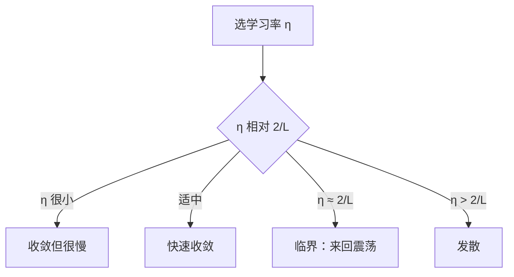

# MATH-702 学习率与收敛

## 1. 知识概览

| 项 | 内容 |
|---|---|
| 知识 ID | `MATH-702` |
| 英文名称 | Learning Rate and Convergence |
| 所属模块 | M-MATH-05 优化方法 |
| 难度等级 | L3 推导 |
| 前置知识 | [[MATH-701 优化问题与凸性]] |
| 所属知识体系 | 更新公式 → 收敛条件 → 震荡/发散 → 调度策略 |
| **AI 应用场景** | 训练不收敛、loss 爆炸、warmup、余弦退火、学习率搜索 |
| **预计学习时间** | 55 分钟 |

**为什么学它**：**学习率是训练中最重要的超参数**。太大直接发散，太小训练不动。它的安全上限由损失面的**曲率**（Lipschitz 常数）决定——这是可以算出来的。

## 2. 直观理解

梯度下降像**下山**：

- 每步朝最陡下坡走 $\eta$ 倍梯度。
- $\eta$ 太小：一步挪一点，走很久还到不了。
- $\eta$ 合适：稳步下降。
- $\eta$ 太大：一步跨过谷底，跳到对面更高的地方，来回震荡甚至飞出去。

**谷底窄（曲率大）时步子必须小**；谷底宽时可以用大步。这就是"曲率限制学习率"。

## 3. 正式数学定义

**梯度下降更新**

$$
\theta_{t+1} = \theta_t - \eta\nabla f(\theta_t)
$$

**$L$-光滑（Lipschitz 梯度）**：存在 $L>0$ 使

$$
\|\nabla f(x)-\nabla f(y)\| \le L\|x-y\|
$$

等价地，二次可微时 $\lambda_{max}(H)\le L$。

**二次函数的收敛条件**：$f(\theta)=\frac12\theta^TA\theta$（$A$ 对称正定，特征值 $\lambda_i$）

$$
\eta < \frac{2}{L} \quad\Longrightarrow\quad \text{收敛}
$$

其中 $L=\lambda_{max}(A)$。

**收敛速率**（$0<\eta<2/L$）

$$
\|\theta_t-\theta^*\| \le \rho^t\|\theta_0-\theta^*\|,\qquad \rho = \max_i|1-\eta\lambda_i|
$$

**最优学习率**（二次情形）

$$
\eta^* = \frac{2}{\lambda_{min}+\lambda_{max}}
$$

## 4. 数学推导

### 4.1 二次函数为什么要求 $\eta<2/L$

**起点**：$f(\theta)=\frac12\theta^TA\theta$，梯度 $\nabla f=A\theta$。

**第 1 步**：更新式

$$
\theta_{t+1} = \theta_t - \eta A\theta_t = (I-\eta A)\theta_t
$$

**第 2 步**：转到 $A$ 的特征基上，每个分量独立

$$
\theta_{t+1}^{(i)} = (1-\eta\lambda_i)\theta_t^{(i)}
$$

**第 3 步**：要收敛，每个分量的缩放因子绝对值都要小于 1

$$
|1-\eta\lambda_i| < 1 \quad \forall i
$$

**第 4 步**：解不等式

$$
-1 < 1-\eta\lambda_i < 1 \;\Rightarrow\; 0 < \eta\lambda_i < 2 \;\Rightarrow\; \eta < \frac{2}{\lambda_i}
$$

**第 5 步**：对最严格的那个（最大的 $\lambda$）成立即可

$$
\eta < \frac{2}{\lambda_{max}} = \frac{2}{L}
$$

**结论**：**学习率上限由最大曲率决定**。超过它，某个方向会被放大而不是收缩，直接发散。

### 4.2 为什么"最优学习率"取 $2/(\lambda_{min}+\lambda_{max})$

**起点**：收敛因子 $\rho(\eta)=\max_i|1-\eta\lambda_i|$，要让它最小。

**第 1 步**：两个极端分量 $\lambda_{min}$ 与 $\lambda_{max}$ 决定 $\rho$

$$
\rho = \max\left(|1-\eta\lambda_{min}|,\ |1-\eta\lambda_{max}|\right)
$$

**第 2 步**：让两者相等时 $\rho$ 最小

$$
1-\eta\lambda_{min} = -(1-\eta\lambda_{max})
$$

**第 3 步**：解出

$$
2 = \eta(\lambda_{min}+\lambda_{max}) \;\Rightarrow\; \eta^* = \frac{2}{\lambda_{min}+\lambda_{max}}
$$

**第 4 步**：此时

$$
\rho^* = \frac{\lambda_{max}-\lambda_{min}}{\lambda_{max}+\lambda_{min}} = \frac{\kappa-1}{\kappa+1}
$$

其中 $\kappa=\lambda_{max}/\lambda_{min}$ 是**条件数**。

**结论**：**条件数越大，收敛越慢**。这就是为什么"特征尺度差异大"的数据要先标准化。

## 5. 几何直观与图解



```text
f(θ)=θ²，L=2，临界 η=1
η=0.1:  θ 稳步趋近 0
η=0.9:  θ 振荡衰减
η=1.0:  θ 在 ±θ0 之间永跳（不收敛）
η=1.5:  θ 越跳越大（发散）
```

## 6. 计算示例

**例**：$f(\theta)=\theta^2$，梯度 $2\theta$，$L=2$。

从 $\theta_0=4$ 出发跑 20 步：

| $\eta$ | $\theta_{20}$ | 现象 |
|---|---|---|
| 0.01 | 2.6704 | 慢 |
| 0.1 | 0.0461 | 快 |
| 0.45 | 0.0（数值下溢） | 很快 |
| 0.5 | 0.0 | 一步到 0（因为 $1-\eta\lambda=0$） |
| 0.6 | 0.0（$|{-0.2}|^{20}\approx10^{-14}$） | 振荡衰减 |
| 1.0 | 4.0 | **不收敛**（$|1-\eta\lambda|=1$） |

**验证临界值**：$\eta^*=2/(\lambda_{min}+\lambda_{max})=2/(2+2)=0.5$，与表中一致。

## 7. Python 辅助验证

**依赖**：仅标准库。

```powershell
python math702_learning_rate.py
```

```python
def gd(lr, steps=20, x0=4.0):
    """f(x)=x²，梯度 2x，L=2"""
    x = x0
    for _ in range(steps):
        x = x - lr * 2 * x
    return x


for lr in (0.01, 0.1, 0.45, 0.5, 0.6, 1.0):
    print(f"η={lr}: x_20 = {gd(lr):.8f}")
```

**实际运行结果**

```
η=0.01: x_20 = 2.67043189
η=0.1: x_20 = 0.04611686
η=0.45: x_20 = 0.00000000
η=0.5: x_20 = 0.00000000
η=0.6: x_20 = 0.00000000
η=1.0: x_20 = 4.00000000
```

**代码解析**

- $\eta=0.5$ 时 $1-\eta\lambda=0$，**一步走到 0**，这是二次函数的最优学习率。
- $\eta=0.6$ 时因子是 $-0.2$，每步符号翻转且衰减，20 步后已到 $10^{-14}$ 量级，显示为 0。
- $\eta=1.0$ 时因子 $-1$，**永远在 $\pm4$ 之间跳**，不收敛——正好卡在临界值上。
- 这些都符合"$\eta<2/L$ 收敛、$\eta\ge2/L$ 不收敛"的结论。

## 8. 知识关联

| 类型 | 链接 |
|---|---|
| 前置数学 | [[MATH-701 优化问题与凸性]]、[[MATH-123 导数应用与极值]]、[[MATH-127 Hessian 与多元展开]] |
| 后续数学 | [[MATH-703 批量梯度下降]]、[[MATH-721 梯度下降]] |
| 相关 Python | [[PY-009 函数]] |
| 相关机器学习 | 待关联（学习率搜索、标准化改善条件数） |
| 相关深度学习 | 待关联（warmup、余弦退火、梯度裁剪） |
| 相关大语言模型 | 待关联（预训练学习率调度） |

## 9. 实战练习

**基础 1**：$f(\theta)=\theta^2$，学习率 1.0，从 $\theta_0=1$ 出发，写出前 3 步的值。

**基础 2**：$f(\theta)=5\theta^2$，$L$ 是多少？临界学习率是多少？

**进阶 1**：为什么特征尺度差异大时要先标准化？用条件数解释。

**综合 1**：训练时 loss 出现"NaN"，可能的学习率问题是什么？给出三种排查/补救手段。

## 10. 参考答案

> [!success]- 基础 1
> 梯度 $2\theta$，更新 $\theta\leftarrow\theta-1.0\times2\theta=-\theta$。
>
> 序列：$1\to-1\to1\to-1\cdots$，**不收敛**（振荡）。

> [!success]- 基础 2
> $f''=10$，所以 $L=10$。
>
> 临界值 $\eta=2/L=0.2$；$\eta<0.2$ 才收敛。

> [!success]- 进阶 1
> 条件数 $\kappa=\lambda_{max}/\lambda_{min}$，收敛因子 $\rho=(\kappa-1)/(\kappa+1)$。
>
> - $\kappa=1$：$\rho=0$，一步到位。
> - $\kappa=100$：$\rho\approx0.98$，需要几百步。
>
> 标准化让各方向尺度接近，$\kappa$ 变小，收敛显著加快。

> [!success]- 综合 1
> NaN 常见原因是**学习率过大导致数值爆炸**（尤其配合除零或 log(0)）。
>
> 补救：
> 1. **降学习率**（先除 10 倍）；
> 2. **梯度裁剪**（`clip_grad_norm_`），限制单步幅度；
> 3. **加 warmup**，前若干步用极小学习率；
> 4. 检查损失里是否有 `log(0)` 或除零，加 `eps`。

## 11. 常见错误

| 类型 | 错误表现 | 原因 | 纠正 |
|---|---|---|---|
| 概念错误 | 认为学习率越小越好 | 收敛慢、易卡住 | 有最优区间 |
| 概念错误 | 用一个学习率跑所有任务 | 曲率不同 | 需按任务调 |
| 计算错误 | 忽略 $2/L$ 里的 2 | 临界值记错 | $\eta<2/L$ |
| 概念错误 | 认为震荡就是不收敛 | 可能衰减震荡 | 看是否最终趋稳 |
| 实践错误 | 不做学习率调度 | 前期慢后期抖 | warmup + 衰减 |

## 12. 学习记录

| 日期 | 状态 | 掌握程度 | 复习状态 | 学习笔记 | 关联练习 |
|---|---|---|---|---|---|
| — | planned | — | — | — | 练习 1–4 |

---

## 🔗 Notion 同步信息

> 以下内容由 Notion「AI Knowledge System · 知识点」数据库按知识 ID 合并而来（导出于 2026-11-09）。

| 属性 | 值 |
|---|---|
| 学科 | 数学 |
| 学习状态 | 未开始 |
| 难度 | L3 推导 |
| 知识类型 | Concept |

- **所属模块**：[M-MATH-05 优化方法](../%E8%AF%BE%E7%A8%8B%E6%A8%A1%E5%9D%97/M-MATH-05%20%E4%BC%98%E5%8C%96%E6%96%B9%E6%B3%95.md)
- **前置知识**：[MATH-701 优化问题与凸性](MATH-701%20%E4%BC%98%E5%8C%96%E9%97%AE%E9%A2%98%E4%B8%8E%E5%87%B8%E6%80%A7.md)
- **后继知识**：[MATH-703 批量梯度下降](MATH-703%20%E6%89%B9%E9%87%8F%E6%A2%AF%E5%BA%A6%E4%B8%8B%E9%99%8D.md)
- **关联Python**：[PY-009 函数](../../01_Python%E5%9F%BA%E7%A1%80/02%20%E5%87%BD%E6%95%B0%E4%B8%8E%E4%BD%9C%E7%94%A8%E5%9F%9F/PY-009%20%E5%87%BD%E6%95%B0.md)
- **关联数学**：[MATH-701 优化问题与凸性](MATH-701%20%E4%BC%98%E5%8C%96%E9%97%AE%E9%A2%98%E4%B8%8E%E5%87%B8%E6%80%A7.md)
- **被引用为数学**：[MATH-703 批量梯度下降](MATH-703%20%E6%89%B9%E9%87%8F%E6%A2%AF%E5%BA%A6%E4%B8%8B%E9%99%8D.md) · [DL-023 神经网络训练的完整流程](../../04_%E6%B7%B1%E5%BA%A6%E5%AD%A6%E4%B9%A0/05%20%E8%AE%AD%E7%BB%83%E6%8A%80%E5%B7%A7/DL-023%20%E7%A5%9E%E7%BB%8F%E7%BD%91%E7%BB%9C%E8%AE%AD%E7%BB%83%E7%9A%84%E5%AE%8C%E6%95%B4%E6%B5%81%E7%A8%8B.md) · [DL-025 Batch Size 与 Learning Rate](../../04_%E6%B7%B1%E5%BA%A6%E5%AD%A6%E4%B9%A0/05%20%E8%AE%AD%E7%BB%83%E6%8A%80%E5%B7%A7/DL-025%20Batch%20Size%20%E4%B8%8E%20Learning%20Rate.md) · [DL-028 Adam 与 AdamW](../../04_%E6%B7%B1%E5%BA%A6%E5%AD%A6%E4%B9%A0/05%20%E8%AE%AD%E7%BB%83%E6%8A%80%E5%B7%A7/DL-028%20Adam%20%E4%B8%8E%20AdamW.md) · [DL-029 学习率调度与 Warmup](../../04_%E6%B7%B1%E5%BA%A6%E5%AD%A6%E4%B9%A0/05%20%E8%AE%AD%E7%BB%83%E6%8A%80%E5%B7%A7/DL-029%20%E5%AD%A6%E4%B9%A0%E7%8E%87%E8%B0%83%E5%BA%A6%E4%B8%8E%20Warmup.md)
