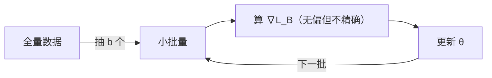

# MATH-703 批量梯度下降

## 1. 知识概览

| 项 | 内容 |
|---|---|
| 知识 ID | `MATH-703` |
| 英文名称 | Batch Gradient Descent |
| 所属模块 | M-MATH-05 优化方法 |
| 难度等级 | L3 推导 |
| 前置知识 | [[MATH-702 学习率与收敛]] |
| 所属知识体系 | 全批量 → 小批量 → 单样本 SGD |
| **AI 应用场景** | 训练循环的全部；batch size 与学习率的线性缩放规则 |
| **预计学习时间** | 55 分钟 |

**为什么学它**：真实数据集上百万样本，**不可能每步都用全量算梯度**。小批量既省算力又能稳定估计梯度——这是所有深度学习框架的默认做法。

## 2. 直观理解

三种做法的区别在"每步用多少样本估梯度"：

| 方式 | 每步样本 | 梯度质量 | 每步速度 |
|---|---|---|---|
| 全批量（BGD） | 全部 $n$ | 精确 | 慢 |
| 小批量（mini-batch） | $B$（如 32/256） | 近似，方差小 | 快 |
| 单样本（SGD） | 1 | 噪声大 | 最快但抖 |

**类比**：想知道全班平均分。

- 全批量：问每个人（准，但累）。
- 小批量：随机问 32 人（够准，且快）。
- 单样本：只问 1 人（快但你被这一个人带偏）。

## 3. 正式数学定义

**目标**（经验风险）

$$
L(\theta) = \frac1n\sum_{i=1}^{n}\ell_i(\theta)
$$

**全批量梯度**

$$
\nabla L(\theta) = \frac1n\sum_{i=1}^{n}\nabla\ell_i(\theta)
$$

**小批量梯度**（$B$ 为随机抽取的下标集，$|B|=b$）

$$
g_B(\theta) = \frac{1}{b}\sum_{i\in B}\nabla\ell_i(\theta)
$$

**无偏性**

$$
\mathbb{E}_B[g_B(\theta)] = \nabla L(\theta)
$$

**方差**

$$
\operatorname{Var}(g_B) = \frac{\sigma_g^2}{b}
$$

其中 $\sigma_g^2$ 是单个样本梯度的方差。

**更新**

$$
\theta_{t+1} = \theta_t - \eta\, g_{B_t}(\theta_t)
$$

**线性缩放规则**：若把 batch 从 $b$ 增到 $kb$，学习率可增到 $k\eta$（方差降 $k$ 倍，可放心迈大步）。

## 4. 数学推导

### 4.1 为什么小批量梯度是无偏的

**起点**：$B$ 是从 $\{1,\dots,n\}$ 中**均匀随机**抽取的 $b$ 个下标。

**第 1 步**：每个样本被抽中的概率是 $b/n$。

**第 2 步**：取期望

$$
\mathbb{E}\left[\frac1b\sum_{i\in B}\nabla\ell_i\right]
= \frac1b\sum_{i=1}^{n}P(i\in B)\nabla\ell_i
= \frac1b\cdot\frac{b}{n}\sum_{i=1}^{n}\nabla\ell_i
$$

**第 3 步**：化简

$$
= \frac1n\sum_{i=1}^{n}\nabla\ell_i = \nabla L(\theta)
$$

**结论**：小批量梯度是**全量梯度的无偏估计**。所以"随机"不影响方向正确性，只影响抖动。

### 4.2 方差为什么按 $1/b$ 下降

**起点**：$g_B=\frac1b\sum_{i\in B}Z_i$，$Z_i$ 独立同分布，$\operatorname{Var}(Z_i)=\sigma_g^2$。

**第 1 步**：方差的可加性（独立）

$$
\operatorname{Var}\left(\sum_{i\in B}Z_i\right) = b\sigma_g^2
$$

**第 2 步**：乘常数 $\frac1b$ 时方差乘 $\frac{1}{b^2}$

$$
\operatorname{Var}(g_B) = \frac{1}{b^2}\cdot b\sigma_g^2 = \frac{\sigma_g^2}{b}
$$

**第 3 步**：标准差（噪声幅度）

$$
\sigma_{g_B} = \frac{\sigma_g}{\sqrt b}
$$

**结论**：**batch 增 4 倍，梯度噪声减半**。这与 [[MATH-401 大数定律与中心极限定理]] 的 $\sigma/\sqrt n$ 是同一个道理。

## 5. 几何直观与图解



```text
全批量：平滑直线下降
小批量：锯齿状但总体下降（噪声随 b 增大而减小）
单样本：抖动剧烈，但能跳出浅坑
```

## 6. 计算示例

**例**：线性回归 $y=Xw+\varepsilon$，$n=500$、3 个特征，真值 $w=(2,-1,0.5)$。

分别用全批量、mini-batch 32、单样本训练 50 轮：

| 方式 | 学习率 | 学到的 $w$ | 最终 MSE |
|---|---|---|---|
| 全批量 | 0.5 | $[2.005, -0.999, 0.506]$ | 0.0106 |
| mini-32 | 0.2 | $[2.019, -0.986, 0.525]$ | 0.0113 |
| 单样本 | 0.05 | $[2.013, -0.970, 0.460]$ | 0.0137 |
| 真值 | — | $[2, -1, 0.5]$ | 0.0107 |

**观察**：

- 三者都接近真值，说明无偏估计有效。
- 噪声越大，学到的参数离真值越远一点点（但仍在抽样误差内）。
- 单样本用更小学习率才稳——噪声大时必须小步走。

## 7. Python 辅助验证

**依赖**：NumPy 2.5.4。

```powershell
python math703_minibatch.py
```

```python
import numpy as np

rng = np.random.default_rng(0)
X = rng.normal(size=(500, 3))
true_w = np.array([2.0, -1.0, 0.5])
y = X @ true_w + 0.1 * rng.normal(size=500)


def train(batch, lr, epochs=50):
    w = np.zeros(3)
    n = len(y)
    for _ in range(epochs):
        idx = rng.permutation(n) if batch < n else np.arange(n)
        for i in range(0, n, batch):
            b = idx[i:i + batch]
            grad = 2 * X[b].T @ (X[b] @ w - y[b]) / len(b)
            w -= lr * grad
    return w


def mse(w):
    return float(((X @ w - y) ** 2).mean())


for name, b, lr in (("全批量", 500, 0.5), ("mini-32", 32, 0.2), ("单样本", 1, 0.05)):
    w = train(b, lr)
    print(f"{name}: w={w.round(3).tolist()}  MSE={mse(w):.4f}")

print("真实 w 的 MSE:", round(mse(true_w), 4))
```

**实际运行结果**

```
全批量: w=[2.005, -0.999, 0.506]  MSE=0.0106
mini-32: w=[2.019, -0.986, 0.525]  MSE=0.0113
单样本: w=[2.013, -0.97, 0.46]  MSE=0.0137
真实 w 的 MSE: 0.0107
```

**代码解析**

- 三种方式都能把 MSE 降到接近真值的水平（0.0107），差别在小数点后第三位。
- 单样本噪声大，因此学习率取得最小（0.05），否则会震荡。
- `rng.permutation` 每轮打乱顺序，避免数据顺序带来的偏差。
- 梯度 `2*Xb.T@(Xb@w-yb)/len(b)` 是小批量上 MSE 的精确梯度。

## 8. 知识关联

| 类型 | 链接 |
|---|---|
| 前置数学 | [[MATH-702 学习率与收敛]]、[[MATH-701 优化问题与凸性]] |
| 后续数学 | [[MATH-721 梯度下降]]、`MATH-704 SGD 与小批量梯度下降`（待建）、`MATH-801 线性回归的数学`（待建） |
| 相关 Python | [[PY-066 矩阵运算]]、[[PY-068 随机数、视图与副本]] |
| 相关机器学习 | 待关联（batch size 选择、学习率搜索） |
| 相关深度学习 | 待关联（DataLoader、梯度累积） |
| 相关大语言模型 | 待关联（大批量训练与线性缩放） |

## 9. 实战练习

**基础 1**：$n=1000$、batch=100，一轮有几个更新步？

**基础 2**：batch 从 32 增到 128，梯度噪声幅度变成原来的几分之几？

**进阶 1**：为什么单样本 SGD 需要更小的学习率？用方差解释。

**综合 1**：显存只能放下 batch=8，但想获得 batch=64 的稳定性，有什么办法？

## 10. 参考答案

> [!success]- 基础 1
> $$\frac{1000}{100} = 10 \text{ 步/轮}$$

> [!success]- 基础 2
> 噪声幅度 $\propto 1/\sqrt b$：$\sqrt{32/128}=\sqrt{1/4}=1/2$。
>
> 变成原来的 **1/2**。

> [!success]- 进阶 1
> 单样本梯度方差是 $\sigma_g^2$（$b=1$），远大于小批量。
>
> 噪声大 ⇒ 每步方向偏离真实梯度多 ⇒ 若学习率大，容易在最优附近来回跳甚至发散。所以要么减小学习率，要么改用小批量/动量。

> [!success]- 综合 1
> 用**梯度累积**：连续算 8 个 micro-batch（各 batch=8）的梯度，累加后再更新一次，等效 batch=64。
>
> 另一种是**学习率按实际 batch 缩放**（batch=8 就用 $1/8$ 的学习率）+ 更长的训练轮数。

## 11. 常见错误

| 类型 | 错误表现 | 原因 | 纠正 |
|---|---|---|---|
| 概念错误 | 认为小批量梯度"不准所以错" | 混淆无偏与精确 | 无偏，只是有方差 |
| 实践错误 | 增大 batch 不调学习率 | 忽略缩放规则 | batch 增 $k$ 倍，lr 增约 $k$ 倍 |
| 概念错误 | 认为 batch 越大越好 | 泛化可能变差、算力受限 | 有最优区间 |
| 计算错误 | 梯度忘了除以 batch 大小 | 步长随 batch 变化 | 除以 `len(b)` |
| 实践错误 | 不打乱数据 | 顺序偏差 | 每轮 shuffle |

## 12. 学习记录

| 日期 | 状态 | 掌握程度 | 复习状态 | 学习笔记 | 关联练习 |
|---|---|---|---|---|---|
| — | planned | — | — | — | 练习 1–4 |

---

## 🔗 Notion 同步信息

> 以下内容由 Notion「AI Knowledge System · 知识点」数据库按知识 ID 合并而来（导出于 2026-11-09）。

| 属性 | 值 |
|---|---|
| 学科 | 数学 |
| 学习状态 | 未开始 |
| 难度 | L3 推导 |
| 知识类型 | Algorithm |

- **所属模块**：[M-MATH-05 优化方法](../%E8%AF%BE%E7%A8%8B%E6%A8%A1%E5%9D%97/M-MATH-05%20%E4%BC%98%E5%8C%96%E6%96%B9%E6%B3%95.md)
- **前置知识**：[MATH-702 学习率与收敛](MATH-702%20%E5%AD%A6%E4%B9%A0%E7%8E%87%E4%B8%8E%E6%94%B6%E6%95%9B.md)
- **后继知识**：[MATH-704 SGD 与小批量梯度下降](MATH-704%20SGD%20%E4%B8%8E%E5%B0%8F%E6%89%B9%E9%87%8F%E6%A2%AF%E5%BA%A6%E4%B8%8B%E9%99%8D.md)
- **关联Python**：[PY-066 矩阵运算](../../01_Python%E5%9F%BA%E7%A1%80/08%20NumPy/PY-066%20%E7%9F%A9%E9%98%B5%E8%BF%90%E7%AE%97.md)
- **关联数学**：[MATH-702 学习率与收敛](MATH-702%20%E5%AD%A6%E4%B9%A0%E7%8E%87%E4%B8%8E%E6%94%B6%E6%95%9B.md)
- **被引用为数学**：[MATH-704 SGD 与小批量梯度下降](MATH-704%20SGD%20%E4%B8%8E%E5%B0%8F%E6%89%B9%E9%87%8F%E6%A2%AF%E5%BA%A6%E4%B8%8B%E9%99%8D.md) · [DL-024 Epoch、Batch 与 Mini-batch](../../04_%E6%B7%B1%E5%BA%A6%E5%AD%A6%E4%B9%A0/05%20%E8%AE%AD%E7%BB%83%E6%8A%80%E5%B7%A7/DL-024%20Epoch%E3%80%81Batch%20%E4%B8%8E%20Mini-batch.md)
