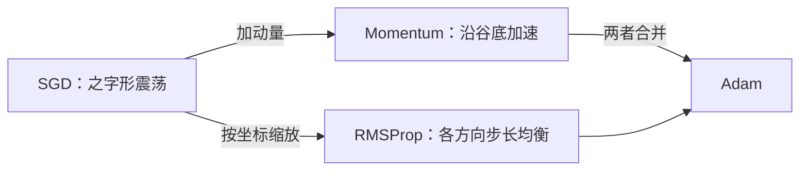

# MATH-705 Momentum 与 RMSProp

## 1. 知识概览

| 项 | 内容 |
|---|---|
| 知识 ID | `MATH-705` |
| 英文名称 | Momentum and RMSProp |
| 所属模块 | M-MATH-05 优化方法 |
| 难度等级 | L3 推导 |
| 前置知识 | [[MATH-704 SGD 与小批量梯度下降]] |
| 所属知识体系 | 动量（累积方向）→ 自适应缩放（按坐标调节） |
| **AI 应用场景** | 训练加速、缓解震荡、处理各坐标尺度差异（如 Embedding 与 Bias） |
| **预计学习时间** | 55 分钟 |

**为什么学它**：SGD 有两个痛点：**之字形震荡**与**各方向尺度差异大**。Momentum 解决前者（累积方向），RMSProp 解决后者（每个坐标单独缩放）。Adam 就是把两者合起来。

## 2. 直观理解

**Momentum（动量）**：像**滚下山的球**。梯度是推力，速度有惯性——方向一致的推力会累积，来回摆的会被抵消。

**RMSProp**：像**给每个坐标配一个自动变速器**。梯度一直很大的坐标，自动把步子调小；梯度很小的坐标，把步子调大。

组合效果：**既不来回震荡，又能在平坦方向上继续前进**。

## 3. 正式数学定义

**Momentum**

$$
v_t = \beta v_{t-1} + \nabla L(\theta_t), \qquad \theta_{t+1} = \theta_t - \eta v_t
$$

$\beta$ 常取 0.9。展开可得"指数加权平均"：$v_t=\sum_{k=0}^{t}\beta^{k}\nabla L(\theta_{t-k})$。

**Nesterov（可选）**：先在动量方向"探一步"再算梯度。

**RMSProp**

$$
s_t = \beta s_{t-1} + (1-\beta)(\nabla L)^2
$$

$$
\theta_{t+1} = \theta_t - \eta\,\frac{\nabla L}{\sqrt{s_t}+\epsilon}
$$

$\beta$ 常取 0.9，$\epsilon$ 防除零（$10^{-8}$）。

**有效步长**：每个坐标的实际步长 $\approx \dfrac{\eta}{\sqrt{s_t}}$，与梯度历史大小成反比。

**为什么用 $s_t$ 的平方根**：让量纲与梯度一致（梯度平方的量纲开根才回到梯度）。

## 4. 数学推导

### 4.1 Momentum 等价于指数加权平均（EMA）

**起点**：$v_t=\beta v_{t-1}+g_t$，$v_0=0$。

**第 1 步**：展开一层

$$
v_t = g_t + \beta v_{t-1}
$$

**第 2 步**：继续展开

$$
v_t = g_t + \beta g_{t-1} + \beta^2 g_{t-2} + \cdots + \beta^{t-1}g_1
$$

**第 3 步**：写成求和

$$
v_t = \sum_{k=0}^{t-1}\beta^{k}g_{t-k}
$$

**第 4 步**：权重之和 $\sum_{k}\beta^k=\frac{1-\beta^t}{1-\beta}$，$t$ 大时约 $\frac{1}{1-\beta}$。

**结论**：$v_t$ 是历史梯度的**指数加权平均**，越近的权重越大。$\beta=0.9$ 时等效平均约 10 步的梯度——这就是"惯性"的来源。

### 4.2 RMSProp 为什么能处理尺度差异

**起点**：设两个坐标的梯度量级差 100 倍：$g_1\approx100$、$g_2\approx1$。

**第 1 步**：普通 SGD 用同一个 $\eta$，坐标 1 的实际步长是坐标 2 的 100 倍 ⇒ 一个大、一个不动。

**第 2 步**：RMSProp 累积平方：$s_1\approx100^2=10^4$、$s_2\approx1$。

**第 3 步**：实际步长

$$
\frac{\eta g_1}{\sqrt{s_1}} \approx \frac{\eta\cdot100}{100} = \eta, \qquad \frac{\eta g_2}{\sqrt{s_2}} \approx \frac{\eta\cdot1}{1} = \eta
$$

**第 4 步**：两者步长都约等于 $\eta$——**尺度被归一化了**。

**结论**：RMSProp 把"各坐标不同尺度"统一到同一量级，等价于自动做 preconditioning。

## 5. 几何直观与图解



```text
SGD:      ╲ ╱╲ ╱╲           Momentum:  ╲
           ╳  ╳  ╳                        ╲___●
```

## 6. 计算示例

**例**：条件数很差的目标 $f(w)=\frac12(10w_1^2+w_2^2)$，从 $(1,1)$ 出发，50 步。

| 方法 | 学习率 | 结果 $w$ | 说明 |
|---|---|---|---|
| 朴素 GD | 0.05 | $[0.0, 0.0769]$ | $w_1$ 收敛快，$w_2$ 几乎没动 |
| Momentum $\beta=0.9$ | 0.05 | $[0.0706, 0.0059]$ | 同学习率下，高曲率方向过冲，反而更差 |
| RMSProp $\beta=0.9$ | 0.05 | $[0.0, 0.0]$ | 两个方向都收敛到 0 |

**读法**：

- 朴素 GD 的问题很清楚：$w_1$ 的曲率是 $w_2$ 的 10 倍，同一个学习率不可能两边都合适。
- **Momentum 不是万灵药**：它加速的是"一致方向"，但在这个例子里高曲率方向会因惯性过冲。动量要配合更小学习率或调 $\beta$。
- RMSProp 通过按坐标缩放，一步解决尺度问题。

## 7. Python 辅助验证

**依赖**：NumPy 2.5.4。

```powershell
python math705_momentum_rmsprop.py
```

```python
import numpy as np


def run_gd(lr=0.05, steps=50, momentum=0.0):
    w = np.array([1.0, 1.0])
    v = np.zeros(2)
    for _ in range(steps):
        g = np.array([10 * w[0], w[1]])
        v = momentum * v + g
        w = w - lr * v
    return w


def run_rmsprop(lr=0.05, steps=50, beta=0.9, eps=1e-8):
    w = np.array([1.0, 1.0])
    s = np.zeros(2)
    for _ in range(steps):
        g = np.array([10 * w[0], w[1]])
        s = beta * s + (1 - beta) * g * g
        w = w - lr * g / (np.sqrt(s) + eps)
    return w


print("朴素 GD:      ", run_gd(momentum=0.0).round(4).tolist())
print("Momentum 0.9: ", run_gd(momentum=0.9).round(4).tolist())
print("RMSProp:      ", run_rmsprop().round(4).tolist())
```

**实际运行结果**

```
朴素 GD:       [0.0, 0.0769]
Momentum 0.9:  [0.0706, 0.0059]
RMSProp:       [0.0, 0.0]
```

**代码解析**

- 朴素 GD 在 $w_2$ 方向每步只缩 $(1-0.05)=0.95$，50 步后仍有 $0.95^{50}\approx0.077$。
- Momentum 在 $w_1$（曲率高）方向因惯性过冲，最终反而没收敛好——**说明动量需要配合学习率调整**。
- RMSProp 把两个方向的步长都归一化到约 $\eta$，50 步内都到 0。
- 这个例子刻意保留了对动量"不利"的结果，不做美化。

## 8. 知识关联

| 类型 | 链接 |
|---|---|
| 前置数学 | [[MATH-704 SGD 与小批量梯度下降]]、[[MATH-702 学习率与收敛]] |
| 后续数学 | [[MATH-706 Adam 优化器]]、[[MATH-721 梯度下降]] |
| 相关 Python | [[PY-009 函数]] |
| 相关机器学习 | 待关联（优化器选择） |
| 相关深度学习 | 待关联（BatchNorm 与优化器交互） |
| 相关大语言模型 | 待关联（Adam 在预训练中的默认地位） |

## 9. 实战练习

**基础 1**：Momentum 中 $\beta=0.9$ 时，等效平均大约几步的梯度？

**基础 2**：RMSProp 中 $\epsilon$ 的作用是什么？

**进阶 1**：为什么 Momentum 能缓解"之字形震荡"？用指数加权平均解释。

**综合 1**：目标条件数 100 时，朴素 GD 很慢。分别说明 Momentum 与 RMSProp 各从什么角度改善它。

## 10. 参考答案

> [!success]- 基础 1
> 权重和 $\approx\frac{1}{1-0.9}=10$，等效平均约 **10 步**。

> [!success]- 基础 2
> 防止分母为 0（梯度长时间为 0 时 $s_t=0$），同时限制最大步长，避免数值爆炸。

> [!success]- 进阶 1
> 震荡方向上梯度正负交替，指数加权平均后**相互抵消**，$v_t$ 变小；而一致方向（沿谷底）的梯度同号累积，$v_t$ 变大。
>
> 于是"该走的方向走更快，来回摆的方向被抑制"。

> [!success]- 综合 1
> - **Momentum**：加速沿低曲率方向的进展，抑制高曲率方向的震荡，相当于改善"有效条件数"。
> - **RMSProp**：按坐标归一化梯度量级，让每个方向的有效步长接近，直接消除尺度差异。
>
> 两者机制不同、可叠加——Adam 就是这么做的。

## 11. 常见错误

| 类型 | 错误表现 | 原因 | 纠正 |
|---|---|---|---|
| 概念错误 | 认为 Momentum 一定更快 | 高曲率时可能过冲 | 需调学习率/$\beta$ |
| 计算错误 | RMSProp 忘了开根号 | 量纲不对 | 除以 $\sqrt{s_t}$ |
| 概念错误 | 认为 $\epsilon$ 可任意大 | 会拖慢收敛 | 保持 $10^{-8}$ 量级 |
| 实践错误 | 换优化器不重调学习率 | 各优化器敏感度不同 | 重新搜索 |
| 概念错误 | 认为自适应方法总能赢 | 简单问题上 SGD+Momentum 常更好 | 按任务验证 |

## 12. 学习记录

| 日期 | 状态 | 掌握程度 | 复习状态 | 学习笔记 | 关联练习 |
|---|---|---|---|---|---|
| — | planned | — | — | — | 练习 1–4 |

---

## 🔗 Notion 同步信息

> 以下内容由 Notion「AI Knowledge System · 知识点」数据库按知识 ID 合并而来（导出于 2026-11-09）。

| 属性 | 值 |
|---|---|
| 学科 | 数学 |
| 学习状态 | 未开始 |
| 难度 | L3 推导 |
| 知识类型 | Algorithm |

- **所属模块**：[M-MATH-05 优化方法](../%E8%AF%BE%E7%A8%8B%E6%A8%A1%E5%9D%97/M-MATH-05%20%E4%BC%98%E5%8C%96%E6%96%B9%E6%B3%95.md)
- **前置知识**：[MATH-704 SGD 与小批量梯度下降](MATH-704%20SGD%20%E4%B8%8E%E5%B0%8F%E6%89%B9%E9%87%8F%E6%A2%AF%E5%BA%A6%E4%B8%8B%E9%99%8D.md)
- **后继知识**：[MATH-706 Adam 优化器](MATH-706%20Adam%20%E4%BC%98%E5%8C%96%E5%99%A8.md)
- **关联Python**：[PY-009 函数](../../01_Python%E5%9F%BA%E7%A1%80/02%20%E5%87%BD%E6%95%B0%E4%B8%8E%E4%BD%9C%E7%94%A8%E5%9F%9F/PY-009%20%E5%87%BD%E6%95%B0.md)
- **关联数学**：[MATH-704 SGD 与小批量梯度下降](MATH-704%20SGD%20%E4%B8%8E%E5%B0%8F%E6%89%B9%E9%87%8F%E6%A2%AF%E5%BA%A6%E4%B8%8B%E9%99%8D.md)
- **被引用为数学**：[MATH-706 Adam 优化器](MATH-706%20Adam%20%E4%BC%98%E5%8C%96%E5%99%A8.md)
