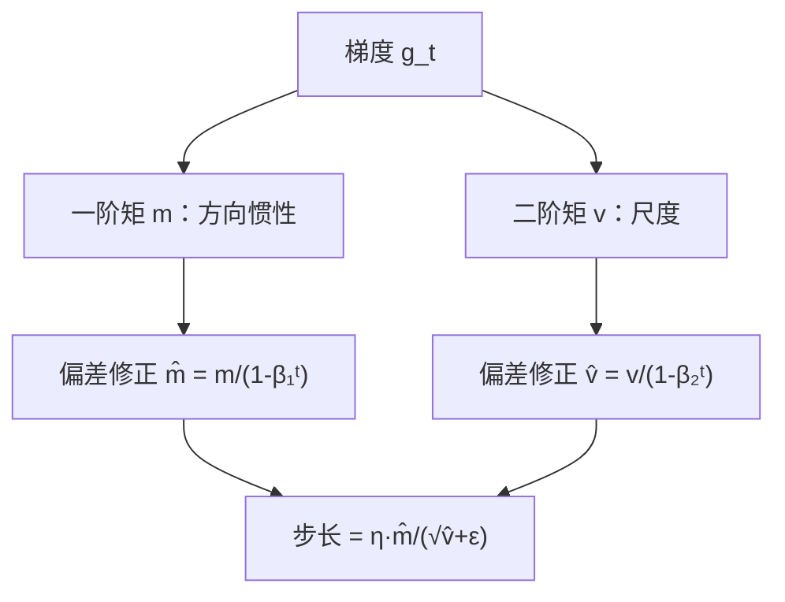

# MATH-706 Adam 优化器

## 1. 知识概览

| 项 | 内容 |
|---|---|
| 知识 ID | `MATH-706` |
| 英文名称 | The Adam Optimizer |
| 所属模块 | M-MATH-05 优化方法 |
| 难度等级 | L3 推导 |
| 前置知识 | [[MATH-705 Momentum 与 RMSProp]] |
| 所属知识体系 | 一阶矩 → 二阶矩 → 偏差修正 → 自适应步长 |
| **AI 应用场景** | 深度学习默认优化器；LLM 预训练的主力（配合 warmup 与权重衰减） |
| **预计学习时间** | 55 分钟 |

**为什么学它**：Adam = Momentum + RMSProp + **偏差修正**。理解偏差修正，才能解释"为什么它从第一步就能稳定更新"，也才能理解 AdamW 里权重衰减为什么单独做。

## 2. 直观理解

Adam 同时维护两个"记忆"：

- **一阶矩 $m$**：梯度的指数平均（方向惯性，像 Momentum）。
- **二阶矩 $v$**：梯度平方的指数平均（尺度归一化，像 RMSProp）。

**偏差修正**是关键：因为 $m_0=v_0=0$，初始几步的估计会系统偏小。除以 $(1-\beta^t)$ 把偏差拉回来。

生活类比：新员工第一周业绩算平均会被拉低（因为从 0 开始累积）。偏差修正相当于"按已工作天数折算"。

## 3. 正式数学定义

**Adam 更新**（$g_t=\nabla L(\theta_t)$）

$$
m_t = \beta_1 m_{t-1} + (1-\beta_1)g_t
$$

$$
v_t = \beta_2 v_{t-1} + (1-\beta_2)g_t^2
$$

**偏差修正**

$$
\hat m_t = \frac{m_t}{1-\beta_1^t}, \qquad \hat v_t = \frac{v_t}{1-\beta_2^t}
$$

**参数更新**

$$
\theta_{t+1} = \theta_t - \eta\,\frac{\hat m_t}{\sqrt{\hat v_t}+\epsilon}
$$

**默认超参**：$\beta_1=0.9$、$\beta_2=0.999$、$\epsilon=10^{-8}$、$\eta=10^{-3}$。

**AdamW**：把 L2 正则从梯度里拿出来，直接对参数做衰减

$$
\theta_{t+1} = \theta_t - \eta\left(\frac{\hat m_t}{\sqrt{\hat v_t}+\epsilon} + \lambda\theta_t\right)
$$

## 4. 数学推导

### 4.1 偏差修正是怎么来的

**起点**：$m_0=0$，$m_t=\beta_1m_{t-1}+(1-\beta_1)g_t$。

**第 1 步**：展开

$$
m_t = (1-\beta_1)\sum_{k=0}^{t-1}\beta_1^{k}g_{t-k}
$$

**第 2 步**：若梯度近似恒定 $g$，则

$$
\mathbb{E}[m_t] \approx (1-\beta_1)g\sum_{k=0}^{t-1}\beta_1^k = g\left(1-\beta_1^t\right)
$$

**第 3 步**：所以 $m_t$ 期望上被缩小了 $(1-\beta_1^t)$ 倍。

**第 4 步**：除以它修正

$$
\mathbb{E}[\hat m_t] = \frac{\mathbb{E}[m_t]}{1-\beta_1^t} \approx g
$$

**结论**：**偏差修正让估计在初始阶段就无偏**。$t=1$ 时 $1-0.9=0.1$，$m_1=0.1g$ 只有真实梯度的 1/10；修正后 $\hat m_1=g$，一步就到位。

**同理**：$v_t$ 的期望是 $g^2(1-\beta_2^t)$，除以 $1-\beta_2^t$ 修正。$\beta_2=0.999$ 时前几步偏差更大（$t=1$ 时因子 $10^{-3}$），修正尤其重要。

### 4.2 为什么有效步长近似 $\eta$

**起点**：只考虑稳态（偏差修正后）。

**第 1 步**：设梯度量级为 $\sigma$，则 $m\approx\sigma$、$v\approx\sigma^2$。

**第 2 步**：更新量

$$
\eta\frac{m}{\sqrt v} \approx \eta\frac{\sigma}{\sigma} = \eta
$$

**第 3 步**：每个坐标的实际步长都约等于 $\eta$，与梯度大小无关。

**结论**：**Adam 的步长主要由 $\eta$ 决定，而非梯度量级**。这带来两个后果：

- 好处：对尺度不敏感，调参容易。
- 坏处：梯度很小的时候也会迈 $\eta$ 步，可能离开最优点（后期需要调小 $\eta$）。

## 5. 几何直观与图解



```text
前 3 步的偏差修正效果（β₁=0.9）：
 t=1: m̂ = g（未修正时只有 0.1g）
 t=2: m̂ ≈ (0.1g₁+0.09g₂)/0.19 ≈ 平均
 t 大: 1-β₁ᵗ → 1，修正项消失
```

## 6. 计算示例

**例**：$f(w)=\frac12(10w_1^2+w_2^2)$，从 $(1,1)$ 出发。

| 配置 | 100 步后 $w$ |
|---|---|
| Adam $\eta=0.1$ | $[0.002937, 0.002937]$ |
| Adam $\eta=0.5$ | $[-0.004346, -0.004346]$ |

**读法**：

- $\eta=0.1$ 时两个坐标都收敛到 3e-3 量级，且**完全对称**——这正是"步长归一化"的结果（两个方向曲率不同，但有效步长相同）。
- $\eta=0.5$ 反而过冲，最后停在负值附近小幅摆动——学习率过大。
- 对比上一节的 RMSProp 结果 $[0,0]$：Adam 多了一阶矩惯性，收敛路径不同但同样有效。

## 7. Python 辅助验证

**依赖**：NumPy 2.5.4。

```powershell
python math706_adam.py
```

```python
import numpy as np


def adam(lr=0.1, steps=100, b1=0.9, b2=0.999, eps=1e-8):
    w = np.array([1.0, 1.0])
    m = np.zeros(2)
    v = np.zeros(2)
    for t in range(1, steps + 1):
        g = np.array([10 * w[0], w[1]])
        m = b1 * m + (1 - b1) * g
        v = b2 * v + (1 - b2) * g * g
        m_hat = m / (1 - b1**t)
        v_hat = v / (1 - b2**t)
        w = w - lr * m_hat / (np.sqrt(v_hat) + eps)
    return w


print("Adam lr=0.1:", adam(0.1).round(6).tolist())
print("Adam lr=0.5:", adam(0.5).round(6).tolist())
```

**实际运行结果**

```
Adam lr=0.1: [0.002937, 0.002937]
Adam lr=0.5: [-0.004346, -0.004346]
```

**代码解析**

- 两个坐标结果完全相同，说明 Adam 把不同曲率方向的步长归一化到了同一水平。
- $\eta=0.5$ 时出现负值（过冲），说明即使是自适应方法，学习率仍有上限。
- 循环从 `t=1` 开始，因为偏差修正要用 $1-\beta^t$，$t=0$ 会除零。
- `eps` 放在根号外加，与论文一致。

## 8. 知识关联

| 类型 | 链接 |
|---|---|
| 前置数学 | [[MATH-705 Momentum 与 RMSProp]]、[[MATH-704 SGD 与小批量梯度下降]]、[[MATH-708 L1 与 L2 正则化]] |
| 后续数学 | `MATH-801 线性回归的数学`（待建）、`MATH-803 神经网络前向传播`（待建） |
| 相关 Python | [[PY-009 函数]] |
| 相关机器学习 | 待关联（优化器对比实验） |
| 相关深度学习 | 待关联（AdamW、warmup、梯度裁剪） |
| 相关大语言模型 | 待关联（预训练默认 AdamW） |

## 9. 实战练习

**基础 1**：$\beta_1=0.9$、$t=1$ 时，偏差修正因子是多少？

**基础 2**：Adam 的默认学习率常设多少？为什么比 SGD 的小？

**进阶 1**：解释为什么 $\beta_2=0.999$ 时偏差修正比 $\beta_1=0.9$ 更关键。

**综合 1**：AdamW 与 Adam + L2 正则有什么区别？为什么大模型训练偏好 AdamW？

## 10. 参考答案

> [!success]- 基础 1
> $$1-\beta_1^1 = 1-0.9 = 0.1$$
>
> 即 $m_1$ 只有真实梯度的 1/10，需除以 0.1 修正。

> [!success]- 基础 2
> 常设 $10^{-3}$ 左右（SGD 常用 $10^{-1}$～$10^{-2}$）。
>
> 因为 Adam 把步长归一化到约 $\eta$，与梯度量级无关；SGD 的步长直接受梯度大小影响。所以 Adam 用更小的 $\eta$ 就能达到相近效果。

> [!success]- 进阶 1
> $t=1$ 时修正因子 $1-0.999=10^{-3}$，$v_1$ 只有真实二阶矩的千分之一，若不修正，$\sqrt{\hat v}$ 被严重低估，导致初期步长爆炸。
>
> $\beta_1=0.9$ 时因子是 0.1，偏差小一个数量级。

> [!success]- 综合 1
> **Adam + L2**：把 $\lambda\theta$ 加进梯度，再被 $1/\sqrt{\hat v}$ 缩放——正则强度被自适应分母削弱，大参数的正则效果变弱。
>
> **AdamW**：把权重衰减直接作用在参数上（解耦），正则强度不受梯度尺度影响。
>
> 大模型偏好 AdamW，因为它让"权重衰减"成为独立可调的超参，泛化更可控。

## 11. 常见错误

| 类型 | 错误表现 | 原因 | 纠正 |
|---|---|---|---|
| 计算错误 | 忘记偏差修正 | 抄公式漏项 | 除以 $1-\beta^t$ |
| 计算错误 | 循环从 $t=0$ 开始 | 除零 | 从 $t=1$ |
| 概念错误 | 认为 Adam 不需要调学习率 | 步长约等于 $\eta$ | 仍需搜索/衰减 |
| 概念错误 | 把 Adam 当"一定更好" | 小任务上 SGD 常更好 | 做对比实验 |
| 实践错误 | 用 Adam 时不配 warmup | 初期不稳 | 前若干步线性升温 |

## 12. 学习记录

| 日期 | 状态 | 掌握程度 | 复习状态 | 学习笔记 | 关联练习 |
|---|---|---|---|---|---|
| — | planned | — | — | — | 练习 1–4 |

---

## 🔗 Notion 同步信息

> 以下内容由 Notion「AI Knowledge System · 知识点」数据库按知识 ID 合并而来（导出于 2026-11-09）。

| 属性 | 值 |
|---|---|
| 学科 | 数学 |
| 学习状态 | 未开始 |
| 难度 | L3 推导 |
| 知识类型 | Algorithm |

- **所属模块**：[M-MATH-05 优化方法](../%E8%AF%BE%E7%A8%8B%E6%A8%A1%E5%9D%97/M-MATH-05%20%E4%BC%98%E5%8C%96%E6%96%B9%E6%B3%95.md)
- **前置知识**：[MATH-705 Momentum 与 RMSProp](MATH-705%20Momentum%20%E4%B8%8E%20RMSProp.md)
- **后继知识**：[MATH-708 L1 与 L2 正则化](MATH-708%20L1%20%E4%B8%8E%20L2%20%E6%AD%A3%E5%88%99%E5%8C%96.md)
- **关联Python**：[PY-009 函数](../../01_Python%E5%9F%BA%E7%A1%80/02%20%E5%87%BD%E6%95%B0%E4%B8%8E%E4%BD%9C%E7%94%A8%E5%9F%9F/PY-009%20%E5%87%BD%E6%95%B0.md)
- **关联数学**：[MATH-705 Momentum 与 RMSProp](MATH-705%20Momentum%20%E4%B8%8E%20RMSProp.md)
- **被引用为数学**：[MATH-708 L1 与 L2 正则化](MATH-708%20L1%20%E4%B8%8E%20L2%20%E6%AD%A3%E5%88%99%E5%8C%96.md)
