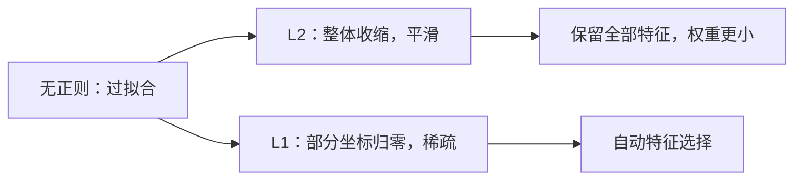

# MATH-708 L1 与 L2 正则化

## 1. 知识概览

| 项 | 内容 |
|---|---|
| 知识 ID | `MATH-708` |
| 英文名称 | L1 and L2 Regularization |
| 所属模块 | M-MATH-05 优化方法 |
| 学习难度 | L3 推导 |
| 前置知识 | [[MATH-706 Adam 优化器]] |
| 所属知识体系 | 损失 + 惩罚项 → 收缩/稀疏 → 贝叶斯解释 |
| **AI 应用场景** | 抑制过拟合、特征选择（L1）、权重衰减（L2/AdamW）、稀疏建模 |
| **预计学习时间** | 55 分钟 |

**为什么学它**：模型"记住"训练数据就是过拟合。正则化是**给模型加约束**，让它别乱跑。L2 让参数整体变小，L1 让一部分参数**直接变成 0**——这是特征选择的数学来源。

## 2. 直观理解

想象你在拟合一条曲线：

- **不加正则**：曲线疯狂穿过每个点（过拟合）。
- **L2（岭回归）**：给"参数太大"罚分，曲线更平滑，参数都变小但不为 0。
- **L1（Lasso）**：罚"参数的绝对值"，会**把不重要的参数压成 0**，相当于自动挑特征。

**为什么 L1 会产生 0**：L1 的惩罚是尖的（在 0 处不可导），最优解容易"卡"在坐标轴上。

## 3. 正式数学定义

**带正则的目标**

$$
J(\theta) = L(\theta) + \lambda R(\theta)
$$

| 类型 | $R(\theta)$ | 别名 |
|---|---|---|
| L2 | $\frac12\|\theta\|_2^2=\frac12\sum\theta_i^2$ | 岭回归、权重衰减 |
| L1 | $\|\theta\|_1=\sum|\theta_i|$ | Lasso |
| Elastic Net | $\alpha\|\theta\|_1+\frac{1-\alpha}{2}\|\theta\|_2^2$ | 两者混合 |

**简单二次目标下的闭式解**（$L(\theta)=\frac12\|\theta-y\|^2$）

| 正则 | 解 |
|---|---|
| L2 | $\theta_i=\dfrac{y_i}{1+\lambda}$（**收缩**） |
| L1 | $\theta_i=\operatorname{sign}(y_i)\max(|y_i|-\lambda,0)$（**软阈值**） |

**软阈值函数**

$$
S_\lambda(y) = \operatorname{sign}(y)\max(|y|-\lambda, 0)
$$

**贝叶斯解释**：L2 对应高斯先验，L1 对应拉普拉斯先验（MAP 估计）。

## 4. 数学推导

### 4.1 L2 为什么是"按比例收缩"

**起点**：$J(\theta)=\frac12\sum_i(\theta_i-y_i)^2+\frac{\lambda}{2}\sum_i\theta_i^2$，各坐标独立。

**第 1 步**：对单个 $\theta_i$ 求导

$$
\frac{\partial J}{\partial\theta_i} = (\theta_i-y_i) + \lambda\theta_i
$$

**第 2 步**：令其为 0

$$
\theta_i(1+\lambda) = y_i \;\Rightarrow\; \theta_i = \frac{y_i}{1+\lambda}
$$

**结论**：每个坐标都被**同比例缩小**，比例因子 $\frac{1}{1+\lambda}$。没有任何坐标会变成 0（除非 $y_i=0$）。

### 4.2 L1 为什么产生稀疏（软阈值）

**起点**：$J(\theta)=\frac12\sum_i(\theta_i-y_i)^2+\lambda\sum_i|\theta_i|$。

**第 1 步**：$|\theta_i|$ 在 0 处不可导，用**次梯度**（subgradient）

$$
\partial|\theta_i| = \begin{cases}\{1\}, & \theta_i>0\\ \{-1\}, & \theta_i<0\\ [-1,1], & \theta_i=0\end{cases}
$$

**第 2 步**：最优性条件（$0$ 属于次梯度集合）

$$
\theta_i - y_i + \lambda\,\partial|\theta_i| \ni 0
$$

**第 3 步**：分情况

- 若 $\theta_i>0$：$\theta_i=y_i-\lambda$，要求 $y_i>\lambda$。
- 若 $\theta_i<0$：$\theta_i=y_i+\lambda$，要求 $y_i<-\lambda$。
- 若 $\theta_i=0$：需要 $|y_i|\le\lambda$。

**第 4 步**：合并即软阈值

$$
\theta_i = \operatorname{sign}(y_i)\max(|y_i|-\lambda, 0)
$$

**结论**：**$|y_i|\le\lambda$ 的坐标被直接压成 0**——这就是稀疏性。L2 只会让它们变小但非零。

## 5. 几何直观与图解



```text
L1 惩罚等高线（菱形）      L2 惩罚等高线（圆）
     ╱╲                       ╱‾╲
    ╱  ╲                     │    │
    ╲  ╱                      ╲__╱
     ╲╱
菱形顶点在坐标轴上 → 解易落在轴 → 稀疏
```

## 6. 计算示例

**例**：$y=(3.0,\ -0.5,\ 0.2)$，比较 L2（$\lambda=0.5$）与 L1（$\lambda=0.4$）。

**L2 收缩**：$y/(1+0.5)$

$$
(2.0,\ -0.3333,\ 0.1333)
$$

三个分量都非零，只是变小。

**L1 软阈值**：$S_{0.4}(y)$

- $3.0\to3.0-0.4=2.6$
- $-0.5\to-0.5+0.4=-0.1$
- $0.2\to\max(0.2-0.4,0)=0$

结果 $(2.6,\ -0.1,\ 0)$。

**关键对比**：原本非零的 3 个分量，L1 之后只剩 2 个非零——**稀疏性出现**。

## 7. Python 辅助验证

**依赖**：NumPy 2.5.4。

```powershell
python math708_regularization.py
```

```python
import numpy as np


def soft_threshold(x, t):
    return np.sign(x) * np.maximum(np.abs(x) - t, 0.0)


y = np.array([3.0, -0.5, 0.2])
lam = 0.5

print("L2 收缩 (λ=0.5):", (y / (1 + lam)).round(4).tolist())
print("L1 软阈值 (λ=0.4):", soft_threshold(y, 0.4).round(4).tolist())
print("L1 非零个数:", int((soft_threshold(y, 0.4) != 0).sum()), "/", len(y))
print("原始非零个数:", int((y != 0).sum()))
```

**实际运行结果**

```
L2 收缩 (λ=0.5): [2.0, -0.3333, 0.1333]
L1 软阈值 (λ=0.4): [2.6, -0.1, 0.0]
L1 非零个数: 2 / 3
原始非零个数: 3
```

**代码解析**

- L2 结果乘了 $1/1.5$，三个分量等比缩小。
- L1 的第三个分量被压到 0（因为 $|0.2|<0.4$）。
- 非零个数从 3 降到 2，直观展示稀疏。
- 软阈值的实现 `sign(x)*max(|x|-t, 0)` 与推导完全对应。

## 8. 知识关联

| 类型 | 链接 |
|---|---|
| 前置数学 | [[MATH-706 Adam 优化器]]、[[MATH-404 最大似然估计]]（高斯/拉普拉斯先验） |
| 后续数学 | `MATH-801 线性回归的数学`（待建）、`MATH-806 PCA 数学原理`（待建） |
| 相关 Python | [[PY-066 矩阵运算]] |
| 相关机器学习 | 待关联（岭回归、Lasso、特征选择） |
| 相关深度学习 | 待关联（权重衰减、AdamW） |
| 相关大语言模型 | 待关联（预训练中的 weight decay） |

## 9. 实战练习

**基础 1**：$y=5$，$\lambda=1$，求 L2 与 L1 的结果。

**基础 2**：为什么 L2 不会产生稀疏解？

**进阶 1**：$y=(1.0,\ -2.0,\ 0.3)$，$\lambda=1$，求 L1 软阈值结果并指出哪些坐标被归零。

**综合 1**：什么时候该用 L1、什么时候用 L2？如果特征很多且想筛选，选哪个？

## 10. 参考答案

> [!success]- 基础 1
> L2：$\dfrac{5}{1+1}=2.5$。
>
> L1：$5-1=4$。

> [!success]- 基础 2
> L2 的解是 $\theta_i=\frac{y_i}{1+\lambda}$，只有当 $y_i=0$ 时才为 0。
>
> 且 L2 惩罚在 0 处光滑（导数为 0），最优点不会"卡"在 0；L1 在 0 处有尖点（不可导），次梯度允许 $[-1,1]$ 区间，所以最优解可以停在 0。

> [!success]- 进阶 1
> - $1.0\to0.0$（$|1.0|\le1$ ⇒ 归零）
> - $-2.0\to-1.0$
> - $0.3\to0.0$（归零）
>
> 结果 $(0,\ -1.0,\ 0)$，3 个坐标里有 2 个被归零。
>
> **注意**：$\lambda$ 越大，归零越多；$\lambda$ 过大时全归零。

> [!success]- 综合 1
> - **L1**：需要**特征选择/稀疏模型**时用（如高维稀疏数据、可解释性要求）。
> - **L2**：特征都有用、只想**抑制过拟合**时用（训练更稳定、有唯一解）。
>
> 特征很多且想筛选 → **L1（Lasso）**；若特征间高度相关、L1 会随机挑一个，这时期 Elastic Net 更稳。

## 11. 常见错误

| 类型 | 错误表现 | 原因 | 纠正 |
|---|---|---|---|
| 概念错误 | 认为 L2 也能做特征选择 | 只收缩不归零 | 特征选择用 L1 |
| 计算错误 | 软阈值写成硬阈值 | 混淆 | 软阈值是"减 $\lambda$ 再截断" |
| 概念错误 | $\lambda$ 越大越好 | 过大会欠拟合 | 交叉验证选 $\lambda$ |
| 实践错误 | Adam 里直接加 L2 当权重衰减 | 被自适应分母削弱 | 用 AdamW 解耦 |
| 概念错误 | 认为正则只是"防过拟合" | 也有数值稳定作用 | 还能改善条件数 |

## 12. 学习记录

| 日期 | 状态 | 掌握程度 | 复习状态 | 学习笔记 | 关联练习 |
|---|---|---|---|---|---|
| — | planned | — | — | — | 练习 1–4 |

---

## 🔗 Notion 同步信息

> 以下内容由 Notion「AI Knowledge System · 知识点」数据库按知识 ID 合并而来（导出于 2026-11-09）。

| 属性 | 值 |
|---|---|
| 学科 | 数学 |
| 学习状态 | 未开始 |
| 难度 | L3 推导 |
| 知识类型 | Technique |

- **所属模块**：[M-MATH-05 优化方法](../%E8%AF%BE%E7%A8%8B%E6%A8%A1%E5%9D%97/M-MATH-05%20%E4%BC%98%E5%8C%96%E6%96%B9%E6%B3%95.md)
- **前置知识**：[MATH-706 Adam 优化器](MATH-706%20Adam%20%E4%BC%98%E5%8C%96%E5%99%A8.md)
- **后继知识**：[MATH-801 线性回归的数学](../08%20%E6%9C%BA%E5%99%A8%E5%AD%A6%E4%B9%A0%E6%95%B0%E5%AD%A6%E5%BA%94%E7%94%A8/MATH-801%20%E7%BA%BF%E6%80%A7%E5%9B%9E%E5%BD%92%E7%9A%84%E6%95%B0%E5%AD%A6.md)
- **关联Python**：[PY-066 矩阵运算](../../01_Python%E5%9F%BA%E7%A1%80/08%20NumPy/PY-066%20%E7%9F%A9%E9%98%B5%E8%BF%90%E7%AE%97.md)
- **关联数学**：[MATH-706 Adam 优化器](MATH-706%20Adam%20%E4%BC%98%E5%8C%96%E5%99%A8.md)
- **被引用为数学**：[MATH-801 线性回归的数学](../08%20%E6%9C%BA%E5%99%A8%E5%AD%A6%E4%B9%A0%E6%95%B0%E5%AD%A6%E5%BA%94%E7%94%A8/MATH-801%20%E7%BA%BF%E6%80%A7%E5%9B%9E%E5%BD%92%E7%9A%84%E6%95%B0%E5%AD%A6.md) · [ML-015 特征选择与特征构造](../../03_%E6%9C%BA%E5%99%A8%E5%AD%A6%E4%B9%A0/05%20%E7%89%B9%E5%BE%81%E5%B7%A5%E7%A8%8B/ML-015%20%E7%89%B9%E5%BE%81%E9%80%89%E6%8B%A9%E4%B8%8E%E7%89%B9%E5%BE%81%E6%9E%84%E9%80%A0.md) · [ML-020 多项式回归](../../03_%E6%9C%BA%E5%99%A8%E5%AD%A6%E4%B9%A0/02%20%E7%9B%91%E7%9D%A3%E5%AD%A6%E4%B9%A0/ML-020%20%E5%A4%9A%E9%A1%B9%E5%BC%8F%E5%9B%9E%E5%BD%92.md) · [ML-021 岭回归](../../03_%E6%9C%BA%E5%99%A8%E5%AD%A6%E4%B9%A0/02%20%E7%9B%91%E7%9D%A3%E5%AD%A6%E4%B9%A0/ML-021%20%E5%B2%AD%E5%9B%9E%E5%BD%92.md) · [ML-022 Lasso 与 Elastic Net](../../03_%E6%9C%BA%E5%99%A8%E5%AD%A6%E4%B9%A0/02%20%E7%9B%91%E7%9D%A3%E5%AD%A6%E4%B9%A0/ML-022%20Lasso%20%E4%B8%8E%20Elastic%20Net.md) · [ML-055 XGBoost 与 LightGBM](../../03_%E6%9C%BA%E5%99%A8%E5%AD%A6%E4%B9%A0/06%20%E6%A8%A1%E5%9E%8B%E4%BC%98%E5%8C%96/ML-055%20XGBoost%20%E4%B8%8E%20LightGBM.md) · [DL-034 L1/L2 正则化与 Weight Decay](../../04_%E6%B7%B1%E5%BA%A6%E5%AD%A6%E4%B9%A0/05%20%E8%AE%AD%E7%BB%83%E6%8A%80%E5%B7%A7/DL-034%20L1%E3%80%81L2%20%E6%AD%A3%E5%88%99%E5%8C%96%E4%B8%8E%20Weight%20Decay.md)
