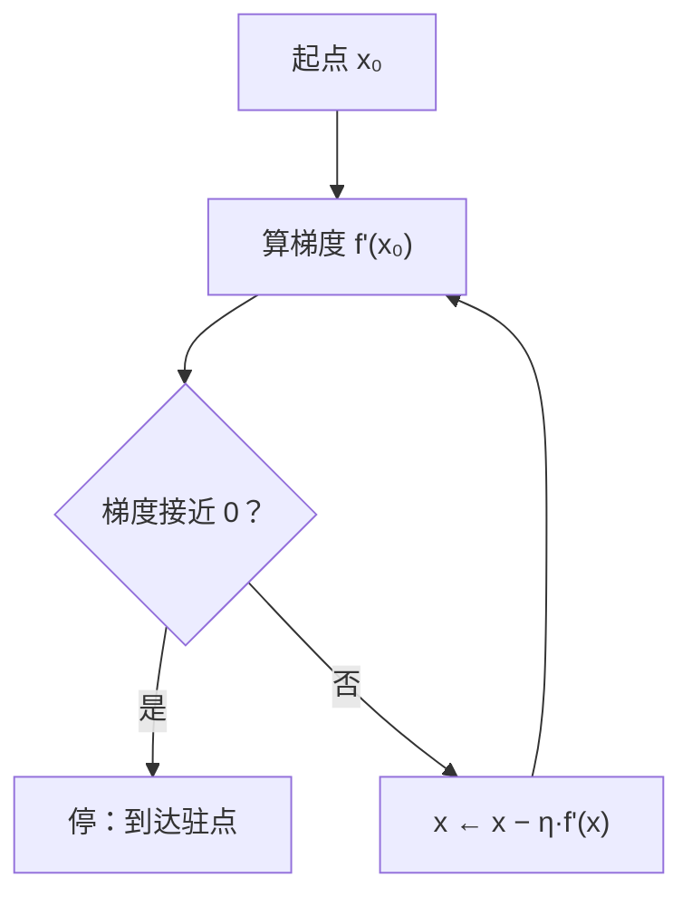

# MATH-721 梯度下降

> **前置说明**：本节只需**导数**（MATH-121）。不假设你知道"优化理论"。
> 全文只回答一个问题：**怎么用导数把函数值一步步压到最小**。

## 1. 通俗概念解释

你在浓雾里下山，看不见山谷在哪，只能摸到脚下哪边更陡。

- 导数告诉你：**往右走是上坡还是下坡，坡有多陡**。
- 那就反着走——下坡方向。
- 每次迈一小步（步长 = 学习率），重复，就能走到谷底附近。

梯度下降就是这套动作的数学化：**沿着负梯度方向，一小步一小步地走**。

## 2. 数学定义

要最小化目标函数 $f(\mathbf{x})$，迭代公式为

$$
\mathbf{x}_{k+1} = \mathbf{x}_k - \eta\,\nabla f(\mathbf{x}_k)
$$

其中：

- $\nabla f$：梯度（各偏导组成的向量，指向**上升最快**的方向）
- $\eta > 0$：学习率（步长）
- $-\nabla f$：负梯度，指向**下降最快**的方向

一维情形退化为

$$
x_{k+1} = x_k - \eta f'(x_k)
$$

## 3. 公式推导

**为什么沿负梯度走能让函数变小？** 用一阶泰勒展开：

$$
f(\mathbf{x} + \Delta) \approx f(\mathbf{x}) + \nabla f(\mathbf{x})^\top \Delta
$$

要让右边变小，需要 $\nabla f^\top \Delta < 0$。在固定步长 $\|\Delta\| = \eta$ 下，使内积最小（最负）的方向正是

$$
\Delta = -\eta\,\frac{\nabla f}{\|\nabla f\|}
$$

即**负梯度方向**。这就是梯度下降的几何来源：它是"一阶近似下最陡的下降方向"。

**步长怎么选**：

- $\eta$ 太小 → 收敛慢，走一万步还没到。
- $\eta$ 太大 → 直接跨过谷底，来回震荡甚至发散。
- 对二次函数 $f(x)=\tfrac{1}{2}ax^2$，收敛条件是 $\eta < \frac{2}{a}$；可以验证迭代为 $x_{k+1}=(1-\eta a)x_k$，要使 $|1-\eta a|<1$ 才有 $\eta<\frac{2}{a}$。

**收敛速度**：梯度下降在强凸光滑问题上线性收敛；条件数越差（山谷越狭长），越慢。这就是为什么实践里要"特征标准化"和"自适应优化器"。

## 4. 几何直观



一维直观：抛物线 $f(x)=(x-3)^2$，最低点在 $x=3$。
从 $x=0$ 出发，$f'(0) = -6$（负），减去负梯度 → 往右走，正好朝谷底。

## 5. 具体数值示例

最小化 $f(x)=(x-3)^2$，取 $f'(x)=2(x-3)$，$\eta=0.1$，$x_0=0$。

迭代式：

$$
x_{k+1} = x_k - 0.1\cdot 2(x_k-3) = 0.8x_k + 0.6
$$

| 步 | $x_k$ | $f(x_k)$ |
|---|---|---|
| 0 | 0.00000 | 9.00000 |
| 1 | 0.60000 | 5.76000 |
| 2 | 1.08000 | 3.68640 |
| 3 | 1.46400 | 2.35930 |
| 4 | 1.77120 | 1.50995 |
| 5 | 2.01696 | 0.96637 |
| 50 | ≈ 2.999957 | ≈ 1.8e-9 |

每步误差按 $0.8$ 倍衰减（因为 $0.8 = 1-\eta a$，此处 $a=2$），所以 50 步后已经非常接近 3。

## 6. 计算步骤

1. 写出 $f(x)$ 与它的导数（或梯度）。
2. 选初值 $x_0$ 与学习率 $\eta$。
3. 循环：算梯度 → 更新 → 记录损失。
4. 终止条件：梯度足够小 / 损失变化足够小 / 达到最大步数。
5. 检查：损失是否单调下降（不降说明 $\eta$ 太大）。

## 7. Python 应用示例

```python
def f(x):
    return (x - 3) ** 2

def grad(x):
    return 2 * (x - 3)

x = 0.0
lr = 0.1

for step in range(1, 6):
    x = x - lr * grad(x)
    print(f"step {step}: x={x:.5f}  f(x)={f(x):.5f}")

for _ in range(45):
    x = x - lr * grad(x)
print(f"50 步后: x={x:.6f}")

# 学习率过大会怎样？
x_bad = 0.0
for step in range(1, 6):
    x_bad = x_bad - 1.1 * grad(x_bad)
    print(f"lr=1.1 step {step}: x={x_bad:.2f}")
```

## 8. 基础练习

1. 对 $f(x)=(x-1)^2$，从 $x=0$ 出发、$\eta=0.5$，手算前 3 步。
2. 若 $f'(x_k)=0$，下一步 $x_{k+1}$ 等于什么？说明含义。
3. 判断：学习率越大收敛越快。对还是错？

## 9. 进阶练习

1. 对 $f(x)=\tfrac{1}{2}\cdot 4x^2$（即 $a=4$），求收敛所需的学习率上界，并说明 $\eta=0.6$ 时会怎样。
2. 写出二维情形 $\mathbf{x}=(x_1,x_2)$、$f=x_1^2+4x_2^2$ 的梯度，并解释为什么这个函数上梯度下降会"之字形"前进。

## 10. 参考答案

**基础**

1. $f'(x)=2(x-1)$；$x_1=0-0.5\times(-2)=1$，$x_2=1-0.5\times0=1$，$x_3=1$。一步到位（因为 $\eta$ 恰好等于 $1/a$）。
2. $x_{k+1}=x_k$，即停住不动；说明已到驻点（可能是极小、极大或鞍点）。
3. 错。过大会震荡或发散；存在使收敛最快的"合适值"，不是越大越好。

**进阶**

1. $a=4$，上界 $\eta<\frac{2}{4}=0.5$。取 $\eta=0.6$ 时 $|1-\eta a|=|1-2.4|=1.4>1$，发散。
2. $\nabla f=(2x_1,\ 8x_2)$。两个方向曲率差 4 倍，等步长下会在狭长山谷两侧来回反弹，呈之字形（条件数大 → 收敛慢）。

## 11. 常见错误

| 错误 | 说明 | 正确做法 |
|---|---|---|
| 忘了负号，沿梯度走 | 那是梯度**上升** | $x \leftarrow x - \eta\nabla f$ |
| 学习率固定且过大 | 震荡/发散 | 调小，或用衰减/自适应 |
| 特征量纲差异大就训 | 条件数差，之字形 | 先标准化 |
| 只看损失不检查梯度 | 可能卡在鞍点 | 监控梯度范数 |
| 以为损失一定单调下降 | 小批量噪声下会抖动 | 看趋势而非单步 |

## 12. 与机器学习、深度学习的联系

| 用到的地方 | 具体形式 |
|---|---|
| 线性/逻辑回归训练 | 对损失求梯度后迭代 |
| 神经网络反向传播 | 梯度由链式法则逐层算出，更新用本节公式 |
| 优化器家族 | SGD → Momentum → Adam，本质都在改"怎么用梯度" |
| 学习率调度 | warmup + 衰减，解决"前期炸、后期抖" |
| 损失曲面 | 条件数、鞍点、平坦极小值都从本节概念延伸 |

---

## 关联与记录

- **前置**：[[MATH-121 导数]]
- **关联数学**：[[MATH-121 导数]]（梯度定义）、[[MATH-451 最小二乘与回归统计]]（有闭式解时可对照）
- **后继**：无（数学基础模块到此收尾）
- **被谁用**：见 Backlinks（所有模型训练）
- **所属模块**：`M-MATH-01 数学基础`

| 日期 | 动作 | 用时 | 结果 | 复盘 |
|---|---|---|---|---|
| 2026-11-01 | 建立笔记 | — | 待学 | — |

---

## 🔗 Notion 同步信息

> 以下内容由 Notion「AI Knowledge System · 知识点」数据库按知识 ID 合并而来（导出于 2026-11-09）。

| 属性 | 值 |
|---|---|
| 学科 | 数学 |
| 学习状态 | 未开始 |
| 难度 | L3 推导 |
| 知识类型 | Algorithm |
| 学习目标 | 理解梯度下降更新规则与学习率影响，能实现并观察收敛。 |

- **所属模块**：[M-MATH-05 优化方法](../%E8%AF%BE%E7%A8%8B%E6%A8%A1%E5%9D%97/M-MATH-05%20%E4%BC%98%E5%8C%96%E6%96%B9%E6%B3%95.md)
- **前置知识**：[MATH-121 导数](../01%20%E9%AB%98%E7%AD%89%E6%95%B0%E5%AD%A6/MATH-121%20%E5%AF%BC%E6%95%B0.md)
- **关联数学**：[MATH-121 导数](../01%20%E9%AB%98%E7%AD%89%E6%95%B0%E5%AD%A6/MATH-121%20%E5%AF%BC%E6%95%B0.md) · [MATH-451 最小二乘与回归统计](../04%20%E6%95%B0%E7%90%86%E7%BB%9F%E8%AE%A1/MATH-451%20%E6%9C%80%E5%B0%8F%E4%BA%8C%E4%B9%98%E4%B8%8E%E5%9B%9E%E5%BD%92%E7%BB%9F%E8%AE%A1.md)
- **被引用为数学**：[ML-018 线性回归（手写实现）](../../03_%E6%9C%BA%E5%99%A8%E5%AD%A6%E4%B9%A0/02%20%E7%9B%91%E7%9D%A3%E5%AD%A6%E4%B9%A0/ML-018%20%E7%BA%BF%E6%80%A7%E5%9B%9E%E5%BD%92%EF%BC%88%E6%89%8B%E5%86%99%E5%AE%9E%E7%8E%B0%EF%BC%89.md) · [ML-054 梯度提升树 GBDT](../../03_%E6%9C%BA%E5%99%A8%E5%AD%A6%E4%B9%A0/06%20%E6%A8%A1%E5%9E%8B%E4%BC%98%E5%8C%96/ML-054%20%E6%A2%AF%E5%BA%A6%E6%8F%90%E5%8D%87%E6%A0%91%20GBDT.md) · [ML-055 XGBoost 与 LightGBM](../../03_%E6%9C%BA%E5%99%A8%E5%AD%A6%E4%B9%A0/06%20%E6%A8%A1%E5%9E%8B%E4%BC%98%E5%8C%96/ML-055%20XGBoost%20%E4%B8%8E%20LightGBM.md) · [DL-026 SGD 与 Momentum](../../04_%E6%B7%B1%E5%BA%A6%E5%AD%A6%E4%B9%A0/05%20%E8%AE%AD%E7%BB%83%E6%8A%80%E5%B7%A7/DL-026%20SGD%20%E4%B8%8E%20Momentum.md) · [DL-027 Nesterov、AdaGrad 与 RMSprop](../../04_%E6%B7%B1%E5%BA%A6%E5%AD%A6%E4%B9%A0/05%20%E8%AE%AD%E7%BB%83%E6%8A%80%E5%B7%A7/DL-027%20Nesterov%E3%80%81AdaGrad%20%E4%B8%8E%20RMSprop.md) · [DL-031 梯度裁剪与训练稳定性](../../04_%E6%B7%B1%E5%BA%A6%E5%AD%A6%E4%B9%A0/05%20%E8%AE%AD%E7%BB%83%E6%8A%80%E5%B7%A7/DL-031%20%E6%A2%AF%E5%BA%A6%E8%A3%81%E5%89%AA%E4%B8%8E%E8%AE%AD%E7%BB%83%E7%A8%B3%E5%AE%9A%E6%80%A7.md)
