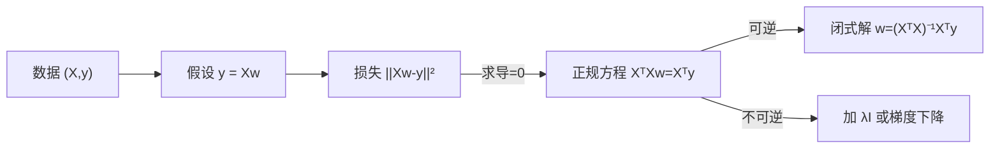

# MATH-801 线性回归的数学

## 1. 知识概览

| 项 | 内容 |
|---|---|
| 知识 ID | `MATH-801` |
| 英文名称 | The Mathematics of Linear Regression |
| 所属模块 | M-MATH-07 机器学习数学应用 |
| 难度等级 | L3 推导 |
| 前置知识 | [[MATH-708 L1 与 L2 正则化]]、[[MATH-216 矩阵乘法]] |
| 所属知识体系 | 模型假设 → 最小二乘 → 正规方程 → 梯度下降 |
| **AI 应用场景** | 最基础的监督学习模型；理解"闭式解 vs 迭代解"的样板 |
| **预计学习时间** | 55 分钟 |

**为什么学它**：线性回归是所有回归模型的基线，也是**唯一能写出闭式解的常用模型**。它把"最小化损失"这件事从"求导=0"到"矩阵求解"完整走了一遍。

## 2. 直观理解

假设房价由面积、房龄等线性决定：

$$
y \approx w_1 x_1 + w_2 x_2 + b
$$

写成矩阵：$y\approx Xw$（$X$ 第一列全 1，对应截距）。

**目标**：找 $w$ 让预测值与真实值的**平方误差总和最小**。

**为什么用平方**：平方对大误差惩罚更重，且处处可导，数学上好处理（对应高斯噪声假设）。

## 3. 正式数学定义

**模型**

$$
\hat y = Xw
$$

**损失（MSE）**

$$
L(w) = \frac1n\|Xw-y\|_2^2 = \frac1n\sum_{i=1}^{n}(\hat y_i-y_i)^2
$$

**正规方程**（闭式解）

$$
\nabla L = \frac2n X^T(Xw-y) = 0 \;\Longrightarrow\; \hat w = (X^TX)^{-1}X^Ty
$$

**带 L2 正则（岭回归）**

$$
\hat w = (X^TX+\lambda I)^{-1}X^Ty
$$

**梯度下降更新**

$$
w_{t+1} = w_t - \eta\,\frac2n X^T(Xw_t-y)
$$

**Hessian**

$$
H = \frac2n X^TX \succeq 0
$$

所以损失是**凸函数**，任一局部最优即全局最优。

## 4. 数学推导

### 4.1 正规方程的推导

**起点**：$L(w)=\frac1n\|Xw-y\|^2$。

**第 1 步**：展开范数

$$
L = \frac1n (Xw-y)^T(Xw-y) = \frac1n\left(w^TX^TXw - 2w^TX^Ty + y^Ty\right)
$$

**第 2 步**：对 $w$ 求梯度（用 $\nabla_w(w^TAw)=2Aw$，$A$ 对称）

$$
\nabla L = \frac1n\left(2X^TXw - 2X^Ty\right) = \frac2n X^T(Xw-y)
$$

**第 3 步**：令梯度为 0

$$
X^TXw = X^Ty
$$

**第 4 步**：若 $X^TX$ 可逆

$$
\hat w = (X^TX)^{-1}X^Ty
$$

**条件**：$X$ 必须**列满秩**（特征不共线）。否则 $X^TX$ 奇异，需加正则或求伪逆。

### 4.2 为什么加 $\lambda I$ 能解决不可逆

**起点**：$X^TX$ 可能奇异（特征完全共线）。

**第 1 步**：$X^TX$ 半正定，特征值 $\ge0$；奇异意味着有 0 特征值。

**第 2 步**：加 $\lambda I$ 后特征值变成 $\mu_i+\lambda$。

**第 3 步**：$\lambda>0$ 时所有特征值严格为正

$$
X^TX+\lambda I \succ 0 \;\Rightarrow\; \text{可逆}
$$

**结论**：**L2 正则既防过拟合，又保证数值可解**。这是岭回归的双重作用。

## 5. 几何直观与图解



```text
几何：y 到 X 的列空间作正交投影
   y ●
      ╲
       ╲ 残差（垂直于列空间）
        ● Xw   ← 投影点
   ——列空间——
```

## 6. 计算示例

**例**：$n=200$，3 个特征 + 截距，真值 $w=(1.5,2.0,-1.0,0.5)$，噪声 $\sigma=0.2$。

| 方法 | 解 |
|---|---|
| 闭式解 | $[1.4928,\ 1.9820,\ -1.0192,\ 0.5106]$ |
| 梯度下降（2000 步） | $[1.4928,\ 1.9820,\ -1.0192,\ 0.5106]$ |
| 真值 | $[1.5,\ 2.0,\ -1.0,\ 0.5]$ |

MSE $=0.04$（噪声方差 $0.2^2=0.04$，正好吻合）。

**读法**：两种方法结果一致到小数点后 4 位，说明推导正确；估计值与真值的差异来自抽样噪声。

## 7. Python 辅助验证

**依赖**：NumPy 2.5.4。

```powershell
python math801_linear_regression.py
```

```python
import numpy as np

rng = np.random.default_rng(0)
n = 200
X0 = rng.normal(size=(n, 3))
X = np.column_stack([np.ones(n), X0])          # 加截距列
true_w = np.array([1.5, 2.0, -1.0, 0.5])
y = X @ true_w + 0.2 * rng.normal(size=n)

w_closed = np.linalg.solve(X.T @ X, X.T @ y)
print("闭式解:", w_closed.round(4).tolist())

w = np.zeros(4)
lr = 0.05
for _ in range(2000):
    w -= lr * 2 * X.T @ (X @ w - y) / n
print("梯度下降:", w.round(4).tolist())
print("MSE:", round(float(((X @ w_closed - y) ** 2).mean()), 4))
```

**实际运行结果**

```
闭式解: [1.4928, 1.982, -1.0192, 0.5106]
梯度下降: [1.4928, 1.982, -1.0192, 0.5106]
MSE: 0.04
```

**代码解析**

- 用 `np.linalg.solve` 解正规方程，比显式求逆更稳。
- 梯度下降用全批量梯度 `2 Xᵀ(Xw-y)/n`，2000 步后与闭式解一致。
- MSE 0.04 恰好是噪声方差，说明模型已学到真实关系。
- 系数与真值有约 0.02 的偏移，来自 200 个样本的抽样误差。

## 8. 知识关联

| 类型 | 链接 |
|---|---|
| 前置数学 | [[MATH-708 L1 与 L2 正则化]]、[[MATH-216 矩阵乘法]]、[[MATH-451 最小二乘与回归统计]] |
| 后续数学 | `MATH-802 逻辑回归与 Sigmoid`、`MATH-803 神经网络前向传播` |
| 相关 Python | [[PY-066 矩阵运算]]、[[PY-073 分组聚合]] |
| 相关机器学习 | 待关联（线性回归、岭回归、特征共线） |
| 相关深度学习 | 待关联（单层网络的特例） |
| 相关大语言模型 | 待关联（线性探针） |

## 9. 实战练习

**基础 1**：$X$ 是 $n\times1$（只有一列）时，写出 $\hat w$ 的标量形式。

**基础 2**：为什么 $X$ 的列必须线性无关？

**进阶 1**：证明 $X^TX$ 总是半正定。

**综合 1**：$n=1000$、特征 5000 个（高维），闭式解会遇到什么问题？怎么办？

## 10. 参考答案

> [!success]- 基础 1
> $$X^TX = \sum x_i^2,\qquad X^Ty = \sum x_iy_i$$
>
> $$\hat w = \frac{\sum x_iy_i}{\sum x_i^2}$$

> [!success]- 基础 2
> 列相关 ⇒ $X^TX$ 奇异 ⇒ 不可逆 ⇒ 有无穷多解（不是唯一）。
>
> 从模型角度：两个特征完全共线，无法区分它们各自的贡献。

> [!success]- 进阶 1
> 对任意向量 $v$：$v^T(X^TX)v = (Xv)^T(Xv) = \|Xv\|^2\ge0$。
>
> 所以半正定，特征值均 $\ge0$。

> [!success]- 综合 1
> $X^TX$ 是 $5000\times5000$，且 $n<d$ 时必然奇异（秩 $\le1000$），**不可逆**。
>
> 解决办法：
> 1. 加 L2 正则（岭回归），$X^TX+\lambda I$ 可逆；
> 2. 用伪逆 `np.linalg.lstsq`；
> 3. 先降维（PCA）或用随机梯度下降；
> 4. 用 L1（Lasso）做特征选择。

## 11. 常见错误

| 类型 | 错误表现 | 原因 | 纠正 |
|---|---|---|---|
| 计算错误 | 忘记加截距列 | 模型无偏置 | 补一列全 1 |
| 概念错误 | 认为闭式解总存在 | 需 $X$ 列满秩 | 否则加正则/伪逆 |
| 计算错误 | 直接 `inv` 而不 `solve` | 数值不稳 | 用 `solve` 或 `lstsq` |
| 概念错误 | 认为梯度下降一定比闭式快 | $d$ 小时闭式更快 | 按规模选 |
| 概念错误 | 用 MSE 评价分类模型 | 目标不匹配 | 分类用交叉熵 |

## 12. 学习记录

| 日期 | 状态 | 掌握程度 | 复习状态 | 学习笔记 | 关联练习 |
|---|---|---|---|---|---|
| — | planned | — | — | — | 练习 1–4 |

---

## 🔗 Notion 同步信息

> 以下内容由 Notion「AI Knowledge System · 知识点」数据库按知识 ID 合并而来（导出于 2026-11-09）。

| 属性 | 值 |
|---|---|
| 学科 | 数学 |
| 学习状态 | 未开始 |
| 难度 | L3 推导 |
| 知识类型 | Application |

- **所属模块**：[M-MATH-07 机器学习数学应用](../%E8%AF%BE%E7%A8%8B%E6%A8%A1%E5%9D%97/M-MATH-07%20%E6%9C%BA%E5%99%A8%E5%AD%A6%E4%B9%A0%E6%95%B0%E5%AD%A6%E5%BA%94%E7%94%A8.md)
- **前置知识**：[MATH-708 L1 与 L2 正则化](../07%20%E6%9C%80%E4%BC%98%E5%8C%96%E6%96%B9%E6%B3%95/MATH-708%20L1%20%E4%B8%8E%20L2%20%E6%AD%A3%E5%88%99%E5%8C%96.md)
- **后继知识**：[MATH-802 逻辑回归与 Sigmoid](MATH-802%20%E9%80%BB%E8%BE%91%E5%9B%9E%E5%BD%92%E4%B8%8E%20Sigmoid.md)
- **关联Python**：[PY-066 矩阵运算](../../01_Python%E5%9F%BA%E7%A1%80/08%20NumPy/PY-066%20%E7%9F%A9%E9%98%B5%E8%BF%90%E7%AE%97.md)
- **关联数学**：[MATH-708 L1 与 L2 正则化](../07%20%E6%9C%80%E4%BC%98%E5%8C%96%E6%96%B9%E6%B3%95/MATH-708%20L1%20%E4%B8%8E%20L2%20%E6%AD%A3%E5%88%99%E5%8C%96.md)
- **被引用为数学**：[MATH-802 逻辑回归与 Sigmoid](MATH-802%20%E9%80%BB%E8%BE%91%E5%9B%9E%E5%BD%92%E4%B8%8E%20Sigmoid.md) · [ML-018 线性回归（手写实现）](../../03_%E6%9C%BA%E5%99%A8%E5%AD%A6%E4%B9%A0/02%20%E7%9B%91%E7%9D%A3%E5%AD%A6%E4%B9%A0/ML-018%20%E7%BA%BF%E6%80%A7%E5%9B%9E%E5%BD%92%EF%BC%88%E6%89%8B%E5%86%99%E5%AE%9E%E7%8E%B0%EF%BC%89.md) · [ML-019 多元线性回归与正规方程](../../03_%E6%9C%BA%E5%99%A8%E5%AD%A6%E4%B9%A0/02%20%E7%9B%91%E7%9D%A3%E5%AD%A6%E4%B9%A0/ML-019%20%E5%A4%9A%E5%85%83%E7%BA%BF%E6%80%A7%E5%9B%9E%E5%BD%92%E4%B8%8E%E6%AD%A3%E8%A7%84%E6%96%B9%E7%A8%8B.md) · [ML-021 岭回归](../../03_%E6%9C%BA%E5%99%A8%E5%AD%A6%E4%B9%A0/02%20%E7%9B%91%E7%9D%A3%E5%AD%A6%E4%B9%A0/ML-021%20%E5%B2%AD%E5%9B%9E%E5%BD%92.md)
