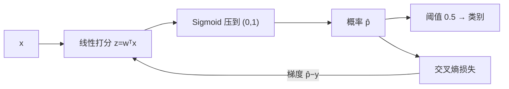

# MATH-802 逻辑回归与 Sigmoid

## 1. 知识概览

| 项 | 内容 |
|---|---|
| 知识 ID | `MATH-802` |
| 英文名称 | Logistic Regression and the Sigmoid Function |
| 所属模块 | M-MATH-07 机器学习数学应用 |
| 难度等级 | L3 推导 |
| 前置知识 | [[MATH-801 线性回归的数学]]、[[MATH-507 交叉熵与 KL 散度]] |
| 所属知识体系 | 线性分数 → Sigmoid → 概率 → 交叉熵 → 梯度 |
| **AI 应用场景** | 二分类基线；神经网络的输出层（二分类）；门控机制（LSTM、GLU） |
| **预计学习时间** | 55 分钟 |

**为什么学它**：逻辑回归是**"线性模型 + 概率输出"的最小完整例子**。它的梯度 $p-y$ 极其干净，这个结果会一路沿用到深层网络。

## 2. 直观理解

线性回归输出可以是任意实数，但**概率必须在 (0,1)**。Sigmoid 就是那个"压缩器"：

$$
\sigma(z) = \frac{1}{1+e^{-z}}
$$

- $z=0$ → 0.5
- $z$ 很大 → 接近 1
- $z$ 很小 → 接近 0

**直觉**：先算一个"打分"$z=w^Tx$，再用 Sigmoid 把打分压成概率。打分越高，越可能是正类。

## 3. 正式数学定义

**Sigmoid**

$$
\sigma(z) = \frac{1}{1+e^{-z}}, \qquad \sigma'(z) = \sigma(z)\left(1-\sigma(z)\right)
$$

**模型**

$$
\hat p = \sigma(w^Tx), \qquad \hat y = \mathbb{1}[\hat p \ge 0.5]
$$

**损失（二元交叉熵 / 对数损失）**

$$
L = -\left[y\ln\hat p + (1-y)\ln(1-\hat p)\right]
$$

**梯度**

$$
\frac{\partial L}{\partial z} = \hat p - y, \qquad \frac{\partial L}{\partial w} = (\hat p - y)\,x
$$

**决策边界**：$\hat p=0.5 \iff w^Tx=0$，是一条直线（超平面）。

## 4. 数学推导

### 4.1 Sigmoid 导数

**起点**：$\sigma(z)=(1+e^{-z})^{-1}$。

**第 1 步**：链式法则

$$
\sigma'(z) = -(1+e^{-z})^{-2}\cdot(-e^{-z}) = \frac{e^{-z}}{(1+e^{-z})^2}
$$

**第 2 步**：拆成两个因子

$$
= \frac{1}{1+e^{-z}}\cdot\frac{e^{-z}}{1+e^{-z}} = \sigma(z)\cdot\left(1-\sigma(z)\right)
$$

**结论**：$\sigma'=\sigma(1-\sigma)$，最大值 0.25（在 $z=0$）。

### 4.2 为什么梯度是 $\hat p-y$（关键推导）

**起点**：$L=-[y\ln\hat p+(1-y)\ln(1-\hat p)]$，$\hat p=\sigma(z)$，$z=w^Tx$。

**第 1 步**：对 $\hat p$ 求导

$$
\frac{\partial L}{\partial\hat p} = -\frac{y}{\hat p} + \frac{1-y}{1-\hat p} = \frac{\hat p-y}{\hat p(1-\hat p)}
$$

**第 2 步**：对 $z$ 用链式法则，乘上 $\sigma'=\hat p(1-\hat p)$

$$
\frac{\partial L}{\partial z} = \frac{\hat p-y}{\hat p(1-\hat p)}\cdot\hat p(1-\hat p) = \hat p-y
$$

**第 3 步**：对 $w$

$$
\frac{\partial L}{\partial w} = (\hat p-y)\,x
$$

**结论**：**分母 $\hat p(1-\hat p)$ 与 Sigmoid 导数精确抵消**，梯度就是"预测减真实"。

**为什么重要**：预测错得越离谱（$\hat p$ 接近 0 而 $y=1$），梯度越大，学得越快；不会像 MSE 那样在饱和区梯度消失。

## 5. 几何直观与图解



```text
Sigmoid 曲线：
 1 ┤      ╭────
   │    ╱
0.5┤──╱
   │╱
 0 ┴──────────
    -4  0  +4   z
```

## 6. 计算示例

**例 1**：$z=-2,-1,0,1,2$ 的 Sigmoid 值。

| $z$ | -2 | -1 | 0 | 1 | 2 |
|---|---|---|---|---|---|
| $\sigma(z)$ | 0.1192 | 0.2689 | 0.5 | 0.7311 | 0.8808 |

**例 2**：$y=1$ 时的 BCE。

- $\hat p=0.9$：$L=-\ln0.9\approx0.1054$
- $\hat p=0.1$：$L=-\ln0.1\approx2.3026$

预测对时损失小，预测错时损失大（相差 20 倍）。

**例 3**：梯度验证。若 $\hat p=0.9$、$y=1$，则

$$
\hat p-y = -0.1
$$

负梯度方向增大 $z$（增大 $\hat p$），方向正确。若 $z=0$（$\hat p=0.5$）配 $y=0.5$，梯度为 0——完全无信息时不更新。

## 7. Python 辅助验证

**依赖**：NumPy 2.5.4 + `math`。

```powershell
python math802_logistic.py
```

```python
import math

import numpy as np


def sigmoid(z):
    return 1 / (1 + np.exp(-z))


def bce(y, p):
    return float(-(y * math.log(p) + (1 - y) * math.log(1 - p)))


z = np.array([-2, -1, 0, 1, 2])
print("sigmoid:", sigmoid(z).round(4).tolist())

print("BCE(y=1,p=0.9) =", round(bce(1, 0.9), 4))
print("BCE(y=1,p=0.1) =", round(bce(1, 0.1), 4))
print("BCE(y=0,p=0.1) =", round(bce(0, 0.1), 4))

p = 0.9
print("梯度 p-y (y=1) =", round(p - 1, 4))
```

**实际运行结果**

```
sigmoid: [0.1192, 0.2689, 0.5, 0.7311, 0.8808]
BCE(y=1,p=0.9) = 0.1054
BCE(y=1,p=0.1) = 2.3026
BCE(y=0,p=0.1) = 0.1054
```

**代码解析**

- Sigmoid 在 $z=0$ 处取 0.5，两侧对称。
- 预测错时损失 2.3026（正好 $-\ln0.1$），预测对时 0.1054——**差 20 倍**。
- $y=0$ 且 $\hat p=0.1$ 时损失也很小，说明"预测正确的负类"同样被奖励。
- 梯度 $\hat p-y=-0.1$，取负号更新会使 $z$ 增大，方向正确。

## 8. 知识关联

| 类型 | 链接 |
|---|---|
| 前置数学 | [[MATH-801 线性回归的数学]]、[[MATH-507 交叉熵与 KL 散度]]、[[MATH-122 求导法则与链式法则]] |
| 后续数学 | `MATH-803 神经网络前向传播`、`MATH-804 反向传播与链式法则` |
| 相关 Python | [[PY-009 函数]] |
| 相关机器学习 | 待关联（二分类、类别不平衡、阈值选择） |
| 相关深度学习 | 待关联（输出层、LSTM 门控） |
| 相关大语言模型 | 待关联（二分类奖励模型） |

## 9. 实战练习

**基础 1**：$z=0$ 时 Sigmoid 值？$\sigma'(0)$ 呢？

**基础 2**：$y=0$、$\hat p=0.9$，求 BCE 损失。

**进阶 1**：推导 $\sigma(-z)=1-\sigma(z)$，并解释它的意义。

**综合 1**：为什么"用 MSE 训练逻辑回归"效果差？用梯度说明。

## 10. 参考答案

> [!success]- 基础 1
> $$\sigma(0)=0.5,\qquad \sigma'(0)=0.5\times0.5=0.25$$
>
> 0.25 是 Sigmoid 导数的最大值。

> [!success]- 基础 2
> $$L = -\ln(1-0.9) = -\ln0.1 \approx 2.3026$$
>
> 预测"正类"但真实是负类，惩罚很重。

> [!success]- 进阶 1
> $$\sigma(-z)=\frac{1}{1+e^{z}}=\frac{e^{-z}}{e^{-z}+1}=1-\frac{1}{1+e^{-z}}=1-\sigma(z)$$
>
> 意义：对称性——把打分取反，概率正好互补。这是"决策边界在 $z=0$"的代数根源。

> [!success]- 综合 1
> MSE 配 Sigmoid 时梯度含 $\sigma'(z)=\hat p(1-\hat p)$。
>
> 当预测严重错误（$\hat p\approx0$ 而 $y=1$）时 $\sigma'\approx0$，梯度接近 0——**错得越离谱学得越慢**。
>
> 交叉熵的梯度是 $\hat p-y$，此时约等于 $-1$，梯度很大，能快速纠正。

## 11. 常见错误

| 类型 | 错误表现 | 原因 | 纠正 |
|---|---|---|---|
| 计算错误 | Sigmoid 导数为 $\sigma$ | 漏项 | $\sigma(1-\sigma)$ |
| 概念错误 | 用 0.5 阈值总是最优 | 类别不平衡时不然 | 按业务调阈值 |
| 概念错误 | 认为逻辑回归是"回归" | 名字误导 | 是分类模型 |
| 实践错误 | 特征不标准化 | 梯度尺度差异大 | 先标准化 |
| 计算错误 | 概率为 0 或 1 时算 log | 无穷 | 加 `eps` 裁剪 |

## 12. 学习记录

| 日期 | 状态 | 掌握程度 | 复习状态 | 学习笔记 | 关联练习 |
|---|---|---|---|---|---|
| — | planned | — | — | — | 练习 1–4 |

---

## 🔗 Notion 同步信息

> 以下内容由 Notion「AI Knowledge System · 知识点」数据库按知识 ID 合并而来（导出于 2026-11-09）。

| 属性 | 值 |
|---|---|
| 学科 | 数学 |
| 学习状态 | 未开始 |
| 难度 | L3 推导 |
| 知识类型 | Application |

- **所属模块**：[M-MATH-07 机器学习数学应用](../%E8%AF%BE%E7%A8%8B%E6%A8%A1%E5%9D%97/M-MATH-07%20%E6%9C%BA%E5%99%A8%E5%AD%A6%E4%B9%A0%E6%95%B0%E5%AD%A6%E5%BA%94%E7%94%A8.md)
- **前置知识**：[MATH-801 线性回归的数学](MATH-801%20%E7%BA%BF%E6%80%A7%E5%9B%9E%E5%BD%92%E7%9A%84%E6%95%B0%E5%AD%A6.md)
- **后继知识**：[MATH-803 神经网络前向传播](MATH-803%20%E7%A5%9E%E7%BB%8F%E7%BD%91%E7%BB%9C%E5%89%8D%E5%90%91%E4%BC%A0%E6%92%AD.md)
- **关联Python**：[PY-009 函数](../../01_Python%E5%9F%BA%E7%A1%80/02%20%E5%87%BD%E6%95%B0%E4%B8%8E%E4%BD%9C%E7%94%A8%E5%9F%9F/PY-009%20%E5%87%BD%E6%95%B0.md)
- **关联数学**：[MATH-801 线性回归的数学](MATH-801%20%E7%BA%BF%E6%80%A7%E5%9B%9E%E5%BD%92%E7%9A%84%E6%95%B0%E5%AD%A6.md)
- **被引用为数学**：[MATH-803 神经网络前向传播](MATH-803%20%E7%A5%9E%E7%BB%8F%E7%BD%91%E7%BB%9C%E5%89%8D%E5%90%91%E4%BC%A0%E6%92%AD.md) · [ML-024 分类任务基本概念](../../03_%E6%9C%BA%E5%99%A8%E5%AD%A6%E4%B9%A0/02%20%E7%9B%91%E7%9D%A3%E5%AD%A6%E4%B9%A0/ML-024%20%E5%88%86%E7%B1%BB%E4%BB%BB%E5%8A%A1%E5%9F%BA%E6%9C%AC%E6%A6%82%E5%BF%B5.md) · [ML-025 逻辑回归](../../03_%E6%9C%BA%E5%99%A8%E5%AD%A6%E4%B9%A0/02%20%E7%9B%91%E7%9D%A3%E5%AD%A6%E4%B9%A0/ML-025%20%E9%80%BB%E8%BE%91%E5%9B%9E%E5%BD%92.md) · [ML-030 决策边界与分类阈值](../../03_%E6%9C%BA%E5%99%A8%E5%AD%A6%E4%B9%A0/02%20%E7%9B%91%E7%9D%A3%E5%AD%A6%E4%B9%A0/ML-030%20%E5%86%B3%E7%AD%96%E8%BE%B9%E7%95%8C%E4%B8%8E%E5%88%86%E7%B1%BB%E9%98%88%E5%80%BC.md)
