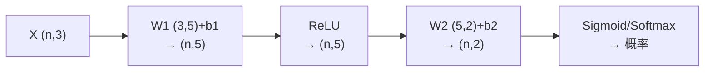

# MATH-803 神经网络前向传播

## 1. 知识概览

| 项 | 内容 |
|---|---|
| 知识 ID | `MATH-803` |
| 英文名称 | Neural Network Forward Propagation |
| 所属模块 | M-MATH-07 机器学习数学应用 |
| 难度等级 | L3 推导 |
| 前置知识 | [[MATH-802 逻辑回归与 Sigmoid]]、[[MATH-217 矩阵运算与维度]] |
| 所属知识体系 | 线性层 → 激活 → 堆叠 → 输出层 |
| **AI 应用场景** | 所有神经网络的基本骨架；理解形状（shape）是调模型的前提 |
| **预计学习时间** | 55 分钟 |

**为什么学它**：前向传播就是**矩阵乘法 + 逐元素激活**交替。搞清形状怎么变、参数有多少，才能判断"这个模型能不能跑、显存够不够"。

## 2. 直观理解

一层网络做两件事：

1. **线性变换**：$z = XW + b$ —— 把输入"投影"到新空间。
2. **非线性激活**：$a = \text{ReLU}(z)$ —— 让模型能拟合弯曲的边界。

**为什么必须有非线性**：两个线性层叠起来还是线性的（$W_2W_1$ 仍是一个矩阵），等于白叠。**激活函数是深度的意义所在**。

## 3. 正式数学定义

**单层**

$$
z^{(l)} = a^{(l-1)}W^{(l)} + b^{(l)}, \qquad a^{(l)} = \phi\left(z^{(l)}\right)
$$

**常用激活**

| 名称 | 公式 | 特点 |
|---|---|---|
| ReLU | $\max(0,z)$ | 梯度不饱和，最常用 |
| Sigmoid | $\frac{1}{1+e^{-z}}$ | 输出 (0,1)，易饱和 |
| Tanh | $\frac{e^z-e^{-z}}{e^z+e^{-z}}$ | 零中心，仍会饱和 |
| Softmax | $\frac{e^{z_i}}{\sum_j e^{z_j}}$ | 多分类输出 |

**形状规则**（$n$ 个样本）

$$
(n, d_{in}) \times (d_{in}, d_{out}) \to (n, d_{out})
$$

**参数量**

$$
\sum_l \left(d_{in}^{(l)}\cdot d_{out}^{(l)} + d_{out}^{(l)}\right)
$$

**输出层**：二分类用 Sigmoid，多分类用 Softmax，回归用线性。

## 4. 数学推导

### 4.1 为什么取消激活后多层等于一层

**起点**：两层线性网络，无激活

$$
a^{(1)} = XW_1 + b_1, \qquad a^{(2)} = a^{(1)}W_2 + b_2
$$

**第 1 步**：代入

$$
a^{(2)} = (XW_1+b_1)W_2+b_2 = X(W_1W_2) + (b_1W_2+b_2)
$$

**第 2 步**：令 $\tilde W=W_1W_2$、$\tilde b=b_1W_2+b_2$

$$
a^{(2)} = X\tilde W+\tilde b
$$

**结论**：**多层线性 = 单层线性**。所以没有激活函数，深度毫无意义。

### 4.2 ReLU 为什么缓解梯度消失

**起点**：反向传播时梯度要逐层相乘。

**第 1 步**：Sigmoid 的导数 $\sigma'=\sigma(1-\sigma)\le0.25$。

**第 2 步**：$L$ 层连乘，梯度量级 $\le0.25^L$，$L=10$ 时约 $10^{-6}$——**梯度消失**。

**第 3 步**：ReLU 的导数在 $z>0$ 时为 1，连乘不衰减。

**结论**：**ReLU 让梯度能传得更深**。代价是 $z<0$ 时导数为 0（"死亡 ReLU"），可用 LeakyReLU 缓解。

## 5. 几何直观与图解



```text
每层：线性"压扁/拉伸" + 非线性"折叠"
多层组合 → 能拟合复杂曲面
```

## 6. 计算示例

**例**：$n=4$、输入 3 维、隐藏 5 维、输出 2 类。

**形状链**

| 步骤 | 形状 |
|---|---|
| $X$ | $(4,3)$ |
| $z_1=XW_1+b_1$ | $(4,5)$ |
| $a_1=\text{ReLU}(z_1)$ | $(4,5)$ |
| $z_2=a_1W_2+b_2$ | $(4,2)$ |
| $\hat p=\sigma(z_2)$ | $(4,2)$ |

**参数量**

$$
(3\times5+5) + (5\times2+2) = 20 + 12 = 32
$$

**输出检查**：概率和若做过 Softmax 应为 1；这里逐元素 Sigmoid，和约为 3.1474（不是 1），说明是"多标签"设定。

## 7. Python 辅助验证

**依赖**：NumPy 2.5.4。

```powershell
python math803_forward.py
```

```python
import numpy as np

rng = np.random.default_rng(0)
X = rng.normal(size=(4, 3))
W1 = rng.normal(size=(3, 5))
b1 = np.zeros(5)
W2 = rng.normal(size=(5, 2))
b2 = np.zeros(2)


def relu(z):
    return np.maximum(z, 0)


z1 = X @ W1 + b1
a1 = relu(z1)
z2 = a1 @ W2 + b2
p = 1 / (1 + np.exp(-z2))

print("X:", X.shape, " z1:", z1.shape, " a1:", a1.shape)
print("z2:", z2.shape, " p:", p.shape)
print("参数量:", W1.size + b1.size + W2.size + b2.size)
print("概率和:", round(float(p.sum()), 6))
```

**实际运行结果**

```
X: (4, 3)  z1: (4, 5)  a1: (4, 5)
z2: (4, 2)  p: (4, 2)
参数量: 32
概率和: 3.147441
```

**代码解析**

- 形状从 $(4,3)$ 经 $(4,5)$ 到 $(4,2)$，与手推一致。
- 参数量 32 与公式算的一致。
- 概率和 3.147 ≠ 1，因为用的是**逐元素 Sigmoid**（多标签），若换 Softmax 才会归一化。
- 这个细节常被忽略：**输出层用什么激活，决定了任务类型**。

## 8. 知识关联

| 类型 | 链接 |
|---|---|
| 前置数学 | [[MATH-802 逻辑回归与 Sigmoid]]、[[MATH-217 矩阵运算与维度]]、[[PY-064 广播机制]] |
| 后续数学 | [[MATH-804 反向传播与链式法则]]、`MATH-805 Softmax 与交叉熵`（待建） |
| 相关 Python | [[PY-066 矩阵运算]]、[[PY-064 广播机制]] |
| 相关机器学习 | 待关联（模型容量、参数量估算） |
| 相关深度学习 | 待关联（CNN/RNN/Transformer 的层结构） |
| 相关大语言模型 | 待关联（Transformer block 的形状） |

## 9. 实战练习

**基础 1**：输入 $(32,128)$，$W$ 为 $(128,256)$，输出形状？

**基础 2**：上述层有多少参数（含偏置）？

**进阶 1**：若把 ReLU 换成恒等映射，两层网络等价于什么？

**综合 1**：一个 3 层 MLP：输入 20 → 64 → 32 → 10，估算总参数量与显存（float32，batch=128 时激活占用）。

## 10. 参考答案

> [!success]- 基础 1
> $$(32,128)\times(128,256)\to(32,256)$$

> [!success]- 基础 2
> $$128\times256+256 = 32768+256 = 33024$$

> [!success]- 进阶 1
> 等价于**单层线性变换**（$X\tilde W+\tilde b$），因为线性复合仍是线性。
>
> 所以深度失去意义。

> [!success]- 综合 1
> 参数量：
> $$(20\times64+64)+(64\times32+32)+(32\times10+10) = 1344+2080+330 = 3754$$
>
> 激活占用（batch=128，float32）：
>
> $$\approx (20+64+32+10)\times128\times4 \approx 64.5\text{ KB}$$
>
> 可见小模型的激活不是瓶颈，**大模型（十亿参数）才需要精打细算**。

## 11. 常见错误

| 类型 | 错误表现 | 原因 | 纠正 |
|---|---|---|---|
| 概念错误 | 认为多层线性能拟合非线性 | 忽略复合仍线性 | 必须有激活 |
| 形状错误 | 权重写成 $(d_{out},d_{in})$ 却按 $(d_{in},d_{out})$ 乘 | 约定不一致 | 明确"行=输入维" |
| 计算错误 | 参数量漏算偏置 | 只数权重 | 每层加 $d_{out}$ |
| 概念错误 | 多分类用 Sigmoid | 输出不归一 | 用 Softmax |
| 实践错误 | ReLU 后接大学习率 | 大量神经元死亡 | 降学习率/换 LeakyReLU |

## 12. 学习记录

| 日期 | 状态 | 掌握程度 | 复习状态 | 学习笔记 | 关联练习 |
|---|---|---|---|---|---|
| — | planned | — | — | — | 练习 1–4 |

---

## 🔗 Notion 同步信息

> 以下内容由 Notion「AI Knowledge System · 知识点」数据库按知识 ID 合并而来（导出于 2026-11-09）。

| 属性 | 值 |
|---|---|
| 学科 | 数学 |
| 学习状态 | 未开始 |
| 难度 | L3 推导 |
| 知识类型 | Application |

- **所属模块**：[M-MATH-07 机器学习数学应用](../%E8%AF%BE%E7%A8%8B%E6%A8%A1%E5%9D%97/M-MATH-07%20%E6%9C%BA%E5%99%A8%E5%AD%A6%E4%B9%A0%E6%95%B0%E5%AD%A6%E5%BA%94%E7%94%A8.md)
- **前置知识**：[MATH-802 逻辑回归与 Sigmoid](MATH-802%20%E9%80%BB%E8%BE%91%E5%9B%9E%E5%BD%92%E4%B8%8E%20Sigmoid.md)
- **后继知识**：[MATH-804 反向传播与链式法则](MATH-804%20%E5%8F%8D%E5%90%91%E4%BC%A0%E6%92%AD%E4%B8%8E%E9%93%BE%E5%BC%8F%E6%B3%95%E5%88%99.md)
- **关联Python**：[PY-066 矩阵运算](../../01_Python%E5%9F%BA%E7%A1%80/08%20NumPy/PY-066%20%E7%9F%A9%E9%98%B5%E8%BF%90%E7%AE%97.md)
- **关联数学**：[MATH-802 逻辑回归与 Sigmoid](MATH-802%20%E9%80%BB%E8%BE%91%E5%9B%9E%E5%BD%92%E4%B8%8E%20Sigmoid.md)
- **被引用为数学**：[MATH-804 反向传播与链式法则](MATH-804%20%E5%8F%8D%E5%90%91%E4%BC%A0%E6%92%AD%E4%B8%8E%E9%93%BE%E5%BC%8F%E6%B3%95%E5%88%99.md) · [DL-003 神经网络的基本思想](../../04_%E6%B7%B1%E5%BA%A6%E5%AD%A6%E4%B9%A0/01%20%E7%A5%9E%E7%BB%8F%E7%BD%91%E7%BB%9C%E5%9F%BA%E7%A1%80/DL-003%20%E7%A5%9E%E7%BB%8F%E7%BD%91%E7%BB%9C%E7%9A%84%E5%9F%BA%E6%9C%AC%E6%80%9D%E6%83%B3.md) · [DL-004 生物神经元与人工神经元](../../04_%E6%B7%B1%E5%BA%A6%E5%AD%A6%E4%B9%A0/01%20%E7%A5%9E%E7%BB%8F%E7%BD%91%E7%BB%9C%E5%9F%BA%E7%A1%80/DL-004%20%E7%94%9F%E7%89%A9%E7%A5%9E%E7%BB%8F%E5%85%83%E4%B8%8E%E4%BA%BA%E5%B7%A5%E7%A5%9E%E7%BB%8F%E5%85%83.md) · [DL-005 人工神经元：权重、偏置与线性组合](../../04_%E6%B7%B1%E5%BA%A6%E5%AD%A6%E4%B9%A0/01%20%E7%A5%9E%E7%BB%8F%E7%BD%91%E7%BB%9C%E5%9F%BA%E7%A1%80/DL-005%20%E4%BA%BA%E5%B7%A5%E7%A5%9E%E7%BB%8F%E5%85%83%E2%80%94%E2%80%94%E6%9D%83%E9%87%8D%E3%80%81%E5%81%8F%E7%BD%AE%E4%B8%8E%E7%BA%BF%E6%80%A7%E7%BB%84%E5%90%88.md) · [DL-007 感知机与感知机学习规则](../../04_%E6%B7%B1%E5%BA%A6%E5%AD%A6%E4%B9%A0/01%20%E7%A5%9E%E7%BB%8F%E7%BD%91%E7%BB%9C%E5%9F%BA%E7%A1%80/DL-007%20%E6%84%9F%E7%9F%A5%E6%9C%BA%E4%B8%8E%E6%84%9F%E7%9F%A5%E6%9C%BA%E5%AD%A6%E4%B9%A0%E8%A7%84%E5%88%99.md) · [DL-008 多层感知机 MLP](../../04_%E6%B7%B1%E5%BA%A6%E5%AD%A6%E4%B9%A0/01%20%E7%A5%9E%E7%BB%8F%E7%BD%91%E7%BB%9C%E5%9F%BA%E7%A1%80/DL-008%20%E5%A4%9A%E5%B1%82%E6%84%9F%E7%9F%A5%E6%9C%BA%20MLP.md) · [DL-009 激活函数：Sigmoid、Tanh、ReLU](../../04_%E6%B7%B1%E5%BA%A6%E5%AD%A6%E4%B9%A0/01%20%E7%A5%9E%E7%BB%8F%E7%BD%91%E7%BB%9C%E5%9F%BA%E7%A1%80/DL-009%20%E6%BF%80%E6%B4%BB%E5%87%BD%E6%95%B0%E2%80%94%E2%80%94Sigmoid%E3%80%81Tanh%E3%80%81ReLU.md) · [DL-011 神经网络前向传播](../../04_%E6%B7%B1%E5%BA%A6%E5%AD%A6%E4%B9%A0/01%20%E7%A5%9E%E7%BB%8F%E7%BD%91%E7%BB%9C%E5%9F%BA%E7%A1%80/DL-011%20%E7%A5%9E%E7%BB%8F%E7%BD%91%E7%BB%9C%E5%89%8D%E5%90%91%E4%BC%A0%E6%92%AD.md) · [DL-051 RNN 结构与前向传播](../../04_%E6%B7%B1%E5%BA%A6%E5%AD%A6%E4%B9%A0/03%20RNN%E4%B8%8E%E5%BA%8F%E5%88%97%E6%A8%A1%E5%9E%8B/DL-051%20RNN%20%E7%BB%93%E6%9E%84%E4%B8%8E%E5%89%8D%E5%90%91%E4%BC%A0%E6%92%AD.md)
