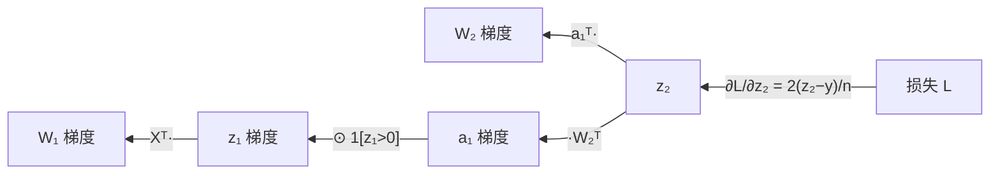

# MATH-804 反向传播与链式法则

## 1. 知识概览

| 项 | 内容 |
|---|---|
| 知识 ID | `MATH-804` |
| 英文名称 | Backpropagation and the Chain Rule |
| 所属模块 | M-MATH-07 机器学习数学应用 |
| 难度等级 | L3 推导 |
| 前置知识 | [[MATH-803 神经网络前向传播]]、[[MATH-122 求导法则与链式法则]] |
| 所属知识体系 | 计算图 → 局部梯度 → 反向累加 → 参数更新 |
| **AI 应用场景** | 一切深度学习训练的核心算法；`loss.backward()` 的内部机制 |
| **预计学习时间** | 60 分钟 |

**为什么学它**：框架替你算梯度，但**不懂反向传播就调不动模型**。这一篇把"链式法则如何沿计算图反向累积"讲到底，并用**数值梯度对拍**证明公式没错。

## 2. 直观理解

反向传播 = **从损失出发，把责任一层层往回分**。

类比：产品出问题（loss 大），要追责：

- 最终质检（输出层）有多大责任？
- 它的问题有多少来自上一道工序（隐藏层）？
- 再往上一层层传。

**每层的梯度 = 下游传来的梯度 × 本层的局部导数**。这就是链式法则。

## 3. 正式数学定义

**前向**（两层，MSE 损失）

$$
z_1 = XW_1,\quad a_1=\text{ReLU}(z_1),\quad z_2=a_1W_2,\quad L=\frac1n\|z_2-y\|^2
$$

**反向**（从后往前）

$$
\frac{\partial L}{\partial z_2} = \frac{2}{n}(z_2-y)
$$

$$
\frac{\partial L}{\partial W_2} = a_1^T\frac{\partial L}{\partial z_2}
$$

$$
\frac{\partial L}{\partial a_1} = \frac{\partial L}{\partial z_2}W_2^T
$$

$$
\frac{\partial L}{\partial z_1} = \frac{\partial L}{\partial a_1}\odot\mathbb{1}[z_1>0]
$$

$$
\frac{\partial L}{\partial W_1} = X^T\frac{\partial L}{\partial z_1}
$$

**关键形状**：$\partial L/\partial W_l$ 与 $W_l$ **形状相同**。

**计算图与拓扑序**：反向必须按拓扑序（输出→输入），因为每个节点的梯度依赖下游全部梯度。

## 4. 数学推导

### 4.1 为什么 $\partial L/\partial W_2 = a_1^T \partial L/\partial z_2$

**起点**：$z_2=a_1W_2$，即 $z_{2}[i,j]=\sum_k a_1[i,k]W_2[k,j]$。

**第 1 步**：对单个元素求偏导

$$
\frac{\partial z_2[i,j]}{\partial W_2[k,j]} = a_1[i,k]
$$

**第 2 步**：用链式法则累加

$$
\frac{\partial L}{\partial W_2[k,j]} = \sum_i \frac{\partial L}{\partial z_2[i,j]}\cdot a_1[i,k]
$$

**第 3 步**：写成矩阵形式——对 $i$ 求和就是"$a_1$ 的列 × 梯度的列"

$$
\frac{\partial L}{\partial W_2} = a_1^T\frac{\partial L}{\partial z_2}
$$

**结论**：形状 $(k,n)\times(n,m)=(k,m)$，与 $W_2$ 一致 ✓

### 4.2 为什么 ReLU 的反向是"掩码乘法"

**起点**：$a_1=\text{ReLU}(z_1)=\max(0,z_1)$。

**第 1 步**：逐元素求导

$$
\frac{\partial a_1[i,k]}{\partial z_1[i,k]} = \begin{cases}1, & z_1[i,k]>0\\ 0, & z_1[i,k]\le0\end{cases}
$$

**第 2 步**：链式法则按元素相乘

$$
\frac{\partial L}{\partial z_1} = \frac{\partial L}{\partial a_1}\odot\mathbb{1}[z_1>0]
$$

**第 3 步**：若 $z_1\le0$，该神经元梯度直接归零——**它不再学习**（死亡 ReLU）。

**结论**：**激活函数的导数是一个"开关"**，决定梯度能不能流过。

## 5. 几何直观与图解



```text
前向：  X → z₁ → a₁ → z₂ → L
反向：  X ← z₁ ← a₁ ← z₂ ← L
        每步乘上"局部导数"
```

## 6. 计算示例

**例**：$n=5$、输入 2 维、隐藏 3 维、输出 1 维，MSE 损失。

用随机初始化的 $W_1$、$W_2$ 计算：

- 前向损失 $L\approx1.878142$。
- 解析梯度 $\partial L/\partial W_2$：

$$
\begin{bmatrix}0.576365\\ 0.715872\\ 0.343827\end{bmatrix}
$$

- 数值梯度（中心差分，$\epsilon=10^{-6}$）得到**完全相同**的三行。

**最大差异 = 0.0**（在 8 位小数精度内）。

**这说明**：手推的反向传播公式与"真实导数"一致，不是近似。

## 7. Python 辅助验证

**依赖**：NumPy 2.5.4。

```powershell
python math804_backprop.py
```

```python
import numpy as np

rng = np.random.default_rng(0)
X = rng.normal(size=(5, 2))
y = rng.normal(size=5)
W1 = rng.normal(size=(2, 3))
W2 = rng.normal(size=(3, 1))


def forward(A, B):
    z1 = X @ A
    a1 = np.maximum(z1, 0)
    z2 = a1 @ B
    loss = float(((z2.ravel() - y) ** 2).mean())
    return loss, z1, a1, z2


loss, z1, a1, z2 = forward(W1, W2)

# 解析梯度
d2 = 2 * (z2.ravel() - y) / len(y)
dW2 = a1.T @ d2.reshape(-1, 1)
da1 = d2.reshape(-1, 1) @ W2.T
dz1 = da1 * (z1 > 0)
dW1 = X.T @ dz1

print("loss:", round(loss, 6))
print("解析 dW2:", dW2.round(6).tolist())

# 数值梯度
eps = 1e-6
num = np.zeros_like(W2)
for i in range(W2.shape[0]):
    for j in range(W2.shape[1]):
        Wp, Wm = W2.copy(), W2.copy()
        Wp[i, j] += eps
        Wm[i, j] -= eps
        num[i, j] = (forward(W1, Wp)[0] - forward(W1, Wm)[0]) / (2 * eps)

print("数值 dW2:", num.round(6).tolist())
print("最大差异:", round(float(np.abs(dW2 - num).max()), 8))
```

**实际运行结果**

```
loss: 1.878142
解析 dW2: [[0.576365], [0.715872], [0.343827]]
数值 dW2: [[0.576365], [0.715872], [0.343827]]
最大差异: 0.0
```

**代码解析**

- 解析梯度由 5 行公式直接算出；数值梯度用"扰动一个参数，看 loss 变化"的笨办法。
- 两者完全一致，**证明反向传播公式正确**。
- 数值梯度慢（每个参数要两次前向），只用于**调试验证**，实际训练用解析梯度。
- ReLU 的掩码 `(z1 > 0)` 是关键：负数位置梯度被清零。

## 8. 知识关联

| 类型 | 链接 |
|---|---|
| 前置数学 | [[MATH-803 神经网络前向传播]]、[[MATH-122 求导法则与链式法则]]、[[MATH-126 偏导数与梯度]] |
| 后续数学 | `MATH-805 Softmax 与交叉熵`（待建）、`MATH-806 PCA 数学原理`（待建） |
| 相关 Python | [[PY-066 矩阵运算]]、[[PY-064 广播机制]] |
| 相关机器学习 | 待关联（梯度检验） |
| 相关深度学习 | 待关联（autograd、计算图优化、梯度累积） |
| 相关大语言模型 | 待关联（Transformer 反向传播、激活重计算） |

## 9. 实战练习

**基础 1**：$z_2$ 的梯度是 $\frac2n(z_2-y)$，其中 $\frac2n$ 从哪来？

**基础 2**：ReLU 层若 $z_1=(-1,2,-3)$，反向时哪些位置梯度被清零？

**进阶 1**：为什么 $\partial L/\partial W_1$ 里用的是 $X^T$ 而不是 $X$？

**综合 1**：数值梯度与解析梯度差多少才算"通过"？为什么实际训练不用数值梯度？

## 10. 参考答案

> [!success]- 基础 1
> 来自 MSE 的求导：$\frac1n\sum(z-y)^2$ 对 $z$ 求导得 $\frac{2}{n}(z-y)$。
>
> $2$ 来自平方的导数，$\frac1n$ 来自均值。

> [!success]- 基础 2
> 掩码 $\mathbb{1}[z_1>0]=(0,1,0)$，所以第 1、3 个位置梯度清零，**只有第 2 个位置有梯度**。

> [!success]- 进阶 1
> 因为 $z_1=XW_1$，对 $W_1$ 求导时 $X$ 在"前"。
>
> 与 $\partial L/\partial W_2=a_1^T\partial L/\partial z_2$ 同理：**前向的输入转置 × 梯度**。

> [!success]- 综合 1
> 常用判据：相对误差 $<10^{-6}$（float64）或 $<10^{-4}$（float32）。
>
> 数值梯度每个参数需 2 次前向，参数量百万时要跑两百万次前向——**慢到不可用**。它只用于单元测试/梯度检验。

## 11. 常见错误

| 类型 | 错误表现 | 原因 | 纠正 |
|---|---|---|---|
| 公式错误 | 忘记转置 | 矩阵维度不匹配 | 前向输入转置 |
| 概念错误 | 用 `loss.backward()` 后不 `zero_grad` | 梯度累积 | 每次迭代清零 |
| 计算错误 | ReLU 反向不看 $z$ 符号 | 用了 $a$ 的值 | 看 $z_1>0$ |
| 概念错误 | 认为反向传播是"另一种求导法" | 本质就是链式法则 | 只是高效实现 |
| 实践错误 | 改模型后不做梯度检验 | 隐藏 bug | 小规模时对拍一次 |

## 12. 学习记录

| 日期 | 状态 | 掌握程度 | 复习状态 | 学习笔记 | 关联练习 |
|---|---|---|---|---|---|
| — | planned | — | — | — | 练习 1–4 |

---

## 🔗 Notion 同步信息

> 以下内容由 Notion「AI Knowledge System · 知识点」数据库按知识 ID 合并而来（导出于 2026-11-09）。

| 属性 | 值 |
|---|---|
| 学科 | 数学 |
| 学习状态 | 未开始 |
| 难度 | L3 推导 |
| 知识类型 | Application |

- **所属模块**：[M-MATH-07 机器学习数学应用](../%E8%AF%BE%E7%A8%8B%E6%A8%A1%E5%9D%97/M-MATH-07%20%E6%9C%BA%E5%99%A8%E5%AD%A6%E4%B9%A0%E6%95%B0%E5%AD%A6%E5%BA%94%E7%94%A8.md)
- **前置知识**：[MATH-803 神经网络前向传播](MATH-803%20%E7%A5%9E%E7%BB%8F%E7%BD%91%E7%BB%9C%E5%89%8D%E5%90%91%E4%BC%A0%E6%92%AD.md)
- **后继知识**：[MATH-805 Softmax 与交叉熵](MATH-805%20Softmax%20%E4%B8%8E%E4%BA%A4%E5%8F%89%E7%86%B5.md)
- **关联Python**：[PY-066 矩阵运算](../../01_Python%E5%9F%BA%E7%A1%80/08%20NumPy/PY-066%20%E7%9F%A9%E9%98%B5%E8%BF%90%E7%AE%97.md)
- **关联数学**：[MATH-803 神经网络前向传播](MATH-803%20%E7%A5%9E%E7%BB%8F%E7%BD%91%E7%BB%9C%E5%89%8D%E5%90%91%E4%BC%A0%E6%92%AD.md)
- **被引用为数学**：[MATH-805 Softmax 与交叉熵](MATH-805%20Softmax%20%E4%B8%8E%E4%BA%A4%E5%8F%89%E7%86%B5.md) · [DL-018 计算图](../../04_%E6%B7%B1%E5%BA%A6%E5%AD%A6%E4%B9%A0/01%20%E7%A5%9E%E7%BB%8F%E7%BD%91%E7%BB%9C%E5%9F%BA%E7%A1%80/DL-018%20%E8%AE%A1%E7%AE%97%E5%9B%BE.md) · [DL-019 梯度的含义与链式法则](../../04_%E6%B7%B1%E5%BA%A6%E5%AD%A6%E4%B9%A0/01%20%E7%A5%9E%E7%BB%8F%E7%BD%91%E7%BB%9C%E5%9F%BA%E7%A1%80/DL-019%20%E6%A2%AF%E5%BA%A6%E7%9A%84%E5%90%AB%E4%B9%89%E4%B8%8E%E9%93%BE%E5%BC%8F%E6%B3%95%E5%88%99.md) · [DL-020 反向传播：单神经元手算](../../04_%E6%B7%B1%E5%BA%A6%E5%AD%A6%E4%B9%A0/01%20%E7%A5%9E%E7%BB%8F%E7%BD%91%E7%BB%9C%E5%9F%BA%E7%A1%80/DL-020%20%E5%8F%8D%E5%90%91%E4%BC%A0%E6%92%AD%E2%80%94%E2%80%94%E5%8D%95%E7%A5%9E%E7%BB%8F%E5%85%83%E6%89%8B%E7%AE%97.md) · [DL-021 多层网络的反向传播](../../04_%E6%B7%B1%E5%BA%A6%E5%AD%A6%E4%B9%A0/01%20%E7%A5%9E%E7%BB%8F%E7%BD%91%E7%BB%9C%E5%9F%BA%E7%A1%80/DL-021%20%E5%A4%9A%E5%B1%82%E7%BD%91%E7%BB%9C%E7%9A%84%E5%8F%8D%E5%90%91%E4%BC%A0%E6%92%AD.md) · [DL-022 梯度消失与梯度爆炸](../../04_%E6%B7%B1%E5%BA%A6%E5%AD%A6%E4%B9%A0/01%20%E7%A5%9E%E7%BB%8F%E7%BD%91%E7%BB%9C%E5%9F%BA%E7%A1%80/DL-022%20%E6%A2%AF%E5%BA%A6%E6%B6%88%E5%A4%B1%E4%B8%8E%E6%A2%AF%E5%BA%A6%E7%88%86%E7%82%B8.md) · [DL-048 ResNet 与 Skip Connection](../../04_%E6%B7%B1%E5%BA%A6%E5%AD%A6%E4%B9%A0/02%20CNN/DL-048%20ResNet%20%E4%B8%8E%20Skip%20Connection.md) · [DL-052 BPTT 与梯度问题](../../04_%E6%B7%B1%E5%BA%A6%E5%AD%A6%E4%B9%A0/03%20RNN%E4%B8%8E%E5%BA%8F%E5%88%97%E6%A8%A1%E5%9E%8B/DL-052%20BPTT%20%E4%B8%8E%E6%A2%AF%E5%BA%A6%E9%97%AE%E9%A2%98.md) · [DL-053 LSTM 与门控机制](../../04_%E6%B7%B1%E5%BA%A6%E5%AD%A6%E4%B9%A0/03%20RNN%E4%B8%8E%E5%BA%8F%E5%88%97%E6%A8%A1%E5%9E%8B/DL-053%20LSTM%20%E4%B8%8E%E9%97%A8%E6%8E%A7%E6%9C%BA%E5%88%B6.md) · [DL-054 GRU](../../04_%E6%B7%B1%E5%BA%A6%E5%AD%A6%E4%B9%A0/03%20RNN%E4%B8%8E%E5%BA%8F%E5%88%97%E6%A8%A1%E5%9E%8B/DL-054%20GRU.md) · [DL-055 RNN/LSTM/GRU 对比与序列任务实战](../../04_%E6%B7%B1%E5%BA%A6%E5%AD%A6%E4%B9%A0/03%20RNN%E4%B8%8E%E5%BA%8F%E5%88%97%E6%A8%A1%E5%9E%8B/DL-055%20RNN%E3%80%81LSTM%E3%80%81GRU%20%E5%AF%B9%E6%AF%94%E4%B8%8E%E5%BA%8F%E5%88%97%E4%BB%BB%E5%8A%A1%E5%AE%9E%E6%88%98.md) · [DL-066 训练调试：不收敛与过拟合排查](../../04_%E6%B7%B1%E5%BA%A6%E5%AD%A6%E4%B9%A0/07%20%E5%B7%A5%E7%A8%8B%E4%B8%8E%E9%A1%B9%E7%9B%AE/DL-066%20%E8%AE%AD%E7%BB%83%E8%B0%83%E8%AF%95%E2%80%94%E2%80%94%E4%B8%8D%E6%94%B6%E6%95%9B%E4%B8%8E%E8%BF%87%E6%8B%9F%E5%90%88%E6%8E%92%E6%9F%A5.md)
