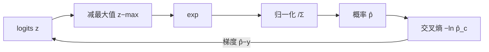

# MATH-805 Softmax 与交叉熵

## 1. 知识概览

| 项 | 内容 |
|---|---|
| 知识 ID | `MATH-805` |
| 英文名称 | Softmax and Cross-Entropy |
| 所属模块 | M-MATH-07 机器学习数学应用 |
| 难度等级 | L3 推导 |
| 前置知识 | [[MATH-804 反向传播与链式法则]]、[[MATH-507 交叉熵与 KL 散度]] |
| 所属知识体系 | logits → Softmax → 概率 → 交叉熵 → 梯度 |
| **AI 应用场景** | 多分类输出层、语言模型的下一个 token 分布、注意力权重 |
| **预计学习时间** | 55 分钟 |

**为什么学它**：**语言模型的输出层就是 Softmax**。它把任意实数打分变成概率分布，交叉熵衡量预测与真实标签的差距。理解数值稳定的写法（减最大值）是工程必备。

## 2. 直观理解

Softmax 是"**把打分变成比例**"：

- 打分 $(2,\ 1,\ 0.1)$ → 概率 $(0.66,\ 0.24,\ 0.10)$。
- 打分差距越大，概率越集中。

**关键性质**：所有输出为正且和为 1——正好是概率分布。

**为什么减最大值**：$e^{1000}$ 会溢出成 `inf`。但 Softmax 对"整体平移"不变，所以先把每个打分减去最大值，数学上等价，数值上安全。

## 3. 正式数学定义

**Softmax**

$$
\text{softmax}(z)_i = \frac{e^{z_i}}{\sum_{j=1}^{K}e^{z_j}}
$$

**平移不变性**

$$
\text{softmax}(z + c\mathbf{1}) = \text{softmax}(z)
$$

**多分类交叉熵**（真实标签 $y$ 为 one-hot）

$$
L = -\sum_{i=1}^{K}y_i\ln\hat p_i
$$

若真实类别为 $c$（one-hot），则 $L=-\ln\hat p_c$。

**梯度**

$$
\frac{\partial L}{\partial z_i} = \hat p_i - y_i
$$

**Softmax 的 Jacobian**

$$
\frac{\partial \hat p_i}{\partial z_j} = \hat p_i(\delta_{ij}-\hat p_j)
$$

## 4. 数学推导

### 4.1 为什么梯度是 $\hat p - y$（多分类版）

**起点**：$L=-\sum_k y_k\ln\hat p_k$，$\hat p_k=\dfrac{e^{z_k}}{\sum_j e^{z_j}}$。

**第 1 步**：先算 $\dfrac{\partial \hat p_k}{\partial z_i}$。分两种情况：

- $k=i$：分子求导得 $\hat p_i$ 自身，得 $\hat p_i(1-\hat p_i)$。
- $k\neq i$：分子不求导，只对分母求导，得 $-\hat p_k\hat p_i$。

合并即 $\dfrac{\partial \hat p_k}{\partial z_i}=\hat p_k(\delta_{ki}-\hat p_i)$。

**第 2 步**：对 $L$ 求导（链式法则）

$$
\frac{\partial L}{\partial z_i} = -\sum_k \frac{y_k}{\hat p_k}\cdot\hat p_k(\delta_{ki}-\hat p_i)
$$

**第 3 步**：约掉 $\hat p_k$

$$
= -\sum_k y_k(\delta_{ki}-\hat p_i) = -y_i + \hat p_i\sum_k y_k
$$

**第 4 步**：因 one-hot 满足 $\sum_k y_k=1$

$$
\frac{\partial L}{\partial z_i} = \hat p_i - y_i
$$

**结论**：**与二分类的 $p-y$ 完全同形**。这是交叉熵 + Softmax 组合的经典结果。

### 4.2 减最大值为什么等价

**起点**：设 $m=\max_j z_j$，令 $z'_i=z_i-m$。

**第 1 步**：代入 Softmax

$$
\frac{e^{z_i-m}}{\sum_j e^{z_j-m}} = \frac{e^{z_i}e^{-m}}{\sum_j e^{z_j}e^{-m}}
$$

**第 2 步**：分子分母同约去 $e^{-m}$

$$
= \frac{e^{z_i}}{\sum_j e^{z_j}}
$$

**结论**：结果完全相同，但 $z'_i\le0$，$e^{z'_i}\in(0,1]$，**不会溢出**。

## 5. 几何直观与图解



```text
z=(2,1,0.1) → p=(0.659, 0.242, 0.099)
差距大 → 概率更集中（接近 one-hot）
差距小 → 概率更均匀（接近均匀分布）
```

## 6. 计算示例

**例 1**：$z=(2.0,\ 1.0,\ 0.1)$。

**第 1 步**：减最大值 2.0 得 $(0,\ -1,\ -1.9)$。

**第 2 步**：取指数 $(1,\ 0.367879,\ 0.149569)$，和为 $1.517448$。

**第 3 步**：归一化

$$
\hat p = (0.659001,\ 0.242433,\ 0.098566)
$$

**第 4 步**：真实类别为第 2 类（下标 1），损失

$$
L = -\ln 0.242433 \approx 1.41703
$$

**第 5 步**：梯度 $\hat p - y=(0.659001,\ -0.757567,\ 0.098566)$。

**例 2（溢出验证）**：$z=(1000,\ 1001)$。

- 直接 `np.exp` 得 `[inf, inf]`。
- 减最大值后 Softmax 得 $(0.268941,\ 0.731059)$，和仍为 1。

## 7. Python 辅助验证

**依赖**：NumPy 2.5.4 + `math`。

```powershell
python math805_softmax.py
```

```python
import math

import numpy as np


def softmax(z):
    z = np.asarray(z, dtype=float)
    z = z - z.max()          # 数值稳定
    e = np.exp(z)
    return e / e.sum()


z = np.array([2.0, 1.0, 0.1])
p = softmax(z)
print("softmax:", p.round(6).tolist(), " 和:", round(float(p.sum()), 10))

big = np.array([1000.0, 1001.0])
print("直接 exp:", np.exp(big).tolist())
print("稳定版:", softmax(big).round(6).tolist())

y = np.array([0.0, 1.0, 0.0])
print("交叉熵:", round(-math.log(p[1]), 6))
print("梯度 p-y:", (p - y).round(6).tolist())
```

**实际运行结果**

```
softmax: [0.659001, 0.242433, 0.098566]  和: 1.0
直接 exp: [inf, inf]
稳定版: [0.268941, 0.731059]
交叉熵: 1.41703
梯度 p-y: [0.659001, -0.757567, 0.098566]
```

**代码解析**

- 概率和精确为 1.0，验证归一化正确。
- 直接 `exp(1000)` 溢出成 `inf`，减最大值后正常——**这就是工程上必须减最大值的原因**。
- 交叉熵 $1.417$ 与手算一致。
- 梯度只有真实类别位置为负（$-0.7576$），其余为正，方向正确。

## 8. 知识关联

| 类型 | 链接 |
|---|---|
| 前置数学 | [[MATH-804 反向传播与链式法则]]、[[MATH-507 交叉熵与 KL 散度]]、[[MATH-003 指数、根式与对数]] |
| 后续数学 | `MATH-806 PCA 数学原理`、`MATH-807 贝叶斯分类` |
| 相关 Python | [[PY-067 聚合与统计]]、[[PY-064 广播机制]] |
| 相关机器学习 | 待关联（多分类、类别不平衡、label smoothing） |
| 相关深度学习 | 待关联（输出层、蒸馏温度） |
| 相关大语言模型 | 待关联（下一个 token 分布、采样策略、困惑度） |

## 9. 实战练习

**基础 1**：$z=(0,0,0)$，Softmax 输出是什么？

**基础 2**：$z=(1,2)$，求 Softmax 概率（4 位小数）。

**进阶 1**：为什么 Softmax 对"整体加常数"不变？这带来了什么工程好处？

**综合 1**：某模型输出 $z=(3,1,-1)$，真实类别是第 1 类。求交叉熵损失与梯度。

## 10. 参考答案

> [!success]- 基础 1
> 三项相等，均为 $\frac13\approx0.3333$。
>
> 说明"打分完全相同"时模型不偏好任何类别。

> [!success]- 基础 2
> $$e^1=2.71828,\ e^2=7.38906,\ \text{和}=10.10734$$
>
> $$p=(0.2689,\ 0.7311)$$

> [!success]- 进阶 1
> $$\frac{e^{z_i+c}}{\sum e^{z_j+c}}=\frac{e^{c}e^{z_i}}{e^{c}\sum e^{z_j}}=\frac{e^{z_i}}{\sum e^{z_j}}$$
>
> 好处：可以任意平移数值范围，从而**减去最大值避免溢出**，而不改变计算结果。

> [!success]- 综合 1
> 先算 Softmax：$e^3=20.0855$、$e^1=2.7183$、$e^{-1}=0.3679$，和 $23.1717$。
>
> $$p=(0.8668,\ 0.1173,\ 0.0159)$$
>
> 损失：$L=-\ln0.8668\approx0.1429$。
>
> 梯度：$p-y=(0.8668-1,\ 0.1173,\ 0.0159)=(-0.1332,\ 0.1173,\ 0.0159)$。

## 11. 常见错误

| 类型 | 错误表现 | 原因 | 纠正 |
|---|---|---|---|
| 实践错误 | 直接 `exp(z)` 不减最大值 | 溢出 | 先减 `z.max()` |
| 概念错误 | 多分类用 Sigmoid | 输出不归一 | 用 Softmax |
| 计算错误 | 梯度写成 $\hat p$ 或 $y$ | 漏减 | $\hat p-y$ |
| 概念错误 | 认为 Softmax 输出"置信度" | 可能是过度自信 | 需校准（temperature） |
| 计算错误 | 交叉熵用 $\log_{10}$ | 底数混淆 | 用 $\ln$ |

## 12. 学习记录

| 日期 | 状态 | 掌握程度 | 复习状态 | 学习笔记 | 关联练习 |
|---|---|---|---|---|---|
| — | planned | — | — | — | 练习 1–4 |

---

## 🔗 Notion 同步信息

> 以下内容由 Notion「AI Knowledge System · 知识点」数据库按知识 ID 合并而来（导出于 2026-11-09）。

| 属性 | 值 |
|---|---|
| 学科 | 数学 |
| 学习状态 | 未开始 |
| 难度 | L3 推导 |
| 知识类型 | Application |

- **所属模块**：[M-MATH-07 机器学习数学应用](../%E8%AF%BE%E7%A8%8B%E6%A8%A1%E5%9D%97/M-MATH-07%20%E6%9C%BA%E5%99%A8%E5%AD%A6%E4%B9%A0%E6%95%B0%E5%AD%A6%E5%BA%94%E7%94%A8.md)
- **前置知识**：[MATH-804 反向传播与链式法则](MATH-804%20%E5%8F%8D%E5%90%91%E4%BC%A0%E6%92%AD%E4%B8%8E%E9%93%BE%E5%BC%8F%E6%B3%95%E5%88%99.md)
- **后继知识**：[MATH-806 PCA 数学原理](MATH-806%20PCA%20%E6%95%B0%E5%AD%A6%E5%8E%9F%E7%90%86.md)
- **关联Python**：[PY-067 聚合与统计](../../01_Python%E5%9F%BA%E7%A1%80/08%20NumPy/PY-067%20%E8%81%9A%E5%90%88%E4%B8%8E%E7%BB%9F%E8%AE%A1.md)
- **关联数学**：[MATH-804 反向传播与链式法则](MATH-804%20%E5%8F%8D%E5%90%91%E4%BC%A0%E6%92%AD%E4%B8%8E%E9%93%BE%E5%BC%8F%E6%B3%95%E5%88%99.md)
- **被引用为数学**：[MATH-806 PCA 数学原理](MATH-806%20PCA%20%E6%95%B0%E5%AD%A6%E5%8E%9F%E7%90%86.md) · [ML-031 多分类策略](../../03_%E6%9C%BA%E5%99%A8%E5%AD%A6%E4%B9%A0/02%20%E7%9B%91%E7%9D%A3%E5%AD%A6%E4%B9%A0/ML-031%20%E5%A4%9A%E5%88%86%E7%B1%BB%E7%AD%96%E7%95%A5.md) · [DL-013 输出层设计与输出维度](../../04_%E6%B7%B1%E5%BA%A6%E5%AD%A6%E4%B9%A0/01%20%E7%A5%9E%E7%BB%8F%E7%BD%91%E7%BB%9C%E5%9F%BA%E7%A1%80/DL-013%20%E8%BE%93%E5%87%BA%E5%B1%82%E8%AE%BE%E8%AE%A1%E4%B8%8E%E8%BE%93%E5%87%BA%E7%BB%B4%E5%BA%A6.md) · [DL-014 损失函数总览与选择](../../04_%E6%B7%B1%E5%BA%A6%E5%AD%A6%E4%B9%A0/01%20%E7%A5%9E%E7%BB%8F%E7%BD%91%E7%BB%9C%E5%9F%BA%E7%A1%80/DL-014%20%E6%8D%9F%E5%A4%B1%E5%87%BD%E6%95%B0%E6%80%BB%E8%A7%88%E4%B8%8E%E9%80%89%E6%8B%A9.md) · [DL-016 二分类交叉熵](../../04_%E6%B7%B1%E5%BA%A6%E5%AD%A6%E4%B9%A0/01%20%E7%A5%9E%E7%BB%8F%E7%BD%91%E7%BB%9C%E5%9F%BA%E7%A1%80/DL-016%20%E4%BA%8C%E5%88%86%E7%B1%BB%E4%BA%A4%E5%8F%89%E7%86%B5.md) · [DL-017 多分类交叉熵与 Softmax](../../04_%E6%B7%B1%E5%BA%A6%E5%AD%A6%E4%B9%A0/01%20%E7%A5%9E%E7%BB%8F%E7%BD%91%E7%BB%9C%E5%9F%BA%E7%A1%80/DL-017%20%E5%A4%9A%E5%88%86%E7%B1%BB%E4%BA%A4%E5%8F%89%E7%86%B5%E4%B8%8E%20Softmax.md) · [DL-020 反向传播：单神经元手算](../../04_%E6%B7%B1%E5%BA%A6%E5%AD%A6%E4%B9%A0/01%20%E7%A5%9E%E7%BB%8F%E7%BD%91%E7%BB%9C%E5%9F%BA%E7%A1%80/DL-020%20%E5%8F%8D%E5%90%91%E4%BC%A0%E6%92%AD%E2%80%94%E2%80%94%E5%8D%95%E7%A5%9E%E7%BB%8F%E5%85%83%E6%89%8B%E7%AE%97.md) · [DL-061 损失函数与优化器 API](../../04_%E6%B7%B1%E5%BA%A6%E5%AD%A6%E4%B9%A0/06%20PyTorch/DL-061%20%E6%8D%9F%E5%A4%B1%E5%87%BD%E6%95%B0%E4%B8%8E%E4%BC%98%E5%8C%96%E5%99%A8%20API.md) · [LLM-003 神经语言模型：RNN 与 Seq2Seq](../../05_%E5%A4%A7%E8%AF%AD%E8%A8%80%E6%A8%A1%E5%9E%8B/01%20NLP%E5%9F%BA%E7%A1%80/LLM-003%20%E7%A5%9E%E7%BB%8F%E8%AF%AD%E8%A8%80%E6%A8%A1%E5%9E%8B%E2%80%94%E2%80%94RNN%20%E4%B8%8E%20Seq2Seq.md) · [LLM-014 Softmax 在 Attention 中的作用](../../05_%E5%A4%A7%E8%AF%AD%E8%A8%80%E6%A8%A1%E5%9E%8B/03%20Attention%E6%9C%BA%E5%88%B6/LLM-014%20Softmax%20%E5%9C%A8%20Attention%20%E4%B8%AD%E7%9A%84%E4%BD%9C%E7%94%A8.md) · [LLM-088 自回归推理的基本流程](../../05_%E5%A4%A7%E8%AF%AD%E8%A8%80%E6%A8%A1%E5%9E%8B/06%20%E6%8E%A8%E7%90%86%E4%B8%8E%E9%83%A8%E7%BD%B2/LLM-088%20%E8%87%AA%E5%9B%9E%E5%BD%92%E6%8E%A8%E7%90%86%E7%9A%84%E5%9F%BA%E6%9C%AC%E6%B5%81%E7%A8%8B.md) · [LLM-092 采样策略：温度、Top-K、Top-P](../../05_%E5%A4%A7%E8%AF%AD%E8%A8%80%E6%A8%A1%E5%9E%8B/06%20%E6%8E%A8%E7%90%86%E4%B8%8E%E9%83%A8%E7%BD%B2/LLM-092%20%E9%87%87%E6%A0%B7%E7%AD%96%E7%95%A5%EF%BC%9A%E6%B8%A9%E5%BA%A6%E3%80%81Top-K%E3%80%81Top-P.md)
