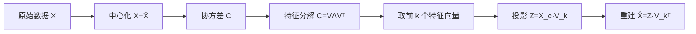

# MATH-806 PCA 数学原理

## 1. 知识概览

| 项 | 内容 |
|---|---|
| 知识 ID | `MATH-806` |
| 英文名称 | The Mathematics of PCA |
| 所属模块 | M-MATH-07 机器学习数学应用 |
| 难度等级 | L3 推导 |
| 前置知识 | [[MATH-805 Softmax 与交叉熵]]、[[MATH-223 特征值与特征向量]]、[[MATH-224 SVD 与低秩近似]] |
| 所属知识体系 | 中心化 → 协方差 → 特征分解 → 投影 |
| **AI 应用场景** | 降维、可视化、去噪、白化、特征压缩；Embedding 的 PCA 可视化 |
| **预计学习时间** | 55 分钟 |

**为什么学它**：PCA 是**特征分解最经典的应用**。它也解释了"为什么降维能去噪"——方差小的方向主要是噪声。理解它，就理解了"信息量 = 方差"这个直觉。

## 2. 直观理解

高维数据往往"挤在"少数几个方向上。

- 一群人的身高体重：两个变量高度相关，其实主要差异在"整体大小"一个方向上。
- PCA 就是**找到数据变化最大的那几个方向**，用它们重新描述数据。

**降维的本质**：舍弃方差小的方向。丢掉的信息量 = 丢掉的方差。

## 3. 正式数学定义

**中心化**：$X_c = X - \bar X$（每列减均值）。

**协方差矩阵**

$$
C = \frac{1}{n-1}X_c^TX_c \in \mathbb{R}^{d\times d}
$$

**特征分解**

$$
C = V\Lambda V^T, \qquad \Lambda = \operatorname{diag}(\lambda_1\ge\lambda_2\ge\cdots\ge\lambda_d)
$$

**主成分**：$V$ 的列，按对应特征值降序排列。

**投影（降到 $k$ 维）**

$$
Z = X_c V_{:,:k}
$$

**重建**

$$
\hat X = Z V_{:,:k}^T + \bar X
$$

**解释方差比**

$$
r_k = \frac{\sum_{i=1}^{k}\lambda_i}{\sum_{i=1}^{d}\lambda_i}
$$

**与 SVD 的关系**：若 $X_c=U\Sigma V^T$，则 $C=\frac{1}{n-1}V\Sigma^2V^T$，即 $\lambda_i=\dfrac{\sigma_i^2}{n-1}$。

## 4. 数学推导

### 4.1 为什么"最大方差方向"是协方差矩阵的特征向量

**起点**：要找单位向量 $v$（$\|v\|=1$），使投影 $X_cv$ 的方差最大。

**第 1 步**：投影后的方差

$$
\operatorname{Var}(X_cv) = \frac{1}{n-1}\|X_cv\|^2 = v^T\left(\frac{X_c^TX_c}{n-1}\right)v = v^TCv
$$

**第 2 步**：于是问题变成约束优化

$$
\max_v\ v^TCv \quad \text{s.t. } \|v\|=1
$$

**第 3 步**：拉格朗日函数

$$
\mathcal{L} = v^TCv - \lambda(v^Tv-1)
$$

**第 4 步**：对 $v$ 求导并令 0（$C$ 对称）

$$
2Cv - 2\lambda v = 0 \;\Longrightarrow\; Cv = \lambda v
$$

**第 5 步**：这正是特征值方程。代回目标函数

$$
v^TCv = v^T(\lambda v) = \lambda
$$

**结论**：**方差最大值就是最大特征值，对应方向就是最大特征向量**。依次取第二、第三大特征值即得后续主成分。

### 4.2 为什么主成分互相正交

**起点**：$C$ 是实对称矩阵。

**第 1 步**：实对称矩阵属于不同特征值的特征向量必然正交。

**第 2 步**：即使有重根，也可通过 Gram-Schmidt 正交化。

**第 3 步**：所以 $V$ 是正交矩阵，$V^TV=I$。

**结论**：**主成分是一组正交基**，信息不重复——这正是"降维不丢重复信息"的数学保证。

## 5. 几何直观与图解



```text
原始数据云（斜椭圆）：
      ╱
    ╱ ●●●
   ╱ ●●●●●    长轴 = 第一主成分（方差大）
  ╱  ●●●●●    短轴 = 第二主成分（方差小，可丢弃）
```

## 6. 计算示例

**例**：500 个二维样本，由 $[[2,1],[0,0.5]]$ 线性变换生成后中心化。

**第 1 步**：协方差矩阵特征值

$$
\lambda_1 \approx 4.9099,\qquad \lambda_2 \approx 0.1854
$$

**第 2 步**：解释方差比

$$
(0.9636,\ 0.0364)
$$

**第 3 步**：只保留第一主成分（$k=1$）

- 累计解释方差 **96.36%**
- 降到 $(500,1)$ 维
- 重建的均方误差约 **0.0925**

**读法**：只用一个方向就保住了 96% 的信息，重建误差很小——说明数据确实是"低维结构"。

## 7. Python 辅助验证

**依赖**：NumPy 2.5.4。

```powershell
python math806_pca.py
```

```python
import numpy as np

rng = np.random.default_rng(0)
X = rng.normal(size=(500, 2)) @ np.array([[2.0, 1.0], [0.0, 0.5]])
X = X - X.mean(axis=0)                     # 中心化

C = X.T @ X / (len(X) - 1)                 # 协方差
vals, vecs = np.linalg.eigh(C)             # 对称矩阵用 eigh
order = np.argsort(vals)[::-1]             # 降序
vals, vecs = vals[order], vecs[:, order]

print("特征值:", vals.round(4).tolist())
print("解释方差比:", (vals / vals.sum()).round(4).tolist())
print("前 1 个累计:", round(float((vals[:1] / vals.sum()).sum()), 4))

Z = X @ vecs[:, :1]
recon = Z @ vecs[:, :1].T
print("降维后形状:", Z.shape)
print("重建均方误差:", round(float(((X - recon) ** 2).mean()), 4))
```

**实际运行结果**

```
特征值: [4.9099, 0.1854]
解释方差比: [0.9636, 0.0364]
前 1 个累计: 0.9636
降维后形状: (500, 1)
重建均方误差: 0.0925
```

**代码解析**

- `eigh` 返回升序，需 `argsort[::-1]` 反转成降序。
- 第一个主成分解释了 96.36% 的方差，第二个几乎可丢。
- 重建误差 0.0925 约等于被丢弃的特征值 0.1854 的一半——量级合理。
- 中心化不能省：不减均值，第一主成分会被"均值方向"污染。

## 8. 知识关联

| 类型 | 链接 |
|---|---|
| 前置数学 | [[MATH-805 Softmax 与交叉熵]]、[[MATH-223 特征值与特征向量]]、[[MATH-224 SVD 与低秩近似]]、[[MATH-306 期望、方差与协方差]] |
| 后续数学 | `MATH-807 贝叶斯分类` |
| 相关 Python | [[PY-067 聚合与统计]]、[[PY-066 矩阵运算]] |
| 相关机器学习 | 待关联（降维、可视化、去噪） |
| 相关深度学习 | 待关联（白化、Embedding 压缩） |
| 相关大语言模型 | 待关联（表示空间的 PCA 分析） |

## 9. 实战练习

**基础 1**：中心化为什么是必须的？

**基础 2**：特征值 $(3,1)$，保留 1 个主成分的解释方差比是多少？

**进阶 1**：证明第一主成分方向使投影方差最大（写出拉格朗日推导关键两步）。

**综合 1**：10 维数据，前 3 个特征值之和占总和的 92%。降到 3 维会损失多少信息？能用什么指标衡量重建质量？

## 10. 参考答案

> [!success]- 基础 1
> PCA 找的是"数据围绕均值的变化方向"。不中心化时，均值本身会被当成最大方差方向，第一主成分变成"指向数据中心的向量"，失去意义。

> [!success]- 基础 2
> $$\frac{3}{3+1} = 0.75 = 75\%$$

> [!success]- 进阶 1
> 目标：$\max_v v^TCv$ s.t. $\|v\|=1$。
>
> 拉格朗日：$\mathcal{L}=v^TCv-\lambda(v^Tv-1)$。
>
> 求导令 0：$2Cv-2\lambda v=0\Rightarrow Cv=\lambda v$，即 $v$ 是特征向量，且 $v^TCv=\lambda$ 最大取 $\lambda_{max}$。

> [!success]- 综合 1
> 损失 **8%** 的方差（信息）。
>
> 衡量重建质量可用：
> 1. 重建均方误差 $\frac1n\|\hat X-X\|^2$；
> 2. 累计解释方差比（$1-r_k$ 即损失比）；
> 3. 下游任务指标（分类准确率是否下降）。

## 11. 常见错误

| 类型 | 错误表现 | 原因 | 纠正 |
|---|---|---|---|
| 实践错误 | 不中心化就做 PCA | 均值污染主成分 | 先减均值 |
| 实践错误 | 不标准化 | 量纲大的特征主导 | 视需求做 z-score |
| 计算错误 | 用 `eig` 而非 `eigh` | 可能返回复数 | 对称矩阵用 `eigh` |
| 概念错误 | 认为主成分越多越好 | 失去降维意义 | 按解释方差比选 $k$ |
| 概念错误 | 认为 PCA 能提升分类精度 | 它是无监督降维 | 可能丢判别信息（可用 LDA） |

## 12. 学习记录

| 日期 | 状态 | 掌握程度 | 复习状态 | 学习笔记 | 关联练习 |
|---|---|---|---|---|---|
| — | planned | — | — | — | 练习 1–4 |

---

## 🔗 Notion 同步信息

> 以下内容由 Notion「AI Knowledge System · 知识点」数据库按知识 ID 合并而来（导出于 2026-11-09）。

| 属性 | 值 |
|---|---|
| 学科 | 数学 |
| 学习状态 | 未开始 |
| 难度 | L3 推导 |
| 知识类型 | Application |

- **所属模块**：[M-MATH-07 机器学习数学应用](../%E8%AF%BE%E7%A8%8B%E6%A8%A1%E5%9D%97/M-MATH-07%20%E6%9C%BA%E5%99%A8%E5%AD%A6%E4%B9%A0%E6%95%B0%E5%AD%A6%E5%BA%94%E7%94%A8.md)
- **前置知识**：[MATH-805 Softmax 与交叉熵](MATH-805%20Softmax%20%E4%B8%8E%E4%BA%A4%E5%8F%89%E7%86%B5.md)
- **后继知识**：[MATH-807 贝叶斯分类](MATH-807%20%E8%B4%9D%E5%8F%B6%E6%96%AF%E5%88%86%E7%B1%BB.md)
- **关联Python**：[PY-067 聚合与统计](../../01_Python%E5%9F%BA%E7%A1%80/08%20NumPy/PY-067%20%E8%81%9A%E5%90%88%E4%B8%8E%E7%BB%9F%E8%AE%A1.md)
- **关联数学**：[MATH-805 Softmax 与交叉熵](MATH-805%20Softmax%20%E4%B8%8E%E4%BA%A4%E5%8F%89%E7%86%B5.md)
- **被引用为数学**：[MATH-807 贝叶斯分类](MATH-807%20%E8%B4%9D%E5%8F%B6%E6%96%AF%E5%88%86%E7%B1%BB.md) · [ML-038 PCA 降维](../../03_%E6%9C%BA%E5%99%A8%E5%AD%A6%E4%B9%A0/03%20%E6%97%A0%E7%9B%91%E7%9D%A3%E5%AD%A6%E4%B9%A0/ML-038%20PCA%20%E9%99%8D%E7%BB%B4.md)
