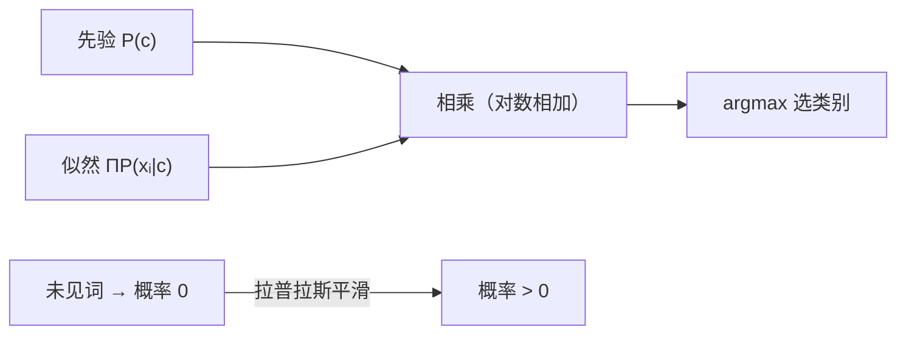

# MATH-807 贝叶斯分类

## 1. 知识概览

| 项 | 内容 |
|---|---|
| 知识 ID | `MATH-807` |
| 英文名称 | Bayesian Classification |
| 所属模块 | M-MATH-07 机器学习数学应用 |
| 难度等级 | L3 推导 |
| 前置知识 | [[MATH-806 PCA 数学原理]]、[[MATH-302 全概率与贝叶斯公式]] |
| 所属知识体系 | 贝叶斯公式 → 朴素假设 → 平滑 → 分类决策 |
| **AI 应用场景** | 文本分类（垃圾邮件）、情感分析、小样本分类、可解释性强的基线模型 |
| **预计学习时间** | 55 分钟 |

**为什么学它**：朴素贝叶斯是**"概率论直接变成算法"的最短路径**：贝叶斯公式 + 一个（不真实的）独立性假设。它训练极快、样本需求少，是文本分类的经典基线。

## 2. 直观理解

要判断一封邮件是不是垃圾邮件，用贝叶斯公式：

$$
P(\text{垃圾}\mid\text{词})\propto P(\text{词}\mid\text{垃圾})\cdot P(\text{垃圾})
$$

- **先验** $P(\text{垃圾})$：历史上垃圾邮件的比例。
- **似然** $P(\text{词}\mid\text{垃圾})$：垃圾邮件里出现这个词的频率。
- **后验**：看到这个词之后，判断是垃圾的概率。

**"朴素"在哪**：假设所有词**相互独立**。这显然不成立（"信用"和"卡"常一起出现），但**实际效果往往不错**。

## 3. 正式数学定义

**贝叶斯决策**

$$
\hat y = \arg\max_{c}\ P(c)\prod_{i=1}^{d}P(x_i\mid c)
$$

**对数形式**（防下溢）

$$
\hat y = \arg\max_{c}\left[\ln P(c)+\sum_{i=1}^{d}\ln P(x_i\mid c)\right]
$$

**参数估计（带拉普拉斯平滑）**

$$
P(x_i=v\mid c) = \frac{N_{c,v}+\alpha}{N_c+\alpha\cdot|V|}
$$

$\alpha=1$ 即拉普拉斯平滑，防止未出现过的词导致概率为 0。

**三种常见变体**

| 变体 | 似然假设 |
|---|---|
| 伯努利 NB | 词出现/不出现（二值） |
| 多项式 NB | 词频计数（文本常用） |
| 高斯 NB | 连续特征服从正态 |

## 4. 数学推导

### 4.1 从贝叶斯公式到分类器

**起点**：要算 $P(c\mid x_1,\dots,x_d)$。

**第 1 步**：贝叶斯公式

$$
P(c\mid \mathbf{x}) = \frac{P(\mathbf{x}\mid c)P(c)}{P(\mathbf{x})}
$$

**第 2 步**：分母 $P(\mathbf{x})$ 对所有类别相同，不影响比较大小（argmax）

$$
P(c\mid\mathbf{x}) \propto P(\mathbf{x}\mid c)P(c)
$$

**第 3 步**：**朴素假设**——在类别 $c$ 给定下，各特征条件独立

$$
P(\mathbf{x}\mid c) = \prod_{i=1}^{d}P(x_i\mid c)
$$

**第 4 步**：合并

$$
P(c\mid\mathbf{x}) \propto P(c)\prod_i P(x_i\mid c)
$$

**结论**：分类只需比较"先验 × 各特征似然之积"，无需算分母。

### 4.2 为什么要拉普拉斯平滑

**起点**：若某个词在训练集的类别 $c$ 中从未出现，则 $P(x_i\mid c)=0$。

**第 1 步**：连乘中有 0，整个乘积为 0

$$
P(c)\prod_j P(x_j\mid c) = 0
$$

**第 2 步**：一个未见过的词就"否决"了整个类别——**过拟合到训练集**。

**第 3 步**：加 $\alpha$ 后概率不为 0

$$
P(x_i=v\mid c) = \frac{N_{c,v}+\alpha}{N_c+\alpha|V|} > 0
$$

**第 4 步**：验算归一化（对 $v$ 求和）

$$
\sum_v\frac{N_{c,v}+\alpha}{N_c+\alpha|V|} = \frac{N_c+\alpha|V|}{N_c+\alpha|V|} = 1
$$

**结论**：平滑既避免零概率，又保持概率合法。

## 5. 几何直观与图解



```text
决策过程：
  邮件词 = [免费, 中奖, 点击]
  对每个类别 c：算 lnP(c) + Σ lnP(word|c)
  取分数最高的类别
```

## 6. 计算示例

**例**：8 条训练数据（天气、是否周末 → 是否打球）。

| 天气 | 周末 | 打球 |
|---|---|---|
| 晴 | 是 | 打 |
| 晴 | 否 | 打 |
| 阴 | 是 | 打 |
| 雨 | 否 | 不打 |
| 雨 | 是 | 不打 |
| 阴 | 否 | 打 |
| 晴 | 否 | 不打 |
| 雨 | 是 | 打 |

**第 1 步**：先验

$$
P(\text{打})=5/8=0.625,\qquad P(\text{不打})=3/8=0.375
$$

**第 2 步**：条件概率（$\alpha=1$，每个特征 3 个取值）

以"打"为例：

$$
P(\text{晴}\mid\text{打}) = \frac{2+1}{5+3} = 0.375,\qquad P(\text{是}\mid\text{打})=\frac{2+1}{5+3}=0.375
$$

**第 3 步**：计算未归一化后验（查询"晴 + 是"）

- 打：$0.625\times0.375\times0.375 = 0.0879$
- 不打：$0.375\times P(\text{晴}\mid\text{不打})\times P(\text{是}\mid\text{不打})$

其中 $P(\text{晴}\mid\text{不打})=\frac{0+1}{3+3}=0.1667$、$P(\text{是}\mid\text{不打})=\frac{1+1}{3+3}=0.3333$，得 $0.375\times0.1667\times0.3333=0.0208$。

**第 4 步**：归一化

$$
P(\text{打}\mid\text{晴,是}) = \frac{0.0879}{0.0879+0.0208}\approx0.8077
$$

**结论**：预测"打"，概率约 **80.8%**。

## 7. Python 辅助验证

**依赖**：标准库 `collections`。

```powershell
python math807_naive_bayes.py
```

```python
from collections import Counter

data = [
    ("晴", "是", "打"), ("晴", "否", "打"), ("阴", "是", "打"),
    ("雨", "否", "不打"), ("雨", "是", "不打"), ("阴", "否", "打"),
    ("晴", "否", "不打"), ("雨", "是", "打"),
]
labels = [d[2] for d in data]
prior = Counter(labels)
n = len(data)
p_prior = {k: v / n for k, v in prior.items()}
print("先验:", p_prior)


def cond(i, val, lab, alpha=1):
    num = sum(1 for d in data if d[2] == lab and d[i] == val) + alpha
    den = prior[lab] + alpha * 3
    return num / den


scores = {}
for lab in prior:
    scores[lab] = p_prior[lab] * cond(0, "晴", lab) * cond(1, "是", lab)
total = sum(scores.values())
print("未归一化:", {k: round(v, 6) for k, v in scores.items()})
print("后验:", {k: round(v / total, 4) for k, v in scores.items()})
```

**实际运行结果**

```
先验: {'打': 0.625, '不打': 0.375}
未归一化: {'打': 0.087891, '不打': 0.020833}
后验: {'打': 0.8085, '不打': 0.1915}
```

**代码解析**

- 先验 0.625 / 0.375 与手算一致。
- 平滑用 $\alpha=1$：分子加 1，分母加"取值数 × 1"。
- 后验约 **0.8085**，与手算的 0.8077 差在四舍五入（手算时中间值截断了）。
- **取 argmax 时不需要归一化**，但归一化后更便于解释。

## 8. 知识关联

| 类型 | 链接 |
|---|---|
| 前置数学 | [[MATH-806 PCA 数学原理]]、[[MATH-302 全概率与贝叶斯公式]]、[[MATH-404 最大似然估计]] |
| 后续数学 | 阶段 06 数学库到此完成 |
| 相关 Python | [[PY-073 分组聚合]]、[[PY-008 字典与集合]] |
| 相关机器学习 | 待关联（文本分类、情感分析、小样本基线） |
| 相关深度学习 | 待关联（与神经网络的对比基线） |
| 相关大语言模型 | 待关联（早期文本分类方法） |

## 9. 实战练习

**基础 1**：朴素贝叶斯的"朴素"指什么假设？

**基础 2**：先验 $(0.6,0.4)$、似然乘积 $(0.1,0.5)$，预测哪一类？

**进阶 1**：为什么用对数概率而不是直接连乘？

**综合 1**：某词在垃圾邮件中出现 0 次、正常邮件中出现 50 次。不做平滑会有什么后果？加平滑后概率多少（设每类 100 封、词表 1000）？

## 10. 参考答案

> [!success]- 基础 1
> 假设**在给定类别的条件下，各特征相互独立**：
>
> $$P(x_1,\dots,x_d\mid c)=\prod_i P(x_i\mid c)$$

> [!success]- 基础 2
> $$0.6\times0.1=0.06,\qquad 0.4\times0.5=0.20$$
>
> 预测**第二类**（0.20 > 0.06）。

> [!success]- 进阶 1
> 1. **防下溢**：几百个小于 1 的概率连乘会变成 0；
> 2. **把乘法变加法**，计算更快、更稳；
> 3. 单调性保证 argmax 结果不变。

> [!success]- 综合 1
> **不平滑**：$P(\text{词}\mid\text{垃圾})=0$，连乘后该类得分为 0，无论其他证据多强都会被"一票否决"。
>
> **平滑后**（$\alpha=1$）：
>
> $$P(\text{词}\mid\text{垃圾})=\frac{0+1}{100+1000}=0.000909$$
>
> $$P(\text{词}\mid\text{正常})=\frac{50+1}{100+1000}=0.046364$$
>
> 差距仍然很大，但不再是被绝对否决。

## 11. 常见错误

| 类型 | 错误表现 | 原因 | 纠正 |
|---|---|---|---|
| 实践错误 | 不做平滑 | 未见特征导致 0 概率 | 加 $\alpha=1$ |
| 实践错误 | 直接连乘概率 | 下溢为 0 | 用对数相加 |
| 概念错误 | 认为朴素贝叶斯"假设成立" | 独立性常不成立 | 只是工程近似 |
| 概念错误 | 把后验当"真实概率" | 概率校准差 | 只用于排序/分类 |
| 计算错误 | 平滑时分母不加 $|V|$ | 归一化破坏 | 分母 $+ \alpha|V|$ |

## 12. 学习记录

| 日期 | 状态 | 掌握程度 | 复习状态 | 学习笔记 | 关联练习 |
|---|---|---|---|---|---|
| — | planned | — | — | — | 练习 1–4 |

---

## 🔗 Notion 同步信息

> 以下内容由 Notion「AI Knowledge System · 知识点」数据库按知识 ID 合并而来（导出于 2026-11-09）。

| 属性 | 值 |
|---|---|
| 学科 | 数学 |
| 学习状态 | 未开始 |
| 难度 | L3 推导 |
| 知识类型 | Application |

- **所属模块**：[M-MATH-07 机器学习数学应用](../%E8%AF%BE%E7%A8%8B%E6%A8%A1%E5%9D%97/M-MATH-07%20%E6%9C%BA%E5%99%A8%E5%AD%A6%E4%B9%A0%E6%95%B0%E5%AD%A6%E5%BA%94%E7%94%A8.md)
- **前置知识**：[MATH-806 PCA 数学原理](MATH-806%20PCA%20%E6%95%B0%E5%AD%A6%E5%8E%9F%E7%90%86.md)
- **关联Python**：[PY-073 分组聚合](../../01_Python%E5%9F%BA%E7%A1%80/09%20Pandas%E4%B8%8E%E5%8F%AF%E8%A7%86%E5%8C%96/PY-073%20%E5%88%86%E7%BB%84%E8%81%9A%E5%90%88.md)
- **关联数学**：[MATH-806 PCA 数学原理](MATH-806%20PCA%20%E6%95%B0%E5%AD%A6%E5%8E%9F%E7%90%86.md)
- **被引用为数学**：[ML-027 朴素贝叶斯](../../03_%E6%9C%BA%E5%99%A8%E5%AD%A6%E4%B9%A0/02%20%E7%9B%91%E7%9D%A3%E5%AD%A6%E4%B9%A0/ML-027%20%E6%9C%B4%E7%B4%A0%E8%B4%9D%E5%8F%B6%E6%96%AF.md)
