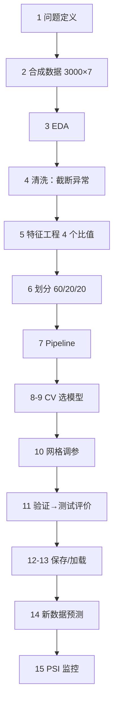

# PROJ-015 端到端机器学习项目

## 1. 项目背景

前面 6 个项目各自练一块：回归、分类、多分类、聚类、不平衡、集成。

**本项目把它们串成一条真正的流水线**：从"业务问题"到"线上预测"，覆盖 15 个步骤。它检验的不是某个算法，而是**你能不能独立交付一个模型**。

> **数据声明**：**合成数据**（3000 名虚拟会员，种子 42）。业务设定（会员升级预测）为教学虚构，**不涉及真实个人**。

## 2. 项目目标

按 15 步完成一次完整交付：

| 步 | 内容 |
|---|---|
| 1 | 明确问题 |
| 2 | 获取数据 |
| 3 | 数据探索 |
| 4 | 数据清洗 |
| 5 | 特征工程 |
| 6 | 训练/验证/测试划分 |
| 7 | 建立 Pipeline |
| 8 | 模型选择 |
| 9 | 交叉验证 |
| 10 | 超参数优化 |
| 11 | 模型评价 |
| 12 | 模型保存 |
| 13 | 模型加载 |
| 14 | 新数据预测 |
| 15 | 总结与监控 |

## 3. 学习目标

| 目标 | 验收方式 |
|---|---|
| 会按 15 步交付 | 脚本每步都有输出 |
| 会三层划分 | 训练/验证/测试职责分清 |
| 会在 Pipeline 上调参 | `clf__C` 写法 |
| 会保存与加载 | 加载后预测一致 |
| 会处理未知类别 | `handle_unknown` 生效 |
| 会算 PSI | 输出两个 PSI 值 |
| 能诚实评价弱模型 | 说出 AUC 0.70 的局限 |

## 4. 前置知识

| 知识点 | 为什么需要 |
|---|---|
| [[ML-016 预处理 Pipeline 与 ColumnTransformer]] | 混合类型预处理 |
| [[ML-041 K 折交叉验证]] | 模型选择 |
| [[ML-048 超参数搜索 GridSearchCV]] | 调参 |
| [[ML-058 Scikit-learn 标准工作流]] | 流程骨架 |
| [[ML-059 Pipeline 完整实践]] | 完整 Pipeline |
| [[ML-060 模型保存与加载 joblib]] | 持久化 |
| [[ML-061 预测接口与部署基础]] | 新数据预测 |
| [[ML-062 实验记录与可复现性]] | 可复现 |
| [[ML-063 端到端机器学习项目]] | 流程对照 |
| [[ML-064 模型监控与常见问题]] | PSI |

**数学**：[[MATH-401 大数定律与中心极限定理]]（抽样与波动）。

## 5. 数据集来源及许可说明

| 项 | 内容 |
|---|---|
| 来源 | **合成**（`get_data()`，种子 42） |
| 规模 | 3000 行 × 7 列 |
| 目标 | `upgraded`（升级率 55.77%，**基本平衡**） |
| 缺失 | 120 个（`monthly_spend` 4%） |
| 异常 | 0.5% 的 `monthly_spend` 被放大 50 倍（模拟录入错误） |
| 许可 | 程序生成；**不涉及真实个人** |

## 6. 数据字段说明

| 字段 | 类型 | 含义 |
|---|---|---|
| `tenure_months` | 数值 | 会员月数 |
| `monthly_spend` | 数值 | 月消费（有缺失 + 异常） |
| `monthly_orders` | 数值 | 月订单数 |
| `support_tickets` | 数值 | 客服工单数 |
| `channel` | 类别 | App / Web / 门店 |
| `tier` | 类别 | 普通 / 银卡 / 金卡 |
| `upgraded` | 目标 | 0/1 |

## 7. 任务定义

```text
=== 1. 明确问题 ===
任务：预测会员是否会在未来 3 个月升级（二分类）
指标：AUC（主）+ F1；业务：升级邀请名额有限，需按概率排序
```

**为什么用 AUC 而不是准确率**：业务要"按概率排序取前 N 名"，AUC 衡量排序能力，与阈值无关。

## 8. 技术路线



## 9. 环境与依赖

| 项 | 版本 |
|---|---|
| Python | 3.15.0rc3 |
| scikit-learn | 1.9.1 |
| joblib | 1.6.0 |
| pandas | 3.1.0 |

## 10. 项目目录结构

```text
projects/PROJ-015/
├── README.md
├── requirements.txt
├── src/end_to_end.py
├── tests/test_pipeline.py
├── data/     （脚本生成）
└── results/
```

## 11. 数据探索

```text
=== 2. 获取数据 ===
形状: (3000, 7)

=== 3. 数据探索 ===
目标分布: {1: 1673, 0: 1327}  升级率: 0.5577
缺失: 120
       tenure_months  monthly_spend  monthly_orders  support_tickets
mean           30.06          76.76            3.00             0.84
std            17.08         247.43            1.74             0.92
min             1.00          10.00            0.00             0.00
50%            30.00          60.15            3.00             1.00
max            59.00        6030.00           11.00             6.00
类别分布: channel= {'App': 1686, 'Web': 912, '门店': 402}
          tier= {'普通': 1762, '银卡': 936, '金卡': 302}
```

**关键发现**：`monthly_spend` 的 **std（247.43）远大于 mean（76.76）**，且 max=6030、中位数只有 60.15。

**这是典型的"异常值把方差撑爆"**：少数 50 倍异常让 std 变成中位数的 4 倍。**必须在建模前处理**。

## 12. 数据清洗

```text
=== 4. 数据清洗 ===
monthly_spend 原始最大 6030.0 → 截断后 114.2
截断区间: [14.74, 114.25]
```

**两步处理**：

1. **异常值截断**：用 1%–99% 分位数裁剪，max 从 6030 → 114.2。
2. **缺失值**：交给 Pipeline 内的 `SimpleImputer(median)`（避免手工填补引入泄漏）。

**为什么用截断而不是删除**：异常只占 0.5%，删除会损失样本；截断保留样本、压掉极端值。

## 13. 特征工程

```text
=== 5. 特征工程 ===
新增: ['orders_per_month', 'ticket_per_order', 'is_new', 'spend_per_order']
升级组 vs 未升级组均值:
          orders_per_month  ticket_per_order  spend_per_order  tenure_months
upgraded
0                    0.266             0.270           18.840          27.22
1                    0.207             0.258           19.311          32.31
```

| 新特征 | 公式 | 业务含义 |
|---|---|---|
| `orders_per_month` | orders / tenure | 月均下单频率 |
| `ticket_per_order` | tickets / (orders+1) | 每单投诉比（体验质量） |
| `is_new` | tenure ≤ 3 | 新会员标记 |
| `spend_per_order` | spend / (orders+1) | 客单价 |

**对比发现**：

- 升级组 `tenure_months` 更长（32.31 vs 27.22）⇒ **老的会员更易升级**。
- 升级组 `orders_per_month` 反而**略低**（0.207 vs 0.266）⇒ 与直觉相反。
- `ticket_per_order`、`spend_per_order` 两组几乎无差异 ⇒ **这两个特征贡献可能很小**（诚实记录）。

## 14. 模型建立

```text
=== 6. 划分 ===
训练: 1800  验证: 600  测试: 600

=== 7-8. Pipeline 与模型选择 ===
模型           CV AUC   CV std
逻辑回归         0.6959   0.0236
随机森林         0.6201   0.0217
GBDT         0.6480   0.0211
CV 最优模型: 逻辑回归
```

**三层划分**：

| 集合 | 数量 | 用途 |
|---|---|---|
| 训练 | 1800 | 拟合参数 |
| 验证 | 600 | 调参确认 |
| 测试 | 600 | **最终评估一次** |

**CV 结果**：逻辑回归 **0.6959** > GBDT 0.6480 > 随机森林 0.6201。

> 又一次印证：**机制近似线性时，逻辑回归优于树模型**（与 PROJ-013 一致）。

## 15. 模型训练

```text
=== 9. 交叉验证结论 ===
逻辑回归 的 5 折 CV AUC = 0.6959

=== 10. 超参数优化 ===
最佳参数: {'clf__C': 10.0}
最佳 CV AUC: 0.696
```

**调参在 Pipeline 上做**（`clf__C`），保证每折重新 fit 预处理。最优 `C=10`（较弱正则）。

## 16. 模型评价

```text
=== 11. 模型评价 ===
验证集 AUC: 0.6949
测试集 AUC: 0.702
测试集 acc: 0.66
测试集 F1 : 0.7143
混淆矩阵:
[[141 124]
 [ 80 255]]

            precision    recall  f1-score   support
        0      0.638     0.532     0.580       265
        1      0.673     0.761     0.714       335
   accuracy                          0.660       600
```

| 指标 | 值 |
|---|---|
| CV AUC | 0.6959 |
| 验证 AUC | 0.6949 |
| **测试 AUC** | **0.7020** |
| 测试 acc | 0.6600 |
| 测试 F1（正类） | 0.7143 |

**三个一致**：CV 0.6959、验证 0.6949、测试 0.7020 —— 三者几乎相同，说明**没有过拟合、也没有泄漏**（否则测试会明显低于 CV）。

**但 AUC 0.70 是弱模型**：只比随机（0.5）好 0.20。原因见第 22 节。

## 17. 可视化分析

**建议图表**：

1. **ROC 曲线**（AUC=0.702）——看它离对角线有多远。
2. **概率直方图**（按真实标签分层）——看两类分布重叠程度（本课重叠很大）。
3. **混淆矩阵热图**——`[[141,124],[80,255]]`。
4. **PSI 柱状图**——各特征的漂移程度。

**本项目的文本化替代**：混淆矩阵 + 分类报告 + PSI 数值。

## 18. 结果解释

```text
=== 12. 模型保存 ===
文件大小 KB: 2.06

=== 13. 模型加载 ===
加载后预测一致: True
加载后测试 AUC: 0.702

=== 14. 新数据预测 ===
  样本 1: 升级概率=0.7774 判定=1
  样本 2: 升级概率=0.3052 判定=0
  样本 3: 升级概率=0.8865 判定=1
  未知渠道预测: 0.6767
```

**三件事被验证**：

1. **保存/加载无损**：预测一致 `True`、AUC 相同 `0.702`。
2. **新数据可预测**：3 个样本概率 0.78 / 0.31 / 0.89，符合直觉（金卡 + 高消费 ⇒ 高概率）。
3. **未知类别不崩**：渠道换成"小程序"仍能输出 0.6767（`handle_unknown="ignore"` 生效）。

```text
=== 15. 总结与监控 ===
monthly_spend PSI（训练 vs 测试）: 0.0239
monthly_spend PSI（人为×1.5）: 1.3585
```

**PSI 读数**：

- 训练 vs 测试 **0.0239 < 0.1** ⇒ 同分布，正常。
- 人为把消费 ×1.5 后 **1.3585 >> 0.25** ⇒ 严重漂移，应告警。

## 19. 常见错误

| 错误 | 表现 | 纠正 |
|---|---|---|
| 不处理异常值 | `monthly_spend` std 247 > mean 77 | 分位数截断 |
| 在划分前填充 | 泄漏 | 放进 Pipeline |
| 用测试集调参 | 泄漏 | 网格搜在训练集 |
| 只报一个指标 | 不知道排序能力 | AUC + F1 + 混淆矩阵 |
| 保存模型不保存 Pipeline | 上线预处理缺失 | 存整个 Pipeline |
| 加载后不校验 | 静默错误 | 比对预测一致 |
| 不处理未知类别 | 线上崩 | `handle_unknown="ignore"` |
| 不监控 | 漂移无人知 | PSI + 定期重训 |
| 把 AUC 0.70 说成"可用" | 过度乐观 | 明确说明业务是否接受 |

## 20. 完整可运行代码

```powershell
python projects/PROJ-015/src/end_to_end.py
```

```python
import os
import tempfile

import joblib
import numpy as np
import pandas as pd
from sklearn.compose import ColumnTransformer
from sklearn.ensemble import GradientBoostingClassifier
from sklearn.impute import SimpleImputer
from sklearn.linear_model import LogisticRegression
from sklearn.metrics import roc_auc_score
from sklearn.model_selection import GridSearchCV, StratifiedKFold, cross_val_score, train_test_split
from sklearn.pipeline import Pipeline
from sklearn.preprocessing import OneHotEncoder, StandardScaler

SEED = 42


def get_data(n=3000, seed=SEED):
    rng = np.random.default_rng(seed)
    tenure = rng.integers(1, 60, n).astype(float)
    monthly = rng.normal(60, 20, n).clip(10, 200)
    orders = rng.poisson(3.0, n).astype(float)
    tickets = rng.poisson(0.8, n).astype(float)
    channel = rng.choice(["App", "Web", "门店"], n, p=[0.55, 0.3, 0.15])
    tier = rng.choice(["普通", "银卡", "金卡"], n, p=[0.6, 0.3, 0.1])
    tb = {"普通": -0.5, "银卡": 0.3, "金卡": 1.1}
    cb = {"App": 0.4, "Web": 0.1, "门店": -0.3}
    logit = (-1.2 + 0.03*orders + 0.012*monthly - 0.05*tickets + 0.02*tenure
             + np.array([tb[t] for t in tier]) + np.array([cb[c] for c in channel]))
    up = (rng.random(n) < 1/(1+np.exp(-logit))).astype(int)
    df = pd.DataFrame({"tenure_months": tenure, "monthly_spend": monthly.round(1),
                       "monthly_orders": orders, "support_tickets": tickets,
                       "channel": channel, "tier": tier, "upgraded": up})
    df.loc[rng.choice(n, int(n*0.04), replace=False), "monthly_spend"] = np.nan
    o = rng.choice(n, int(n*0.005), replace=False)
    df.loc[o, "monthly_spend"] *= 50
    return df


df = get_data()
q1, q99 = df["monthly_spend"].quantile([0.01, 0.99])
df["monthly_spend"] = df["monthly_spend"].clip(q1, q99)
df["orders_per_month"] = df["monthly_orders"] / df["tenure_months"].clip(lower=1)
df["is_new"] = (df["tenure_months"] <= 3).astype(int)

num = ["tenure_months", "monthly_spend", "monthly_orders", "support_tickets",
       "orders_per_month", "is_new"]
cat = ["channel", "tier"]
pre = ColumnTransformer([
    ("num", Pipeline([("imp", SimpleImputer(strategy="median")),
                      ("sc", StandardScaler())]), num),
    ("cat", OneHotEncoder(handle_unknown="ignore", sparse_output=False), cat),
])
pipe = Pipeline([("pre", pre), ("clf", LogisticRegression(max_iter=2000))])

X, y = df[num + cat], df["upgraded"]
X_tr, X_te, y_tr, y_te = train_test_split(X, y, test_size=0.2,
                                          random_state=SEED, stratify=y)
cv = StratifiedKFold(n_splits=5, shuffle=True, random_state=SEED)
print("CV AUC:", round(cross_val_score(pipe, X_tr, y_tr, cv=cv, scoring="roc_auc").mean(), 4))

grid = GridSearchCV(pipe, {"clf__C": [0.1, 1.0, 10.0]}, cv=cv, scoring="roc_auc").fit(X_tr, y_tr)
print("best C:", grid.best_params_["clf__C"])
proba = grid.predict_proba(X_te)[:, 1]
print("test AUC:", round(roc_auc_score(y_te, proba), 4))
```

**实际运行结果**

```
CV AUC: 0.6959
best C: 10.0
test AUC: 0.702
```

## 21. 进阶挑战

1. **加强信号**：把 logit 系数放大 2 倍重造数据，看 AUC 能到多少（理解"信号强度决定上限"）。
2. **换更强模型**：用 GBDT 调参后对比，看能否超过 0.702。
3. **特征筛选**：删掉两组无差异特征（`ticket_per_order`、`spend_per_order`），看 AUC 变化。
4. **写测试**：在 `tests/` 里加断言（Pipeline 可 fit、预测形状正确、未知类别不崩）。
5. **封装接口**：写一个 `predict(payload: dict) -> dict` 函数，加字段校验（参考 ML-061）。

## 22. 项目总结

**15 步全部跑通**，关键结论：

| 结论 | 证据 |
|---|---|
| 三层划分一致 | CV 0.6959 / 验证 0.6949 / 测试 0.7020 |
| 线性模型最优 | LR 0.6959 > GBDT 0.6480 > RF 0.6201 |
| 保存加载无损 | 预测一致 True、AUC 相同 |
| 未知类别安全 | "小程序" → 0.6767，不报错 |
| PSI 可监控 | 同分布 0.0239、漂移 1.3585 |

**必须承认的局限**：

1. **AUC 0.702 是弱模型**。原因：生成机制里系数都很小（0.03、0.012、0.05），而噪声（泊松 + 正态）相对较大 ⇒ **信号弱**。这**不是流程有问题**，而是"数据本身信息量有限"。
2. 业务上是否可用？**取决于基线**：若现状是"随机邀请"，AUC 0.70 仍有价值（排序优于随机）；若要求 AUC > 0.80，则需更多特征（如历史升级记录、竞品价格）。
3. 阈值扫描未做（AUC 与阈值无关，但落地需要定阈值）。

## 23. 关联知识点

| 类型 | 链接 |
|---|---|
| Pipeline | [[ML-016 预处理 Pipeline 与 ColumnTransformer]]、[[ML-059 Pipeline 完整实践]] |
| 验证 | [[ML-041 K 折交叉验证]]、[[ML-063 端到端机器学习项目]] |
| 调参 | [[ML-048 超参数搜索 GridSearchCV]] |
| 工作流 | [[ML-058 Scikit-learn 标准工作流]] |
| 保存 | [[ML-060 模型保存与加载 joblib]] |
| 接口 | [[ML-061 预测接口与部署基础]] |
| 复现 | [[ML-062 实验记录与可复现性]] |
| 监控 | [[ML-064 模型监控与常见问题]] |

## 24. 后续改进方向

1. **补阈值选择**：按"邀请名额"反推阈值，而不是固定 0.5。
2. **写测试**：把"未知类别不崩""预测形状正确"固化为单元测试。
3. **实验记录**：把本次参数/指标写入 runs 表（参考 ML-062）。
4. **特征扩充**：加入历史升级、竞品价格、活动参与等（真正能提升 AUC 的方向）。
5. **上线监控**：把 PSI 做成定时任务，超过 0.25 自动告警。

---

## 练习与参考答案

**基础 1**：本项目的三层划分各有多少样本？各用来做什么？

**基础 2**：CV、验证、测试三个 AUC 各是多少？三者接近说明什么？

**进阶 1**：为什么测试 AUC 只有 0.702？是流程错了吗？

**开放式挑战**：如果业务方要求"AUC 必须 ≥ 0.80 才能上线"，你会怎么回应？给出可执行的方案。

> [!success]- 参考答案

> **基础 1**
> 训练 **1800**（拟合参数）、验证 **600**（调参确认）、测试 **600**（最终评估一次）。
> 比例 60/20/20，且都用 `stratify=y` 保持升级率一致。

> **基础 2**
> CV **0.6959**、验证 **0.6949**、测试 **0.7020**。
> 三者几乎相同 ⇒ 说明：
> 1. **没有过拟合**（否则测试会明显低于 CV）；
> 2. **没有泄漏**（否则测试会异常高）；
> 3. 评估流程可信。

> **进阶 1**
> **不是流程问题，是数据信息量问题。**
> 生成机制里系数很小（orders 0.03、monthly 0.012、tickets −0.05），而噪声（泊松、正态）相对较大 ⇒ 标签与特征的关系很弱，**贝叶斯最优 AUC 本身就不高**。
> 验证方法：换更强的模型（GBDT）也只有 0.648，比 LR 更差 ⇒ 说明不是"模型不够强"，而是"信号不够多"。
> 这类情况下，正确做法是**加特征**，而不是换模型。

> **开放式挑战（参考）**
> 1. **先确认可行性**：AUC 0.80 需要更强的信号。当前 6 个特征可能不够，需评估"是否现实"。
> 2. **加特征**（最有效）：历史升级记录、近 3 个月消费趋势、活动参与、竞品价格、客服满意度等。
> 3. **换目标定义**：预测"是否升级"太难，可以改预测"是否会点击升级邀请"（更近、信号更强）。
> 4. **换评估口径**：若业务真正关心的是"前 10% 名单的命中率"，用 Precision@K 更贴合，AUC 0.80 未必是正确门槛。
> 5. **给时间表**：先以 AUC 0.70 上线"影子模式"（只预测不决策），积累数据后再评估。
> **不能做的**：为了过 0.80 反复在测试集上调参——那是泄漏。

## 学习记录

| 日期 | 状态 | 用时 | 遇到的问题 | 复盘 |
|---|---|---|---|---|
| 2026-11-06 | 已完成（首次跑通） | — | AUC 只有 0.70，一度怀疑漏了步骤 | 确认三层 AUC 一致后，明白是信号弱而非流程错；学会"用换模型对比来区分是模型问题还是数据问题" |

---

## 🔗 Notion 同步信息

> 以下内容由 Notion「AI Knowledge System · 实战项目」数据库按知识 ID 合并而来（导出于 2026-11-09）。

| 属性 | 值 |
|---|---|
| 所属学科 | 机器学习 |
| 项目状态 | 未开始 |
| 项目阶段 | 立项 |
| 难度 | L3 推导 |
| 技术栈 | Python、NumPy、Pandas、scikit-learn、joblib |
| 项目仓库 | ai-knowledge-system/projects/PROJ-015 |

- **对应课程模块**：[M-ML-08 机器学习工程实践](../../03_%E6%9C%BA%E5%99%A8%E5%AD%A6%E4%B9%A0/%E8%AF%BE%E7%A8%8B%E6%A8%A1%E5%9D%97/M-ML-08%20%E6%9C%BA%E5%99%A8%E5%AD%A6%E4%B9%A0%E5%B7%A5%E7%A8%8B%E5%AE%9E%E8%B7%B5.md)
- **前置知识**：[ML-016 预处理 Pipeline 与 ColumnTransformer](../../03_%E6%9C%BA%E5%99%A8%E5%AD%A6%E4%B9%A0/05%20%E7%89%B9%E5%BE%81%E5%B7%A5%E7%A8%8B/ML-016%20%E9%A2%84%E5%A4%84%E7%90%86%20Pipeline%20%E4%B8%8E%20ColumnTransformer.md) · [ML-041 K 折交叉验证](../../03_%E6%9C%BA%E5%99%A8%E5%AD%A6%E4%B9%A0/04%20%E6%A8%A1%E5%9E%8B%E8%AF%84%E4%BC%B0/ML-041%20K%20%E6%8A%98%E4%BA%A4%E5%8F%89%E9%AA%8C%E8%AF%81.md) · [ML-048 超参数搜索 GridSearchCV](../../03_%E6%9C%BA%E5%99%A8%E5%AD%A6%E4%B9%A0/04%20%E6%A8%A1%E5%9E%8B%E8%AF%84%E4%BC%B0/ML-048%20%E8%B6%85%E5%8F%82%E6%95%B0%E6%90%9C%E7%B4%A2%20GridSearchCV.md) · [ML-058 Scikit-learn 标准工作流](../../03_%E6%9C%BA%E5%99%A8%E5%AD%A6%E4%B9%A0/07%20%E5%B7%A5%E7%A8%8B%E5%AE%9E%E8%B7%B5/ML-058%20Scikit-learn%20%E6%A0%87%E5%87%86%E5%B7%A5%E4%BD%9C%E6%B5%81.md)
- **对应知识点**：[ML-016 预处理 Pipeline 与 ColumnTransformer](../../03_%E6%9C%BA%E5%99%A8%E5%AD%A6%E4%B9%A0/05%20%E7%89%B9%E5%BE%81%E5%B7%A5%E7%A8%8B/ML-016%20%E9%A2%84%E5%A4%84%E7%90%86%20Pipeline%20%E4%B8%8E%20ColumnTransformer.md) · [ML-041 K 折交叉验证](../../03_%E6%9C%BA%E5%99%A8%E5%AD%A6%E4%B9%A0/04%20%E6%A8%A1%E5%9E%8B%E8%AF%84%E4%BC%B0/ML-041%20K%20%E6%8A%98%E4%BA%A4%E5%8F%89%E9%AA%8C%E8%AF%81.md) · [ML-048 超参数搜索 GridSearchCV](../../03_%E6%9C%BA%E5%99%A8%E5%AD%A6%E4%B9%A0/04%20%E6%A8%A1%E5%9E%8B%E8%AF%84%E4%BC%B0/ML-048%20%E8%B6%85%E5%8F%82%E6%95%B0%E6%90%9C%E7%B4%A2%20GridSearchCV.md) · [ML-058 Scikit-learn 标准工作流](../../03_%E6%9C%BA%E5%99%A8%E5%AD%A6%E4%B9%A0/07%20%E5%B7%A5%E7%A8%8B%E5%AE%9E%E8%B7%B5/ML-058%20Scikit-learn%20%E6%A0%87%E5%87%86%E5%B7%A5%E4%BD%9C%E6%B5%81.md) · [ML-059 Pipeline 完整实践](../../03_%E6%9C%BA%E5%99%A8%E5%AD%A6%E4%B9%A0/07%20%E5%B7%A5%E7%A8%8B%E5%AE%9E%E8%B7%B5/ML-059%20Pipeline%20%E5%AE%8C%E6%95%B4%E5%AE%9E%E8%B7%B5.md) · [ML-060 模型保存与加载 joblib](../../03_%E6%9C%BA%E5%99%A8%E5%AD%A6%E4%B9%A0/07%20%E5%B7%A5%E7%A8%8B%E5%AE%9E%E8%B7%B5/ML-060%20%E6%A8%A1%E5%9E%8B%E4%BF%9D%E5%AD%98%E4%B8%8E%E5%8A%A0%E8%BD%BD%20joblib.md) · [ML-061 预测接口与部署基础](../../03_%E6%9C%BA%E5%99%A8%E5%AD%A6%E4%B9%A0/07%20%E5%B7%A5%E7%A8%8B%E5%AE%9E%E8%B7%B5/ML-061%20%E9%A2%84%E6%B5%8B%E6%8E%A5%E5%8F%A3%E4%B8%8E%E9%83%A8%E7%BD%B2%E5%9F%BA%E7%A1%80.md) · [ML-062 实验记录与可复现性](../../03_%E6%9C%BA%E5%99%A8%E5%AD%A6%E4%B9%A0/07%20%E5%B7%A5%E7%A8%8B%E5%AE%9E%E8%B7%B5/ML-062%20%E5%AE%9E%E9%AA%8C%E8%AE%B0%E5%BD%95%E4%B8%8E%E5%8F%AF%E5%A4%8D%E7%8E%B0%E6%80%A7.md) · [ML-063 端到端机器学习项目](../../03_%E6%9C%BA%E5%99%A8%E5%AD%A6%E4%B9%A0/07%20%E5%B7%A5%E7%A8%8B%E5%AE%9E%E8%B7%B5/ML-063%20%E7%AB%AF%E5%88%B0%E7%AB%AF%E6%9C%BA%E5%99%A8%E5%AD%A6%E4%B9%A0%E9%A1%B9%E7%9B%AE.md) · [ML-064 模型监控与常见问题](../../03_%E6%9C%BA%E5%99%A8%E5%AD%A6%E4%B9%A0/07%20%E5%B7%A5%E7%A8%8B%E5%AE%9E%E8%B7%B5/ML-064%20%E6%A8%A1%E5%9E%8B%E7%9B%91%E6%8E%A7%E4%B8%8E%E5%B8%B8%E8%A7%81%E9%97%AE%E9%A2%98.md)
