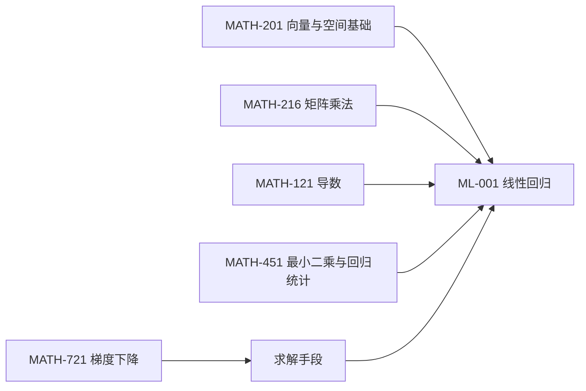

# 🗂 知识关联索引

> 上位导航：[[00_知识首页/00 总索引\|总索引]]
> 本页定义**知识点之间、学科与数学之间**如何关联。它是本库的核心机制说明，不是列表。

---

## 一、为什么"分类"不够，"关联"才是核心

文件夹只能表达"属于"，不能表达"依赖"。
一个知识点真正的信息量在于：**学它之前要会什么、它能推出什么、它用到了哪些数学**。这些必须用链接表达，否则库只是文件柜。

## 二、六类关联

| # | 关联类型 | 语义 | 写法位置 | 示例 |
|---|---|---|---|---|
| 1 | 前置知识 | 学它之前必须会 | 正文"知识关联"节 + `prerequisites` | `[[MATH-121 导数]]` |
| 2 | 后继知识 | 学完它能往哪走 | 正文"知识关联"节 | `[[ML-002 梯度下降]]` |
| 3 | 相关 Python 技术 | 用什么工具实现 | 正文"知识关联"节 | `[[PY-001 变量与赋值]]` |
| 4 | 相关数学知识 | 数学地基 | 正文"数学基础"节 + `related_math` | `[[MATH-216 矩阵乘法]]` |
| 5 | 相关算法 | 同类/替代方法 | 正文"知识关联"节 + `related` | `[[ML-00X 决策树]]` |
| 6 | 实战应用 | 用在哪 | 正文"知识关联"节 | `[[07_实战项目/00 项目总览\|项目总览]]` |

**方向原则**：只写"出边"（我依赖谁、我指向谁），**不写"入边"**（谁依赖我）。入边由 Obsidian Backlinks 自动生成，手写必然过期。

## 三、数学 ↔ 学科的多对多

### 3.1 为什么是多对多

- 一个数学点被多个学科用：`MATH-216 矩阵乘法` 同时被科学计算、机器学习、深度学习、大语言模型使用。
- 一个学科点依赖多个数学点：`ML-001 线性回归` 需要线代、导数、最小二乘、梯度下降。

这就是多对多的定义，**不能用"数学属于某课程"的树状结构表达**。

### 3.2 已锁定的映射样例

以线性回归为例，数学依赖链如下（ID 均已登记为预留锚点）：



| 数学点 | 与线性回归的关系 | 说明 |
|---|---|---|
| `MATH-201` 向量与空间基础 | 前置 | 样本点与参数都在向量空间里 |
| `MATH-216` 矩阵乘法 | 前置 | 特征矩阵与参数向量的乘积 |
| `MATH-121` 导数 | 前置 | 损失对参数求偏导 |
| `MATH-451` 最小二乘与回归统计 | 直接对应 | 闭式解即最小二乘解析解 |
| `MATH-721` 梯度下降 | 求解手段 | 无闭式解时的迭代法 |

> **注意**：`ML-001` 目前是**示例编号**，尚未建笔记。上表用于说明机制，不代表已存在该知识点。

### 3.3 反向怎么查

| 我想知道 | 去哪看 |
|---|---|
| 这个数学点被谁用了 | 该数学笔记页的 **Backlinks**（自动） |
| 这个学科点用了哪些数学 | 该笔记第 5 节"数学基础"表 + frontmatter `related_math` |
| 全库数学使用热度 | [[08_知识索引/02 数学知识索引\|数学知识索引]] |
| 关联是否断裂 | [[08_知识索引/07 链接健康报告\|链接健康报告]] |

## 四、关联的书写规范

```markdown
## 15. 知识关联

- **前置**：[[MATH-216 矩阵乘法]]、[[MATH-121 导数]]
- **后继**：[[ML-002 梯度下降]]
- **相关 Python 技术**：[[02_科学计算/00 模块索引|NumPy 向量化]]
- **相关数学**：[[MATH-451 最小二乘与回归统计]]
- **相关算法**：[[ML-00X 决策树]]
- **实战应用**：[[07_实战项目/00 项目总览|项目总览]]
```

规则：

1. **有实际关联才写，没有就留空。** 不设"每类至少 1 条"的数量要求——为了凑指标硬造的链接，比没有链接更有害：它会污染图谱、误导未来的自己。
2. 确实思考过、确认无关时，可写一行"本节暂无可关联知识点（原因）"，**这是可选项，不是必填项**。
3. 链接目标必须是**已存在**的文件或**已登记**的 ID；指向未建笔记的链接会让健康报告出现断链。
4. 别名要说明关系（`|用于特征变换`），不要只写名字。
5. **宁缺毋滥**：一篇只有 2 条真实关联的笔记，优于一篇有 8 条装饰性关联的笔记。

## 五、跨学科关联的三个典型链条

| 链条 | 路径 | 说明 |
|---|---|---|
| 训练链 | 导数 → 梯度下降 → 反向传播 → 训练循环 | 从数学到工程的完整通路 |
| 表达链 | 向量空间 → 矩阵乘法 → 线性层 → Attention | "表示学习"的数学骨架 |
| 评估链 | 概率 → 统计 → 最小二乘 → 评估指标 | "怎么知道模型好"的依据 |

> 这三条链条是后续建笔记时的**主线**：优先把链条上的点连起来，不要平均用力。

## 六、导航

- [[08_知识索引/08 ID注册表\|ID 注册表]]
- [[08_知识索引/00 全知识点索引\|全知识点索引]]
- [[06_数学基础/00 数学库首页\|数学库首页]]
- [[00_知识首页/02 知识地图说明\|知识地图说明]]
