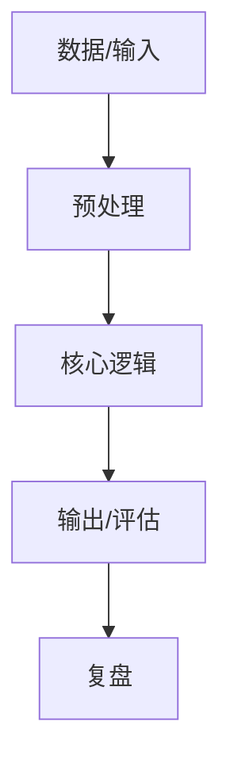

> [!warning] 模板使用说明（创建真实项目时删除本块）
> 1. 项目 ID 格式 `PROJ-<三位序号>`，如 `PROJ-001`；必须先登记在 `08_知识索引/08 ID注册表.md`。
> 2. 项目笔记只写"设计 + 讲解 + 复盘"，**代码留在工作区**，本笔记用路径引用，不要把整个仓库塞进 Vault。
> 3. 归档规则：完成后移动到 `07_实战项目/_archive/`，状态改 `archived`。
> 4. 图片放 `09_资源素材/attachments/images/`，架构图放 `attachments/diagrams/`。

# {{项目名称}}

## 项目 ID

`{{PROJ-ID}}`

- 学科归属：PROJ
- 难度：{{L3}}
- 预计工时：{{N}} 小时
- 状态：planned

## 项目名称

{{项目名称}}

## 项目目标

一句话：做完这个项目，证明我掌握了 ______。

可验证的成功标准：

1. 
2. 
3. 

## 应用场景

- 现实问题：
- 谁会用：
- 不使用它会怎样（说明必要性）：

## 前置知识

| 前置项 | 类型 | 是否具备 |
|---|---|---|
|  | 知识点 / 模块 / 数学分支 | 待补 |

## 技术栈

| 层 | 选型 | 为什么选它 | 替代方案 |
|---|---|---|---|
| 语言 | Python 3.13 |  |  |
| 库 |  |  |  |
| 数据 |  |  |  |
| 运行环境 |  |  |  |

## 项目需求

### 功能需求

| 编号 | 需求 | 优先级 | 验收方式 |
|---|---|---|---|
| F1 |  | 必须 / 应该 / 可选 |  |

### 非功能需求

- 性能：
- 可读性：
- 可复现性（随机种子、依赖版本）：

## 实现流程



| 阶段 | 产出 | 完成标志 |
|---|---|---|
| 1 设计 | 需求表 | 需求可验收 |
| 2 最小可运行 | 跑通主链路 | 有真实输出 |
| 3 完善 | 边界处理 | 异常输入不崩 |
| 4 复盘 | 本笔记 | 能讲清取舍 |

## 完整代码

代码存放位置（工作区相对路径）：``

关键片段（只贴核心 20–50 行，完整代码不要复制进 Vault）：

```python
# 核心逻辑
```

## 测试方法

| 测试类型 | 用例 | 期望结果 |
|---|---|---|
| 正常输入 |  |  |
| 边界输入 |  |  |
| 异常输入 |  |  |

运行命令：

```bash
python xxx.py
```

## 运行结果

贴真实输出（不得编造）。注明环境与随机种子。

```
（粘贴实际输出）
```

## 项目复盘

- **做对了什么**（可复用的决策）：
- **走了什么弯路**（下次怎么避免）：
- **哪些知识其实没懂**（转成待补知识点）：
- **如果重做，会怎么改**：
- **耗时对比**：预计 {{N}} 小时 / 实际 ____ 小时

## 延伸方向

1. 
2. 
3. 

> 反向关联：本项目引用了哪些知识点，见下方链接；哪些知识点引用了本项目，由 Backlinks 自动汇总。

## 关联

- 依赖知识点：
- 关联数学：`[[06_数学基础/00 数学库首页|数学库首页]]`
- 同类项目：`[[07_实战项目/00 项目总览|项目总览]]`

---

## 版式登记（阶段 10 补充，2026-11-09）

实际在用的项目笔记版式有三种，**不要混用、不要创造第四种**：

| 版式 | 节数 | 使用者 | 特征 |
|---|---|---|---|
| A 轻量型 | 10 节 | PROJ-001~008 | 目标/前置/需求/目录/步骤/代码/运行/复盘/延伸/关联 |
| B 教学型 | 26~27 节 | PROJ-009~015 | 含"学习目标""数据字典""评估指标""常见坑"等教学小节 |
| C 交付型 | 15 节（14 正文 + 学习记录） | PROJ-016~026 | 含"技术栈与环境""数据来源与差异说明""验收清单" |

新增项目时：沿用所属阶段已用的版式；若确需新版式，先在本表登记。
