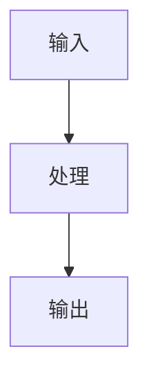

> [!warning] 模板使用说明（创建真实笔记时删除本块）
> 1. 本文件是**模板**，`{{...}}` 是占位符，**不得**直接留在正式笔记里。
> 2. **实际存在两种版式**（阶段 04 起采用）：
>    - **Python 型（14 节）**：知识概览 / 学习目标 / 通俗原理 / 深入原理 / 可运行代码 / 逐段解析 / 运行结果 / 基础练习 / 进阶练习 / 综合实践 / 参考答案 / 常见错误 / 知识关联 / 学习记录。
>    - **数学型（12 节）**：通俗概念 / 数学定义 / 公式推导 / 几何直观 / 数值示例 / 计算步骤 / Python 应用示例 / 基础练习 / 进阶练习 / 参考答案 / 常见错误 / 与 ML·DL 的联系；文末另附「关联与记录」。
>    本文件下面的 17 节是**通用超集**，供需要完整教学细节时取用；不要为凑节数写空话。

> **版式登记表（阶段 10 补充，2026-11-09）**：以下为**实际在用**的全部版式，新增笔记请沿用所属课程的版式，不要创造第 7 种。
>
> | 版式 | 正文节数 | 练习位置 | 使用者 | 备注 |
> |---|---|---|---|---|
> | 代码型（新） | 10 节 | 第 6/7 节 | PY-011~078 | 阶段 05 起 |
> | 代码型（旧） | 14 节 | 第 8~11 节 | PY-001~010 | 阶段 04，保留不重构 |
> | 数学型 | 12 节 | 第 8~10 节 | MATH 全 58 篇 | 阶段 06 |
> | 机器学习型 | 18 节 | 第 18 节 | ML 全 64 篇 | 阶段 07 |
> | 深度学习型 | 18 节 + 独立练习节 | 独立 `## 练习与参考答案` | DL 全 69 篇 | 阶段 08 |
> | 大语言模型型 | 20 节 + 独立练习节 | 独立 `## 练习与参考答案` | LLM 全 110 篇 | 阶段 09 |
>
> **新增课程时**：先在此表登记新版式，再写第一篇笔记。
> 3. 文件名格式：`<ID> <中文名>.md`，例如 `PY-001 变量与赋值.md`；文件标题必须与 `title` 一致。
> 4. 正式 ID 必须先登记在 `08_知识索引/08 ID注册表.md` 才可使用；未登记的号不得写入。
> 5. `prerequisites` / `related_math` / `related` 只填 ID，不填标题；链接请在正文用 Wikilink 写。
> 6. 学科代码：`PY` `SCI` `ML` `DL` `LLM` `MATH` `PROJ`；数学 ID 必须落在其段位区间（MATH-1xx 高数 … 7xx 最优化）。
> 7. **`related_math` 只允许填 `MATH-*`**：它是"本节用到的数学"，不是"随便的相关知识"。没有真实数学依赖就留空。
> 8. 本文中的 `[[...]]` 一律放在反引号内作示例，避免被当成真实链接。

# {{知识点名称}}

## 1. 知识概览

- **一句话定义**：
- **解决什么问题**：
- **所属模块**：{{MODULE_ID}}
- **难度**：{{L1}}　**类型**：{{TYPE}}　**状态**：planned
- **前置知识**：（写 ID，如 `MATH-121`）
- **关联数学**：（写 ID，如 `MATH-216`）

## 2. 学习目标

学完本节应能做到（用可验证的行为描述，不要写"了解""熟悉"这类无法检验的词）：

1. 
2. 
3. 

**自检标准**：不看笔记，能否 ______ ？

## 3. 通俗原理讲解

用日常类比把机制说清楚，不引入公式。

- 类比：
- 类比与本体的对应关系：
- 类比在哪里失效（边界条件）：

## 4. 深入技术原理

严格定义、关键性质、成立条件、复杂度、与相邻概念的区别。

- 定义：
- 关键性质：
- 成立条件 / 前提假设：
- 时间复杂度 / 空间复杂度：
- 与易混概念的区别：

## 5. 数学基础

只写本节真正用到的数学，并用 Wikilink 指回数学库（示例：`[[06_数学基础/02 线性代数/00 分支索引|线性代数]]`）。

| 数学概念 | 数学 ID | 在本节的作用 |
|---|---|---|
|  | `MATH-___` |  |

推导（如需要）：

$$
% 在此书写公式
$$

## 6. 算法流程或结构图

步骤化描述，或用 Mermaid 画流程。图片请存入 `09_资源素材/attachments/diagrams/`。



## 7. 完整代码示例

要求：可直接运行、无外部依赖（或明确写出依赖）、带输入输出示例。

```python
# 示例代码
```

## 8. 代码逐段解析

对照上一节逐段说明"为什么这样写"，而不是逐行翻译语法。

| 代码片段 | 作用 | 为什么必须这样写 |
|---|---|---|
|  |  |  |

## 9. 运行结果

贴真实输出（不要编造）。若结果依赖随机种子或环境，注明条件。

```
（粘贴实际终端输出）
```

## 10. 基础练习

1. 
2. 

## 11. 进阶练习

1. 
2. 

## 12. 综合实战

把本节知识放进一个真实小任务，说明验收标准。

- 任务：
- 输入：
- 期望产出：
- 验收标准：

## 13. 参考答案与解题思路

按题号给出**思路优先、答案其次**的解析；不要只给最终结果。

- 基础 1：思路 → 关键步骤 → 答案
- 进阶 1：思路 → 常见弯路 → 答案

## 14. 常见错误

| 错误现象 | 根本原因 | 正确做法 |
|---|---|---|
|  |  |  |

## 15. 知识关联

> 只写**有真实语义**的关联。没有关联的类别直接留空，不要为了填满而硬造。
> 反向关联由 Obsidian 的 Backlinks 自动生成，无需手工维护"被引用"清单。

- **前置**：（有则写，如 `[[06_数学基础/01 高等数学/00 分支索引|高等数学]]`；无则留空）
- **后继**：
- **相关 Python 技术**：
- **相关数学**：
- **相关算法**：
- **实战应用**：`[[07_实战项目/00 项目总览|实战项目]]`（无实际项目时留空）

## 16. 延伸阅读

| 材料 | 类型 | 说明 |
|---|---|---|
|  | 官方文档 / 教材 / 论文 / 视频 |  |

## 17. 学习记录

| 日期 | 动作 | 用时 | 结果 | 复盘 |
|---|---|---|---|---|
| {{YYYY-MM-DD}} | 首学 |  |  |  |

- **掌握判定**：能独立复现第 7 节代码 + 做对第 11 节进阶题 = `practiced`；能给别人讲清第 4 节 = `mastered`。
- **下次复习**：
