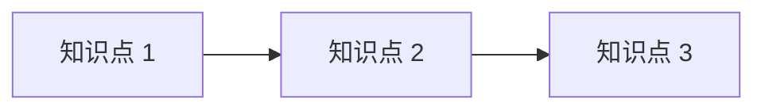

> [!warning] 模板使用说明（创建真实模块时删除本块）
> 1. 模块 ID 格式 `M-<域码>-<两位序号>`，如 `M-PY-01`；序号按学习顺序排。
> 2. 一个模块 = 一组围绕同一能力目标的知识点，**不是**一章教材。
> 3. `knowledge_points` 只填已登记的知识 ID；未建的知识点先留空，不要预占号。
> 4. 模块索引文件放在 `NN_学科/00 模块索引.md`，本模板用于单个模块的详情页。

# {{模块名称}}

## 模块 ID

`{{MODULE_ID}}`

- 学科：{{DOMAIN}}
- 所属目录：
- 学习顺序：第 {{N}} 个模块

## 模块名称

{{模块名称}}

## 学科

{{DOMAIN}}

## 学习目标

学完本模块，应能（可验证的行为）：

1. 
2. 
3. 

**能力边界**：本模块**不**覆盖 ______（说明边界，避免范围蔓延）。

## 前置知识

| 前置项 | 类型 | 说明 |
|---|---|---|
|  | 知识点 / 模块 / 数学分支 |  |

## 知识点清单

| 知识 ID | 名称 | 难度 | 状态 | 笔记 |
|---|---|---|---|---|
|  |  | L1–L4 | planned |  |

> 知识点尚未建立的，本表保持为空 —— **不得**写入未登记的 ID。

## 学习顺序

顺序原则：先"能看懂"再"能写出"，最后"能迁移"。

## 关联数学

| 数学概念 | 数学 ID | 用在哪里 |
|---|---|---|
|  | `MATH-___` |  |

> 数学是独立体系，入口见 `[[06_数学基础/00 数学库首页|数学库首页]]`。

## 练习安排

| 类型 | 数量 | 目的 | 验收 |
|---|---|---|---|
| 基础练习 |  | 巩固语法/定义 | 能独立完成 |
| 进阶练习 |  | 组合应用 | 能解释思路 |
| 综合实战 |  | 迁移到新场景 | 有可运行产出 |

## 实战项目

| 项目 ID | 名称 | 与本模块的关系 |
|---|---|---|
|  |  |  |

## 参考资料

| 材料 | 类型 | 章节 |
|---|---|---|
|  | 官方文档 / 教材 / 课程 |  |

## 完成条件

全部满足才算模块完成：

- [ ] 知识点清单内所有条目状态 ≥ `understood`
- [ ] 基础练习全部完成
- [ ] 至少 1 个进阶练习完成并留有复盘
- [ ] 能脱离笔记讲清本模块主线（3 分钟口述）
